# Title Page

<div align="center">

**STORESENSE**\
**Retail Data Warehouse and Market Basket Analysis**

A project report submitted for the course\
**Data Mining and Data Warehousing (DMDW)**

by **Group 1**

| # | Name | Roll / Registration No. | GitHub |
|---|---|---|---|
| 1 | Manish Sarkar | 24051496 | @maxlovesher |
| 2 | Kavya Agarwal | 24052086 | @Kavya-025 |
| 3 | Kartik Biswal | 24051938 | @KB-0141 |
| 4 | Manish Dey | 24051562 | @foresto-dreamer |
| 5 | Animesh Prakash | 24051610 | @DIO4699 |
| 6 | Rohit Gupta | 24052654 | @rohitguptanit7070-lab |

Under the guidance of\
**Dr. Chittaranjan Pradhan**\
Associate Professor, School of Computer Engineering

School of Computer Science and Engineering\
Kalinga Institute of Industrial Technology (KIIT)\
Bhubaneswar, Odisha

Academic Year: 2026–27\
Date of Submission: 15 October 2026

</div>

---

# Abstract

**Background and motivation.** Grocery retailers record millions of baskets, but raw transaction files do not answer business questions directly. Answering them requires two things taught in the Data Mining and Data Warehousing (DMDW) course: a warehouse that organises the data for fast analytical queries, and mining methods that find patterns no single query shows.

**Problem.** Given the public Instacart order history (3,421,083 orders from 206,209 users, 33,819,106 order lines, 49,688 products in 134 aisles and 21 departments), the project asks when and what customers buy, which products are bought together, what kinds of customers there are and, as a stretch goal, whether a customer will buy a product again.

**Solution.** StoreSense is a Python pipeline and dashboard. An ETL process (extract, transform, load, validate) built on the embedded analytical database **DuckDB** turns the six raw CSV files into a **star-schema warehouse** with two fact tables (`fact_order_line`, `fact_order`) and three dimension tables (`dim_product`, `dim_user`, `dim_time`). Twenty-three SQL validation checks confirm row counts, key integrity and the NULL policy, and all 23 pass on the full data. On this warehouse the project implements the **OLAP operations** roll-up, drill-down, slice, dice and pivot (with `GROUP BY ROLLUP`, `CUBE` and `PIVOT`); **association rule mining** with both **Apriori** and **FP-Growth** at aisle and product level, together with a runtime and memory benchmark of the two algorithms; **customer segmentation** with **K-Means** on RFM-style features; and **reorder prediction** with **Logistic Regression** and **LightGBM**, using features built from prior orders only so that the label does not leak into the inputs. A five-page **Streamlit** dashboard presents all results, including an interactive OLAP query builder and a rotatable 3-D data cube.

**Results.** Produce and dairy eggs account for 45.9% of all order lines, and the two weekend days (Sunday and Saturday, under the assumption that day 0 is Sunday) account for 33.2%. The strongest aisle rule links pasta sauce with dry pasta and packaged cheese (lift 4.80). FP-Growth was about three times faster than Apriori at product level with low minimum support, but Apriori was faster at aisle level. K-Means with k = 4 gives four segments (silhouette ≈ 0.27); the "loyal frequent shopper" segment is 29.4% of users and places about 62% of orders. LightGBM predicts reorders with ROC-AUC 0.829 and F1 0.429 on held-out users, slightly ahead of the Logistic Regression baseline (0.822 and 0.419). An automated test suite of 90 tests passed on 15 October 2026.

**Significance.** The project applies the course's main topics (ETL, dimensional modelling, OLAP, frequent-pattern mining, clustering and classification) end to end on a real dataset of more than 33 million rows, and states its limits openly: the data has no prices and no calendar dates, and the day-of-week coding is assumed.

**Keywords:** data warehouse, star schema, ETL, OLAP, association rules, Apriori, FP-Growth, K-Means, RFM, reorder prediction, DuckDB, Streamlit.

---

# Table of Contents

*Page numbers are left out of this Markdown version. After the report is imported into Microsoft Word, insert an automatic table of contents (References → Table of Contents) to generate them.*

- Abstract
- List of Figures
- List of Tables

**Part I — Academic Project Report**

1. Introduction
   1.1 Background · 1.2 Motivation · 1.3 Problem Statement · 1.4 Objectives · 1.5 Scope · 1.6 Significance
2. Existing System and Proposed System
   2.1 Existing approach · 2.2 Limitations of the existing approach · 2.3 Need for the proposed system · 2.4 The proposed StoreSense system · 2.5 Comparison
3. Literature Review and Related Work
   3.1 Knowledge discovery and data mining · 3.2 Data warehousing and dimensional modelling · 3.3 OLAP and the data cube · 3.4 Frequent-pattern and association rule mining · 3.5 Clustering and customer segmentation · 3.6 Classification, imbalance and leakage · 3.7 Related work on the Instacart data · 3.8 What StoreSense adopts, adapts and contributes
4. System Requirements
   4.1 Functional requirements · 4.2 Non-functional requirements · 4.3 Hardware requirements · 4.4 Software requirements
5. Technology Stack
6. System Architecture and Design
   6.1 Overall architecture · 6.2 Module description · 6.3 Data flow · 6.4 System workflow · 6.5 Architecture diagram · 6.6 Additional diagrams
7. Dataset and Data Preparation
8. DMDW Concepts and Methodology
9. Implementation Details
   9.1 Project structure · 9.2 Module-level implementation · 9.3 Data processing · 9.4 Analytical components · 9.5 Database and storage · 9.6 User interface · 9.7 Integration · 9.8 Important code examples
10. Results and Discussion
11. Testing
    11.1 Testing approach · 11.2 Test cases · 11.3 Testing summary

**Part II — Team Contribution and Individual Responsibilities**

12. Team Contribution and Individual Work Distribution
    12.1 Team member information · 12.2 Work allocation · 12.3 GitHub contribution analysis · 12.4 Individual contribution details · 12.5 Contribution percentage estimation · 12.6 Responsibility matrix · 12.7 Collaboration and integration · 12.8 Contribution evidence and limitations · 12.9 Individual presentation responsibilities
13. Advantages, Limitations and Challenges
14. Future Enhancements
15. Conclusion

References

Appendices
A. Repository and reproduction · B. Warehouse schema (DDL) · C. OLAP query catalogue · D. Result files · E. Complete automated test list · F. Detailed GitHub evidence

---

# List of Figures

| No. | Title | Section |
|---|---|---|
| 6.1 | Overall architecture of StoreSense | 6.5 |
| 6.2 | Use case view | 6.6 |
| 6.3 | Level-1 data flow diagram | 6.6 |
| 6.4 | Entity-relationship view of the star schema | 6.6 |
| 6.5 | ETL activity flow | 6.6 |
| 6.6 | Sequence of an OLAP Explorer query | 6.6 |
| 9.1 | Overview page | 9.6 |
| 9.2 | OLAP Explorer, roll-up and drill-down tab | 9.6 |
| 9.3 | OLAP Explorer, 3-D cube tab | 9.6 |
| 9.4 | Basket Rules page | 9.6 |
| 9.5 | Customer Segments page | 9.6 |
| 9.6 | Reorder Model page | 9.6 |
| 8.1 | Star schema diagram (from the team's DBML source) | 8.3 |
| 10.1 | Runtime of the mining step: Apriori vs FP-Growth | 10.4 |
| 10.2 | Peak memory of the mining step: Apriori vs FP-Growth | 10.4 |
| 10.3 | Elbow curve (inertia against k) | 10.5 |
| 10.4 | Silhouette score against k | 10.5 |
| 10.5 | The four segments projected onto two principal components | 10.5 |
| 10.6 | ROC curves of the two reorder models on the test users | 10.6 |
| 10.7 | LightGBM feature importance | 10.6 |
| 12.1 | Dependencies between modules | 12.7 |

# List of Tables

| No. | Title |
|---|---|
| 2.1 | Comparison of the existing approach and StoreSense |
| 4.1 | Functional requirements |
| 4.2 | Non-functional requirements |
| 4.3 | Recommended hardware |
| 4.4 | Software versions used for verification |
| 5.1 | Technology stack |
| 7.1 | Raw dataset files |
| 7.2 | Data preparation operations |
| 8.1 | DMDW concepts: implemented, partial, future |
| 8.2 | Warehouse tables and grain |
| 8.3 | Association rule settings at the two levels |
| 8.4 | Reorder model features |
| 10.1 | Warehouse load results |
| 10.2 | Roll-up of order lines by department |
| 10.3 | Top association rules |
| 10.4 | Benchmark of Apriori and FP-Growth |
| 10.5 | Segment profiles |
| 10.6 | Reorder model metrics |
| 11.1 | Test cases |
| 12.1 – 12.6 | Team, allocation, GitHub evidence, contribution estimates and responsibility matrix |

---

# PART I — ACADEMIC PROJECT REPORT

# 1. Introduction

## 1.1 Background

Online grocery shopping produces a detailed record of customer behaviour: every order lists the products in it, the order in which they were added to the cart, whether each was bought before, and when the order was placed. A retailer can use this record to plan stock and staff, to place products that are bought together near each other, to recommend products, and to treat different groups of customers differently.

Turning such a record into decisions is the subject of the DMDW course. **Data warehousing** reorganises transactional data into a structure designed for analysis, usually a dimensional model with fact and dimension tables, on which **OLAP** operations summarise the data along business hierarchies [14], [17]. **Data mining** finds patterns in the data that are not visible in a single summary: frequent itemsets and association rules [1]–[3], clusters [5], [18] and predictive models [18].

StoreSense applies both to the *Instacart Online Grocery Shopping Dataset 2017*, published by Instacart through the Kaggle competition "Instacart Market Basket Analysis" [23]. The dataset is large enough to make design choices matter (its largest file holds about 32 million order lines) but small enough to process on one laptop with an embedded analytical database [13].

## 1.2 Motivation

The project was motivated by three practical aims:

1. **To work with realistic scale.** Course examples often use a few dozen transactions. A dataset with 33.8 million order lines forces real decisions about where computation happens (in the database or in memory), about sampling, and about the cost of database constraints.
2. **To connect warehousing and mining.** In StoreSense the warehouse is not a side exercise: every mining module reads its input from the star schema, and the segmentation module writes its result back into a dimension table.
3. **To present results to a non-technical user.** A retailer would not read SQL output, so the results are shown in an interactive dashboard with plain-English interpretations.

## 1.3 Problem Statement

Design and build a retail data warehouse from the raw Instacart grocery transaction files, and mine it to answer:

- **When and what do people buy?** (OLAP analysis along the product and time dimensions)
- **Which products are bought together?** (association rules with Apriori and FP-Growth, and a comparison of the two)
- **What kinds of customers exist?** (customer segmentation with K-Means on RFM-style features)
- *(Stretch goal)* **Will a customer buy a product again?** (reorder prediction by classification)

The results must be presented in an interactive dashboard, and the analysis must take into account three properties of the data: it has **no prices**, **no calendar dates**, and an **undocumented day-of-week coding**. (Source: `docs/PROJECT_BRIEF.md`, sections 1 and 3.)

## 1.4 Objectives

**Primary objectives** (from `docs/PROJECT_BRIEF.md`, section 2):

1. Build an **ETL pipeline** that turns the raw CSV files into a clean, validated **star-schema data warehouse**.
2. Support the **OLAP operations** roll-up, drill-down, slice, dice and pivot, each with a saved demonstration query.
3. Mine **association rules** with **Apriori** and **FP-Growth**, and compare the two algorithms' runtime and memory.
4. **Segment customers** with **K-Means** on RFM-style features, and write each customer's segment back into the warehouse.
5. Present everything in an **interactive dashboard** with clear business insights.

**Secondary (stretch) objective:**

6. Predict whether a customer will **reorder** a product, evaluated with precision, recall, F1 and ROC-AUC, without data leakage.

**Supporting objectives** that the team added during the work (visible in the repository):

7. Automated tests for each module (90 tests at the time of writing).
8. A single assembled report built from per-module sections (`reports/build_report.py`).
9. A small committed demo extract so that the dashboard can be hosted without the 0.23 GB warehouse file (`dashboard/build_demo_data.py`, `docs/DEPLOY.md`).

All nine objectives were implemented. Their results are in Chapter 10, and the status of each one is summarised in Section 10.1.

## 1.5 Scope

**In scope (implemented):**

- **Data:** the six Instacart CSV files (orders, prior and train order lines, products, aisles, departments). The ~75,000 *test* orders, whose contents the competition hides, are kept as orders with no lines.
- **Warehouse:** a DuckDB star schema with 2 fact and 3 dimension tables, built by a repeatable ETL and checked by 23 validation queries.
- **Analysis:** OLAP queries (roll-up, drill-down, slice, dice, pivot, `CUBE`); association rules at aisle and product level; an Apriori vs FP-Growth benchmark; K-Means segmentation; reorder classification.
- **Presentation:** a five-page Streamlit dashboard (Overview, OLAP Explorer, Basket Rules, Customer Segments, Reorder Model), run locally, with a configuration and guide for hosting on Streamlit Community Cloud.
- **Users:** the intended user is an analyst or a store manager exploring the data, and the course evaluators. The dashboard is a single-user analysis tool.

**Out of scope:**

- Revenue or profit analysis (the data has no prices).
- Trend, seasonal or month-by-month analysis (the data has no calendar dates).
- Live or incremental data loading; the warehouse is rebuilt from fixed files.
- User accounts, access control, or a production recommendation service.
- Sequential pattern mining across orders, and itemsets of more than three items.

## 1.6 Significance

- **For the course.** StoreSense covers most of the DMDW syllabus in one connected system: the KDD process [19], ETL, dimensional modelling, OLAP [16], [17], frequent-pattern mining [1], [2], clustering [5], [7] and classification [10], [11], with evaluation that accounts for class imbalance [20], [21] and leakage [22].
- **For the practice of analysis.** Several results came from measuring rather than assuming. For example, a primary key on the largest fact table made its load about 21 times slower, and the textbook expectation that FP-Growth beats Apriori held at product level but not at aisle level (Chapter 10).
- **For a retailer (as an illustration).** The results suggest concrete actions: placing pasta, sauce and cheese together, staffing for the Sunday and late-morning peaks, and building "buy it again" lists from recency and frequency. These suggestions follow from patterns in the data. They have not been tested in a store.

---

# 2. Existing System and Proposed System

## 2.1 Existing approach

The raw Instacart data is distributed as six CSV files in a normalised, transaction-oriented layout: order lines refer to orders and products by id, and products refer to aisles and departments by id. Without a warehouse, the usual ways to analyse such files are:

1. **Spreadsheets or ad-hoc scripts on the flat files.** Analysts open or load the files (often a sample, because a 32-million-row file does not fit in a spreadsheet) and write a new join and aggregation for each question.
2. **Queries on the operational (OLTP) schema.** Analytical queries run against the normalised transactional tables, repeating the same multi-table joins for every report.
3. **Separate, one-off mining notebooks.** Each analysis (for example a basket analysis) reads and reshapes the raw files on its own, so results from different analyses are not stored in one place or linked to one another.

*This description is a general characterisation of how un-warehoused transaction files are commonly analysed, stated as an assumption. The project did not survey or evaluate any specific commercial product.*

## 2.2 Limitations of the existing approach

| Limitation | Effect |
|---|---|
| Every question needs new joins across orders, order lines, products, aisles and departments | Slow to write, easy to get wrong, hard to reuse |
| No defined hierarchies (department → aisle → product; hour band → hour) | Roll-up and drill-down must be rebuilt by hand each time |
| Data quality is not checked systematically | Orphan keys, wrong NULL handling (e.g. first orders) or dropped rows can go unnoticed |
| Large files do not fit into spreadsheets or comfortably into memory | Analysts sample without saying so, or cannot answer the question at all |
| Mining results live in separate notebooks | Insights are not linked to the data model and are not visible to decision makers |

## 2.3 Need for the proposed system

A retailer needs (a) one consistent, validated store of the history, organised for analysis; (b) fast summaries along business hierarchies; (c) pattern discovery that scales to the full product range; and (d) a single place where the results can be explored. StoreSense was designed to meet these four needs on the Instacart data.

## 2.4 The proposed StoreSense system

StoreSense consists of five connected parts (detailed in Chapter 6):

1. **ETL pipeline** (`etl/`): reads the CSV files through DuckDB views without copying them into Python memory, transforms them in SQL, loads the star schema, and runs 23 validation checks.
2. **Star-schema warehouse** (`sql/schema.sql`, `data/warehouse/storesense.duckdb`): two fact tables and three dimensions with defined hierarchies.
3. **OLAP layer** (`sql/olap_queries.sql`, and the query builder in `dashboard/data.py`): roll-up, drill-down, slice, dice, pivot and `CUBE`.
4. **Mining modules** (`mining/`): association rules and benchmark, segmentation, reorder prediction. Each writes small result files to `reports/results/`.
5. **Dashboard** (`dashboard/`): a Streamlit application that queries the warehouse read-only and reads the result files.

**Main features and advantages:**

- One validated warehouse that every module reads; segmentation writes its output back into `dim_user.segment`.
- All heavy processing happens inside DuckDB SQL, so the 32-million-row file is never loaded into pandas.
- Hierarchies are built into the dimensions, so roll-up and drill-down are single `GROUP BY ROLLUP` queries.
- Two mining algorithms are run on the same data and checked against each other.
- Every result has an automated test, and the dashboard shows the same numbers as the report.

## 2.5 Comparison

**Table 2.1 – Comparison of the existing approach and StoreSense**

| Aspect | Existing approach (flat files / OLTP queries) | StoreSense |
|---|---|---|
| Data model | Normalised source files | Star schema: 2 facts, 3 dimensions |
| Data quality | Not checked systematically | 23 validation checks, all passing on the full data |
| Scale handling | Sampling or memory limits | All 33.8M order lines processed in DuckDB; sampling only in mining, and stated explicitly |
| Hierarchical analysis | Re-written per question | Built-in hierarchies; ROLLUP / CUBE / PIVOT queries |
| OLAP query time | Not measured (no baseline was built) | 0.4 s or less per demo query on the full data (team measurement, Section 10.3) |
| Pattern discovery | Separate notebooks | Apriori and FP-Growth at two levels, K-Means, reorder model, all reading the warehouse |
| Algorithm choice | Usually by convention | Chosen from a benchmark on the actual data |
| Presentation | Static tables | Interactive five-page dashboard |
| Reproducibility | Depends on the analyst | Scripted pipeline, committed result files, 90 automated tests |

The project did not build or time the "existing approach" as a baseline. The left column describes the approach qualitatively, so the table does not claim a measured speed-up.

---

# 3. Literature Review and Related Work

## 3.1 Knowledge discovery and data mining

Fayyad, Piatetsky-Shapiro and Smyth describe *knowledge discovery in databases* (KDD) as a process of selection, preprocessing, transformation, data mining, and interpretation and evaluation, of which data mining is one step [19]. Han, Kamber and Pei's textbook, a standard reference for DMDW courses, organises the field in the same way: data preprocessing, warehousing and OLAP, frequent patterns, classification and clustering [18]. StoreSense follows this process: ETL performs selection, cleaning and transformation; the warehouse supports exploration; three mining modules find patterns; and the dashboard and report handle interpretation.

## 3.2 Data warehousing and dimensional modelling

Inmon defines a data warehouse as a subject-oriented, integrated, time-variant and non-volatile collection of data that supports management decisions [15]. Kimball and Ross describe *dimensional modelling*: facts (measurable events at a declared grain) are stored in fact tables, which refer through keys to denormalised dimension tables holding descriptive attributes and hierarchies; the resulting *star schema* keeps analytical queries simple and fast [14]. They also describe *aggregate fact tables* that store pre-summarised measures at a coarser grain. StoreSense uses both ideas: `fact_order_line` is the atomic fact table (one product in one order) and `fact_order` is an aggregate fact table (one order, with basket size already counted).

## 3.3 OLAP and the data cube

Gray et al. introduced the `CUBE` operator, which generalises `GROUP BY` to compute aggregates for every combination of the grouping attributes, together with `ROLLUP` for hierarchical subtotals [16]. Chaudhuri and Dayal survey warehousing and OLAP technology and define the standard operations roll-up, drill-down, slice and dice, and pivot [17]. StoreSense implements these operations with DuckDB's `GROUPING SETS`, `ROLLUP`, `CUBE` and `PIVOT` support [13], [25].

## 3.4 Frequent-pattern and association rule mining

Agrawal, Imieliński and Swami formulated association rule mining over market-basket data with the measures *support* and *confidence* [3]. Agrawal and Srikant's **Apriori** algorithm generates candidate itemsets level by level and prunes them with the downward-closure property (every subset of a frequent itemset is frequent) [1]. Brin et al. introduced the measure now called **lift** (originally "interest"), which compares the observed co-occurrence with what independence would predict [4]. Han, Pei and Yin's **FP-Growth** compresses the transactions into a prefix tree (the FP-tree) and mines frequent itemsets without generating candidates, which is usually faster when there are many frequent itemsets [2]. StoreSense uses the mlxtend implementations of both algorithms [12] and compares them empirically on its own data.

## 3.5 Clustering and customer segmentation

**K-Means** partitions observations into k clusters by minimising the within-cluster sum of squared distances (the *inertia*), and is usually computed with Lloyd's iterative algorithm [5], [6]; scikit-learn initialises it with k-means++ seeding by default [8], [11]. Because K-Means depends on Euclidean distance, features are usually standardised first [18]. Common ways to choose k are the *elbow* heuristic (look for a bend in the inertia curve), whose idea goes back to Thorndike [30], and the **silhouette coefficient**, which compares each point's cohesion with its own cluster against its separation from the nearest other cluster [7]. **RFM analysis** (recency, frequency, monetary value) is a long-established basis for customer segmentation in direct marketing [9]. StoreSense adapts RFM to a dataset without prices or dates (Section 8.6).

## 3.6 Classification, imbalance and leakage

Logistic Regression is a standard linear baseline for binary classification, and gradient-boosted decision trees are a strong non-linear alternative. **LightGBM** is an efficient gradient-boosting implementation that uses histogram-based splits and leaf-wise tree growth [10]. When the positive class is rare, accuracy is misleading, and precision, recall, F1 and ROC analysis are preferred [20], [21]. Kaufman et al. formalise **leakage**: information that would not be available at prediction time entering the training data, which inflates evaluation results [22]. StoreSense uses these principles to design its features, its user-level split and its metrics (Section 8.7).

## 3.7 Related work on the Instacart data

The dataset was released for the Kaggle competition "Instacart Market Basket Analysis", whose task was to predict which previously purchased products would appear in each user's next order [23]. StoreSense's stretch objective is a simplified version of that task: it uses the same prior/train split to define labels, but evaluates with precision, recall, F1 and ROC-AUC on a sample of users, rather than producing competition submissions. The team did not compare its results with competition leaderboards, so this report makes no claim about relative standing.

## 3.8 What StoreSense adopts, adapts and contributes

| | Description |
|---|---|
| **Adopts** | Kimball-style star schema with an atomic and an aggregate fact table [14]; standard OLAP operators [16], [17]; Apriori, FP-Growth, support, confidence and lift [1]–[4]; K-Means with standardisation, elbow and silhouette [5], [7]; precision/recall/F1/ROC-AUC for imbalanced data [20], [21]. |
| **Adapts** | RFM without prices or dates: basket size replaces monetary value, and the gap before the last order replaces recency (Section 8.6). Association rules at two levels of the product hierarchy (aisle and product), with explicit sampling and a top-1,000 product filter. A "validate instead of constrain" approach: database primary and foreign keys are replaced by post-load SQL checks after both options were measured (Section 8.3). |
| **Contributes (as a course project)** | An end-to-end, tested, reproducible pipeline on 33.8M rows; an empirical comparison of Apriori and FP-Growth that shows the result depends on the number of items; a leakage test that changes the label data and checks that no feature changes; an OLAP dashboard with a parameterised query builder and a 3-D cube view. These are contributions within the scope of a course project, not claims of research novelty. |

---

# 4. System Requirements

## 4.1 Functional Requirements

**Table 4.1 – Functional requirements (all implemented)**

| ID | Requirement | Implemented in |
|---|---|---|
| FR-1 | Read the six raw CSV files without copying them into Python memory | `etl/extract.py` (`register_raw_views`) |
| FR-2 | Stop with a clear message if a raw file is missing, without touching an existing warehouse | `etl/extract.py`, `etl/load.py` |
| FR-3 | Build the dimension and fact tables from SQL `SELECT` statements | `etl/transform.py`, `etl/load.py` |
| FR-4 | Refuse to overwrite an existing warehouse unless `--force` is given | `etl/load.py` |
| FR-5 | Validate the warehouse: row counts, orphan keys, unique keys, NULL policy and value ranges (23 checks) | `etl/validate.py` |
| FR-6 | Run roll-up, drill-down, slice, dice, pivot and `CUBE` queries | `sql/olap_queries.sql`, `dashboard/data.py` |
| FR-7 | Mine frequent itemsets and rules with Apriori and FP-Growth at aisle and product level, keeping lift > 1 | `mining/association_rules.py` |
| FR-8 | Check that Apriori and FP-Growth return identical itemsets | `mining/association_rules.py` |
| FR-9 | Benchmark the runtime and peak memory of both algorithms over several `min_support` values | `mining/benchmark.py` |
| FR-10 | Return "frequently bought together" products for a given product | `frequently_bought_together()` |
| FR-11 | Build RFM-style features, choose k, cluster users, name the segments and write them into `dim_user.segment` | `mining/segmentation.py` |
| FR-12 | Build prior-only features, train Logistic Regression and LightGBM, tune the threshold on validation users, and report metrics on test users | `mining/reorder_model.py` |
| FR-13 | Save every mining result as a small CSV file with fixed columns in `reports/results/` | all mining scripts |
| FR-14 | Show KPIs, OLAP results, rules, recommendations, the benchmark, segments and model metrics in a web dashboard | `dashboard/` |
| FR-15 | Let the dashboard user choose dimensions, hierarchy levels and filters, and view a pivot heatmap and a rotatable 3-D cube | `dashboard/views/1_OLAP_Explorer.py` |
| FR-16 | Run the dashboard from a small demo extract when the warehouse is not present | `dashboard/data.py`, `dashboard/build_demo_data.py` |
| FR-17 | Assemble the per-module report sections into one report | `reports/build_report.py` |

## 4.2 Non-Functional Requirements

**Table 4.2 – Non-functional requirements**

| Quality | What StoreSense does | Status |
|---|---|---|
| **Performance** | Heavy work in DuckDB SQL; full warehouse load measured at 8.6 s and 13.8 s in two separate team runs; OLAP demo queries ≤ 0.4 s; dashboard queries 0.1–0.3 s on the full data; results cached in the dashboard | Implemented; figures are the team's single-machine measurements |
| **Reliability / data integrity** | 23 validation checks; `--force` guard; missing-file checks; the dashboard opens the warehouse read-only and closes it after each query | Implemented and tested |
| **Correctness** | 90 automated tests, many with hand-worked answers | Implemented; 90/90 passed on 15 Oct 2026 |
| **Security** | Dashboard filter values are passed to DuckDB as parameters, and column names come from a whitelist; a test sends an SQL-injection string and checks that nothing is dropped. No credentials are stored in the repository | Implemented for the dashboard's inputs; there is no authentication, because the tool is single-user |
| **Usability** | Plain-English rule interpretations, named segments, a message naming the command that creates any missing result file | Implemented; no formal usability study was carried out |
| **Maintainability** | One module per role; shared helper `common/db.py`; fixed result-file contract checked by a test; commented code | Implemented |
| **Portability** | Pure Python and an embedded database; runs on Windows, macOS and Linux; hosting guide for Streamlit Community Cloud | Implemented locally; hosted deployment pending verification |
| **Scalability** | Handles 33.8M rows on one machine. Mining uses samples (500,000 orders for rules, 30,000 users for the reorder model) to bound memory and time | Design goal met for this dataset; no multi-machine scaling |
| **Reproducibility** | Fixed random seeds (42); scripted steps; committed result files | Implemented |

## 4.3 Hardware Requirements

The project documentation does not record the specification of the machine used for the full-data runs. The figures below are **recommendations** derived from the data sizes measured in the project.

**Table 4.3 – Recommended hardware**

| Component | Minimum (recommended) | Comfortable (recommended) | Reason |
|---|---|---|---|
| CPU | 4 cores, 64-bit | 8 cores | DuckDB and LightGBM use several cores |
| RAM | 8 GB | 16 GB | Mining at product level; Apriori without `low_memory` asked for 81.6 GiB, so the low-memory mode and sampling are required |
| Disk | 3 GB free | 5 GB free | ~0.7 GB raw CSVs, ~0.23 GB warehouse, Python environment |
| Display | 1366 × 768 | 1920 × 1080 | Dashboard heatmaps and 3-D cube |

The hosted dashboard needs no warehouse: it runs from a 4.3 MB extract within the resources of a free Streamlit Community Cloud app.

## 4.4 Software Requirements

| Category | Requirement |
|---|---|
| Operating system | Windows 10/11, macOS or Linux. Development and the test run in this report were on Windows 11; Streamlit Community Cloud runs Linux |
| Language | Python 3.11 or newer (`pyproject.toml`: `requires-python = ">=3.11"`) |
| Database | DuckDB (embedded; no server) |
| Python packages | `requirements.txt`: duckdb, pandas, numpy, pyarrow, mlxtend, scikit-learn, lightgbm, plotly, matplotlib, streamlit, jupyter, pytest. The hosted app uses the smaller `dashboard/requirements.txt` |
| Tools | Git and GitHub; a web browser; optionally the Kaggle CLI to download the data; Jupyter for the EDA notebook |
| Data | Instacart Market Basket Analysis files from Kaggle (the competition rules must be accepted to download them) |

**Table 4.4 – Software versions in the environment where the tests were run (15 Oct 2026)**

| Software | Version |
|---|---|
| Python | 3.13.9 |
| DuckDB | 1.5.6 |
| pandas | 3.0.6 |
| NumPy | 2.5.4 |
| PyArrow | 21.0.0 |
| mlxtend | 0.25.0 |
| scikit-learn | 1.9.1 |
| LightGBM | 4.7.0 |
| Streamlit | 1.51.0 |
| Plotly | 6.3.0 |
| Matplotlib | 3.11.2 |

`requirements.txt` gives minimum versions (for example `duckdb>=1.1`), not pinned versions. The versions used for the original mining runs were not recorded.

---

# 5. Technology Stack

**Table 5.1 – Technology stack**

| Technology | Category | Purpose in StoreSense | Actual usage |
|---|---|---|---|
| **Python 3.11+** | Programming language | All ETL, mining, dashboard and test code | Every module; scripts runnable from the project root |
| **SQL (DuckDB dialect)** | Query language | Transformations, warehouse DDL, OLAP and feature engineering | `etl/transform.py`, `sql/schema.sql`, `sql/olap_queries.sql`, `FEATURE_SQL` in `mining/reorder_model.py` |
| **DuckDB** | Embedded analytical (OLAP) database | Reads CSVs, stores the star schema, runs all heavy queries | `data/warehouse/storesense.duckdb` (~0.23 GB); `ROLLUP`, `CUBE`, `PIVOT`; read-only connections from the dashboard |
| **pandas** | Data analysis library | Holding small result tables and query outputs | Converting query results; building one-hot baskets; writing result CSVs |
| **NumPy** | Numerical library | Arrays, random sampling, splits | User sampling and splitting; log transforms |
| **PyArrow / Parquet** | Columnar file format | Storing the demo extract | `data/demo/*.parquet`, read through DuckDB `read_parquet` |
| **mlxtend** | Data mining library | Apriori, FP-Growth and rule generation | `apriori(low_memory=True)`, `fpgrowth`, `association_rules` |
| **scikit-learn** | Machine learning library | K-Means, scaling, PCA, silhouette, Logistic Regression, metrics | `KMeans(n_init=10)`, `StandardScaler`, `PCA`, `silhouette_score`, `LogisticRegression(class_weight="balanced")`, `precision_recall_curve`, `roc_auc_score` |
| **LightGBM** | Gradient-boosting library | Non-linear reorder classifier | `LGBMClassifier` (300 trees, learning rate 0.05, 63 leaves) |
| **Matplotlib** | Plotting library | Static charts for the report | PNG files in `reports/figures/` |
| **Plotly** | Interactive visualisation | Dashboard charts, heatmap and 3-D cube | All dashboard charts |
| **Streamlit** | Web application framework | The five-page dashboard | `dashboard/app.py` with `st.navigation`; `st.cache_data`; headless page tests with `AppTest` |
| **Jupyter** | Notebook environment | Exploratory data analysis | `notebooks/eda.ipynb` |
| **pytest** | Testing framework | Unit, integration and page tests | `tests/` (90 tests) |
| **DBML (dbdiagram.io)** | Diagram notation | Star schema diagram | `reports/figures/star_schema.dbml` and `.png` |
| **Git / GitHub** | Version control and collaboration | Feature branches, pull requests | Private repository `maxlovesher/StoreSense`; 9 merged pull requests |
| **Streamlit Community Cloud** | Hosting platform | Free hosting of the dashboard | Configured through `dashboard/requirements.txt` and `docs/DEPLOY.md`; deployment status to be confirmed |
| **Kaggle** | Dataset source | Distribution of the Instacart data | Manual download or Kaggle CLI into `data/raw/` |

No external web API or cloud database is used. All processing is local.


---

# 6. System Architecture and Design

## 6.1 Overall Architecture

StoreSense is a **batch analytical system** with four layers:

1. **Source layer:** six CSV files from Kaggle in `data/raw/` (not committed to git).
2. **Warehouse layer:** a DuckDB database file `data/warehouse/storesense.duckdb` holding the star schema, built by the ETL scripts in `etl/` from the DDL in `sql/schema.sql`.
3. **Analysis layer:** saved OLAP queries (`sql/olap_queries.sql`) and three mining scripts (`mining/`). The mining scripts read the warehouse and write small result files (CSV) and charts (PNG) to `reports/`. Segmentation also writes one column back into the warehouse.
4. **Presentation layer:** a Streamlit dashboard (`dashboard/`) that queries the warehouse read-only (or, when it is absent, a 4.3 MB Parquet demo extract in `data/demo/`) and reads the result files. The written report is assembled from per-module sections by `reports/build_report.py`.

A shared helper, `common/db.py`, gives every module the same project paths and the same DuckDB connection function, so all modules agree on where the data lives.

## 6.2 Module Description

| Module | Purpose | Inputs | Processing | Outputs |
|---|---|---|---|---|
| **Extract** (`etl/extract.py`) | Make the raw files queryable | Six CSVs | Registers one DuckDB view per CSV with explicit column types (`read_csv`); checks that all files exist | `raw_*` views |
| **Transform** (`etl/transform.py`) | Define each warehouse table | `raw_*` views; loaded tables | One SQL `SELECT` per table: time dimension generated from `range(7) × range(24)`; product hierarchy by `LEFT JOIN`; order lines with user and time copied from the order; basket sizes and user aggregates | SQL statements (`LOAD_STEPS`) |
| **Load** (`etl/load.py`) | Build the warehouse | `sql/schema.sql`, `LOAD_STEPS` | Creates tables, then `INSERT INTO … SELECT` in a fixed order; refuses to overwrite without `--force` | `storesense.duckdb` |
| **Validate** (`etl/validate.py`) | Prove the load is correct | Warehouse, raw row counts | 23 SQL checks; each counts problems, and 0 means pass | Pass/fail report |
| **Warehouse & OLAP** (`sql/`) | Schema and analytical queries | Warehouse | DDL; roll-up, drill-down, slice, dice, pivot and `CUBE` queries | Query results |
| **Association rules** (`mining/association_rules.py`, `benchmark.py`) | Find products and aisles bought together | `fact_order_line` ⨝ `dim_product` | Sample orders, build sparse one-hot baskets, Apriori and FP-Growth, rules with lift > 1, agreement check; benchmark of time and memory | `rules_aisle.csv`, `rules_product.csv`, `benchmark.csv`, 2 charts |
| **Segmentation** (`mining/segmentation.py`) | Group customers | `fact_order`, `dim_user` | RFM-style features, log transform, standardisation, K-Means for k = 2–10, choice of k, naming, PCA | `dim_user.segment`, `segment_profiles.csv`, `segment_pca_sample.csv`, 3 charts |
| **Reorder model** (`mining/reorder_model.py`) | Predict repeat purchases | Warehouse and `orders.csv` (for `eval_set`) | Prior-only features in SQL, user-level split, Logistic Regression and LightGBM, threshold tuned on validation users | `reorder_metrics.csv`, `reorder_feature_importance.csv`, 2 charts |
| **Dashboard data layer** (`dashboard/data.py`, `ui.py`) | All SQL and file reading for the app | Warehouse or demo extract; result CSVs | Whitelisted, parameterised query builder; KPIs; roll-up, pivot and cube builders; cached wrappers | DataFrames for the pages |
| **Dashboard pages** (`dashboard/app.py`, `views/`) | Show the results | Data-layer functions | Plotly charts, tables, filters | Five web pages |
| **Demo extract** (`dashboard/build_demo_data.py`) | Allow hosting without the warehouse | Warehouse | Counts order lines per product and day-hour slot; copies two dimensions and the KPIs | 4 Parquet files (4.3 MB) |
| **Report builder** (`reports/build_report.py`) | One report from many sections | `reports/sections/*.md` | Orders sections, builds a contents list, fixes image paths | `reports/StoreSense_report.md` |

## 6.3 Data Flow

1. **Raw → views.** DuckDB reads each CSV lazily through a view. Nothing is copied into Python memory.
2. **Views → dimensions.** `dim_time` (168 generated rows) and `dim_product` (products joined to aisles and departments) are loaded first.
3. **Views → `fact_order_line`.** Prior and train order lines are stacked with `UNION ALL` and joined to `orders` to obtain `user_key` and `time_key` (33,819,106 rows).
4. **`fact_order_line` → `fact_order`.** Basket sizes and reordered-item counts are aggregated from the loaded order lines, rather than by reading the 32-million-row CSV a second time. Orders without lines (test orders) get `basket_size = 0`.
5. **`fact_order` → `dim_user`.** Per-user aggregates (total orders, average basket, average gap, reorder ratio).
6. **Validation.** 23 checks run on the finished warehouse.
7. **Warehouse → mining.** Each mining script queries the warehouse, brings only the rows it needs into pandas, and writes results to `reports/results/` and `reports/figures/`. Segmentation writes `dim_user.segment` back in one set-based `UPDATE`.
8. **Warehouse / results → dashboard.** The dashboard queries the warehouse read-only (or the demo extract) and reads the result CSVs.

## 6.4 System Workflow

From a fresh checkout, the end-to-end operation is:

1. Download the Instacart files into `data/raw/` (manual step; the Kaggle rules must be accepted).
2. `python etl/load.py`: build the warehouse (all five tables).
3. `python etl/validate.py`: confirm that all 23 checks pass.
4. Run the OLAP queries in `sql/olap_queries.sql` (or use the dashboard).
5. `python mining/association_rules.py` and `python mining/benchmark.py`.
6. `python mining/segmentation.py` (writes to the warehouse, so the dashboard and notebooks must not hold it open).
7. `python mining/reorder_model.py`.
8. `streamlit run dashboard/app.py` and open `http://localhost:8501`.
9. `python reports/build_report.py`: re-assemble the module report.
10. `pytest`: run the 90 automated tests.

Steps 5–7 are optional for running the dashboard, because their result files are committed to the repository.

## 6.5 Architecture Diagram

**Figure 6.1 – Overall architecture of StoreSense**

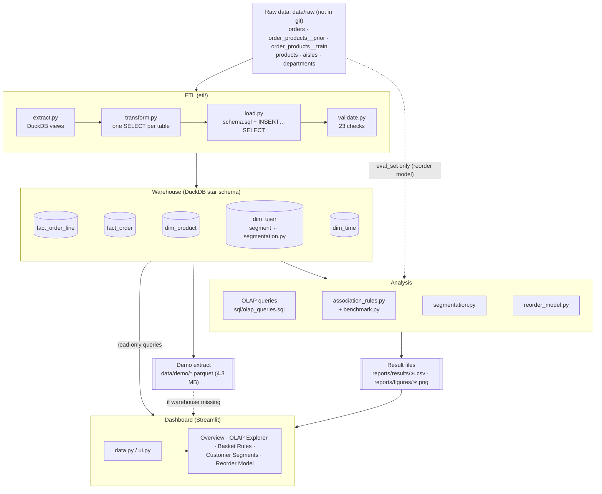

The diagram shows only components that exist in the repository. The dotted arrows are the two special paths: the reorder model reads `eval_set` directly from `orders.csv`, because the warehouse does not store it, and the dashboard falls back to the demo extract when the warehouse file is absent. The segmentation step also writes `dim_user.segment` back into the warehouse, as noted on the `dim_user` table.

## 6.6 Additional Diagrams

### Use case view

**Figure 6.2 – Use case view** (a Mermaid flowchart used in place of a UML use case diagram)

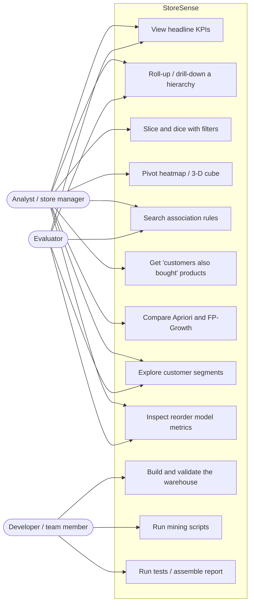

The dashboard has no login, so the analyst and the evaluator use the same functions. The developer use cases are command-line scripts.

### Data flow diagram (level 1)

**Figure 6.3 – Level-1 data flow diagram**

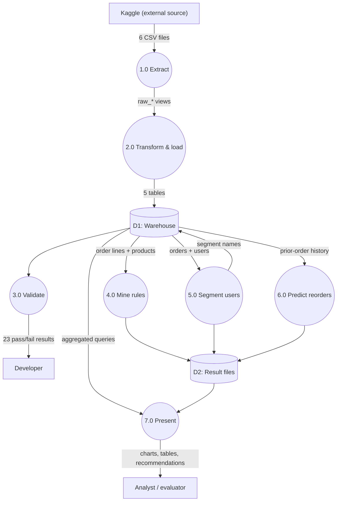

### Entity-relationship view of the star schema

**Figure 6.4 – Entity-relationship view of the star schema**

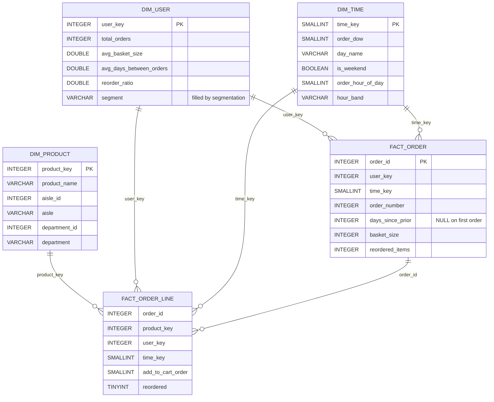

The relationships are **logical**. As explained in Section 8.3, the schema declares primary keys on the dimensions and `fact_order` but deliberately no foreign-key constraints; `etl/validate.py` enforces the relationships after loading.

### ETL activity flow

**Figure 6.5 – ETL activity flow (`etl/load.py` and `etl/validate.py`)**

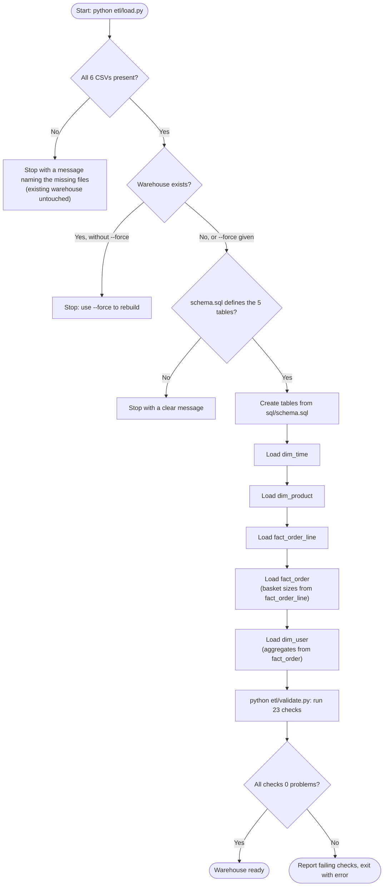

### Sequence of an OLAP Explorer query

**Figure 6.6 – Sequence of an OLAP Explorer query**

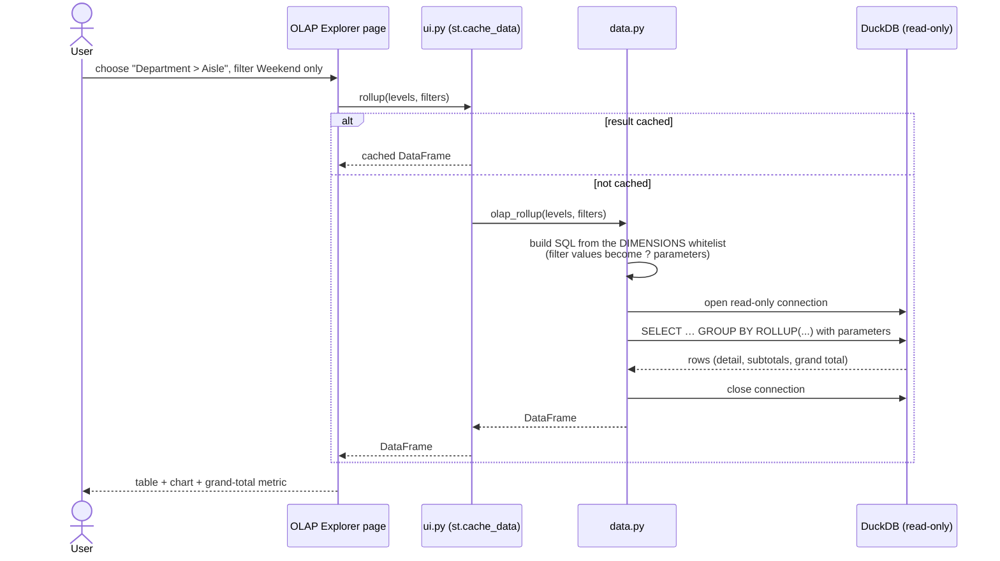

Because the connection is read-only and closed after every query, the dashboard never blocks `mining/segmentation.py`, the one script that writes to the warehouse.

---

# 7. Dataset and Data Preparation

## 7.1 Data source and collection

The data is the **Instacart Online Grocery Shopping Dataset 2017**, distributed through the Kaggle competition *Instacart Market Basket Analysis* [23]. The team did not collect any data itself. Each member downloads the files from Kaggle after accepting the competition rules, either through the website or with the Kaggle CLI (`kaggle competitions download -c instacart-market-basket-analysis -p data/raw`). The files (about 700 MB) are excluded from git by `.gitignore`.

## 7.2 Structure and attributes

**Table 7.1 – Raw dataset files**

| File | One row is… | Rows (measured) | Key attributes |
|---|---|---|---|
| `orders.csv` | an order | 3,421,083 | `order_id`, `user_id`, `eval_set` (prior/train/test), `order_number`, `order_dow` (0–6), `order_hour_of_day` (0–23), `days_since_prior_order` |
| `order_products__prior.csv` | a product in a prior order | 32,434,489 | `order_id`, `product_id`, `add_to_cart_order`, `reordered` (0/1) |
| `order_products__train.csv` | a product in a user's latest (train) order | 1,384,617 | same as prior |
| `products.csv` | a product | 49,688 | `product_id`, `product_name`, `aisle_id`, `department_id` |
| `aisles.csv` | an aisle | 134 | `aisle_id`, `aisle` |
| `departments.csv` | a department | 21 | `department_id`, `department` |

There are 206,209 users. Every user has at least 4 orders (mean 16.6, median 10, maximum 100).

**Data types.** `etl/extract.py` declares every column type explicitly instead of letting DuckDB infer them: ids and counts are `INTEGER`, `reordered` is `TINYINT`, names are `VARCHAR`, and `days_since_prior_order` is `DOUBLE` (it is empty on first orders). `order_dow` and `order_hour_of_day` are read as `INTEGER` deliberately: an early version used `TINYINT`, and the expression `order_dow * 24` overflowed. The automated tests caught this on synthetic data.

## 7.3 Known properties and limitations of the data

- **No prices.** A "sale" is one order line, and basket size (items per order) stands in for spending.
- **No calendar dates.** Only the day of the week, the hour and the days since the previous order exist, and the last of these is **capped at 30** (369,323 orders sit exactly at 30).
- **Undocumented day-of-week coding.** The project **assumes `order_dow = 0` is Sunday**. If this is wrong, the day names shift, but the numeric patterns do not change.
- **Hidden test orders.** 75,000 orders are marked `test` and have no products in the files.
- **Uncategorised products.** 1,258 products are in the dataset's own `missing` department and aisle, and 548 in `other`. Together these two departments hold 115,482 order lines (0.34%).

## 7.4 Data preparation operations

**Table 7.2 – Data preparation operations (what was and was not done)**

| Step | Implemented? | What the project does |
|---|---|---|
| **Loading / ingestion** | Yes | DuckDB views over the CSVs with fixed types; all transformation in SQL; nothing loaded into pandas for the ETL |
| **Missing values** | Yes | `days_since_prior_order` is empty only on each user's first order. It is kept as **NULL**, not 0, because 0 would mean "ordered again the same day", and `AVG()` ignores NULLs. A validation check confirms that the NULLs occur on every first order and nowhere else (206,209 NULLs, one per user) |
| **Hidden values** | Yes (by design) | Test orders are kept in `fact_order` with `basket_size = 0`, so every order in `orders.csv` is in the warehouse; basket statistics filter `basket_size > 0` |
| **Duplicate removal** | Checked, none needed | Validation checks that every dimension key and `fact_order.order_id` is unique; no duplicates were found, so no rows were removed. Duplicate (order, product) lines are not checked by a constraint (see Section 8.3) |
| **Referential integrity** | Yes | Orphan-key checks for every fact-to-dimension and line-to-order relationship; 0 orphans |
| **Integration** | Yes | Products joined to aisles and departments (`LEFT JOIN`, so no product is silently dropped); prior and train lines stacked; each line given its order's user and time slot |
| **Transformation** | Yes | Computed `time_key = order_dow × 24 + order_hour_of_day`; `day_name`, `is_weekend` and `hour_band` (Morning 05–11, Afternoon 12–16, Evening 17–20, Night 21–04); per-order basket size and reordered items; per-user aggregates |
| **Normalisation / scaling** | In mining only | Segmentation applies `log(1 + x)` to the two skewed features and standardises all four; the Logistic Regression pipeline standardises its inputs. The warehouse stores unscaled values |
| **Feature engineering** | In mining only | RFM-style features for segmentation (Section 8.6); 13 prior-only user, product and user × product features for the reorder model (Section 8.7) |
| **Feature selection** | Partly | Features were chosen by design (from the brief and domain reasoning), not by an automatic selection method. `avg_days_between_orders` was deliberately left out of clustering because it overlaps with recency and frequency |
| **Sampling** | In mining only | 500,000 orders for rules; 100,000 for the benchmark; 20,000 users for silhouette scores; 30,000 users for the reorder model; all with seed 42 |
| **Outlier treatment** | Partly | No rows were removed; the long right tails of order counts and basket sizes were reduced by the log transform before clustering |
| **Storage and retrieval** | Yes | A single DuckDB file (~0.23 GB); read-only connections for analysis; one writer at a time |

## 7.5 Data quality considerations

The ETL's quality checks (all 23 pass on the full data, re-run on 15 October 2026) cover:

- **Completeness:** `fact_order` rows = `orders.csv` rows; `fact_order_line` rows = prior + train rows; `dim_product` rows = `products.csv` rows; the basket sizes add up to the number of order lines.
- **Consistency:** no orphan keys, unique keys, no NULL keys, and every product has an aisle and a department.
- **Validity:** `days_since_prior` is between 0 and 30; `reordered` is only 0 or 1; `time_key` is between 0 and 167.

Remaining quality issues that the checks cannot remove are properties of the source: the 30-day cap, the assumed day coding, the absence of prices and dates, and the `missing`/`other` categories.

---

# 8. DMDW Concepts and Methodology

This chapter relates the implementation to the DMDW course concepts. Table 8.1 states, for each concept, whether StoreSense implements it.

**Table 8.1 – DMDW concepts: implemented, partially supported, or future work**

| Concept | Status | Where |
|---|---|---|
| Knowledge discovery (KDD) process | **Implemented** | Whole pipeline (8.1) |
| Data preprocessing, cleaning, integration, transformation | **Implemented** | ETL (Chapter 7, 8.2) |
| ETL | **Implemented** | `etl/` (8.2) |
| Data warehousing: fact and dimension tables, star schema | **Implemented** | `sql/schema.sql` (8.3) |
| Concept hierarchies | **Implemented** | Product and time hierarchies (8.3) |
| OLAP: roll-up, drill-down, slice, dice, pivot, `CUBE` | **Implemented** | `sql/olap_queries.sql`, dashboard (8.4) |
| Exploratory data analysis and descriptive statistics | **Implemented** | `notebooks/eda.ipynb`, report sections (8.1) |
| Frequent pattern / association rule mining (Apriori, FP-Growth) | **Implemented** | `mining/association_rules.py` (8.5) |
| Algorithm performance comparison | **Implemented** | `mining/benchmark.py` (8.5) |
| Clustering (K-Means), cluster validation (elbow, silhouette) | **Implemented** | `mining/segmentation.py` (8.6) |
| Dimensionality reduction (PCA) for visualisation | **Implemented** (visualisation only) | `mining/segmentation.py` |
| Classification and its evaluation | **Implemented** (stretch goal) | `mining/reorder_model.py` (8.7) |
| Data visualisation and analytical reporting | **Implemented** | Dashboard, figures, report (8.8) |
| Snowflake schema | **Not used, by choice** | Hierarchies are denormalised into `dim_product` (8.3) |
| Statistical hypothesis testing | **Not implemented** | Results are descriptive; no significance tests (Chapter 14) |
| Forecasting of demand over time | **Not possible with this data** | No calendar dates |
| Sequential pattern mining | **Future work** | Chapter 14 |
| Incremental / real-time warehouse refresh | **Future work** | Chapter 14 |

## 8.1 Data mining and knowledge discovery

**Concept.** KDD is the process of turning raw data into useful knowledge through selection, preprocessing, transformation, mining and interpretation [19].

**Relevance and implementation.** StoreSense follows these steps in order: *selection and preprocessing* in the ETL (Chapter 7), *transformation* into a star schema, *exploration* with EDA and OLAP, *mining* with three modules, and *interpretation* in the dashboard and report (plain-English rule interpretations, named segments, written business insights).

**EDA outputs** (from `notebooks/eda.ipynb` and queries on the warehouse): mean basket 10.11 items (median 8, 95th percentile 25, maximum 145); 59.0% of all order lines are reorders, highest in dairy eggs (67.0%), beverages (65.4%) and produce (65.1%); Sunday and Monday are the busiest days; 10:00 and 11:00 are the busiest hours; the best-selling product is Banana (491,291 order lines).

**Limitations.** The EDA is descriptive. It does not include significance tests or confidence intervals.

## 8.2 ETL: extraction, transformation and loading

**Concept.** ETL extracts data from sources, transforms it into the warehouse's model (cleaning, integrating, deriving), and loads it, usually followed by quality checks [14], [18].

**Relevance.** The warehouse is only as reliable as its load. With 33.8 million order lines, errors such as orphan keys or wrongly filled NULLs would not be visible by eye.

**Implementation.**

- *Extract:* typed DuckDB views over the CSVs (`register_raw_views`).
- *Transform:* five SQL statements (`etl/transform.py`), executed inside the database.
- *Load:* `sql/schema.sql` creates the tables, then `INSERT INTO <table> (<columns>) SELECT …` fills them in the order `dim_time`, `dim_product`, `fact_order_line`, `fact_order`, `dim_user`. The order matters: `fact_order` counts basket sizes from the already-loaded order lines, and `dim_user` aggregates from `fact_order`.
- *Validate:* 23 checks, each a SQL query that counts problems.

**Inputs and outputs.** Six CSV files in; a 0.23 GB DuckDB file with five tables out; 23/23 checks passed.

**Limitations.** A full rebuild is needed for any change (no incremental load), and a rebuild erases `dim_user.segment`, so segmentation must be run again afterwards.

## 8.3 Data warehousing: star schema, facts, dimensions and hierarchies

**Concept.** A star schema has fact tables that record events at a declared *grain* with numeric *measures*, and dimension tables that describe the events; dimension attributes form *concept hierarchies* used for roll-up and drill-down [14], [18]. A snowflake schema would normalise the dimensions further (for example, separate aisle and department tables).

**Relevance.** Every analytical question in the project has the shape "count order lines (or orders) grouped by product and/or time attributes, possibly filtered". A star schema makes all of them one join from the fact table to one or two small dimensions.

**Implementation.**

**Table 8.2 – Warehouse tables and grain**

| Table | Type | Grain | Measures / attributes | Rows |
|---|---|---|---|---|
| `fact_order_line` | Fact (atomic) | one product in one order | `COUNT(*)` (a "sale"), `reordered`, `add_to_cart_order` | 33,819,106 |
| `fact_order` | Fact (aggregate) | one order | `basket_size`, `reordered_items`, `days_since_prior`, `order_number` | 3,421,083 |
| `dim_product` | Dimension | one product | product → aisle → department | 49,688 |
| `dim_user` | Dimension | one customer | order-history aggregates, `segment` | 206,209 |
| `dim_time` | Dimension | one day-of-week × hour slot | `day_name`, `is_weekend`, `hour_band`, hour | 168 |

*Design decisions:*

- **Keys.** `product_key = product_id` and `user_key = user_id`, because the source ids are already unique integers and keeping them makes results traceable. `time_key = order_dow × 24 + order_hour_of_day` (0–167) is computed, so loading needs no lookup.
- **Keys copied into the atomic fact.** `fact_order_line` carries `user_key` and `time_key` copied from its order, so queries reach the user and time dimensions without joining `fact_order`.
- **Hierarchies.** *Product:* department (21) → aisle (134) → product (49,688). *Time:* hour band (4) → hour (24), with day of week as a separate attribute; together they give the 168 slots of a week.
- **Star rather than snowflake.** Aisle and department names are denormalised into `dim_product` (a few thousand repeated strings at most), which keeps every hierarchy query to a single join.
- **Constraints measured, not assumed.** The team tested the alternatives on the full data:

| Variant | Measured result |
|---|---|
| **Chosen:** primary keys on the dimensions and `fact_order`, none on `fact_order_line` | `fact_order_line` loads in 2.6 s; whole warehouse 13.8 s; file 0.23 GB |
| `PRIMARY KEY (order_id, product_key)` on `fact_order_line` | that table loads in 56.1 s (≈ 21× slower); file 1.81 GB (≈ 8× larger) |
| `FOREIGN KEY` constraints on the fact tables | the load fails after 2.4 s, because `fact_order_line` is loaded before its parent `fact_order` |

Referential integrity is therefore checked by `etl/validate.py` after loading instead of being enforced by the database.

**Figure 8.1 – Star schema diagram (from the team's DBML source)**


**Limitations.** No surrogate keys or slowly changing dimensions, because the data is a single snapshot. The time dimension has no calendar level.

## 8.4 OLAP operations

**Concept.** OLAP views data as a multidimensional cube. *Roll-up* aggregates to a coarser hierarchy level, *drill-down* moves to a finer one, a *slice* fixes one dimension to one value, a *dice* restricts several dimensions at once, and a *pivot* rotates the view, for example turning one dimension's values into columns [16], [17].

**Relevance.** These operations answer "when and what do people buy?" directly.

**Implementation.** Saved queries in `sql/olap_queries.sql` (each commented), and the same operations generated on demand by the dashboard's query builder:

| Query | Operation | SQL technique | Result (full data) |
|---|---|---|---|
| Q1a | Roll-up department → aisle → grand total | `GROUP BY ROLLUP (department, aisle)` with `GROUPING()` to label levels | 156 rows; grand total 33,819,106 order lines |
| Q1b | Drill-down into one aisle (dairy eggs / yogurt) to product level | `ROLLUP` with a fixed department and aisle | aisle total 1,507,583 lines |
| Q2 | Slice: weekend only | `WHERE t.is_weekend` | 11,241,275 lines (33.2%) |
| Q3 | Dice: produce and dairy eggs, Evening band | `WHERE department IN (…) AND hour_band = 'Evening'` | 8 rows; both fall ~52% from 17:00 to 20:00 |
| Q4 | Pivot: department × day of week | DuckDB `PIVOT … ON day_name IN (…) USING COUNT(order_id)` | 21 × 7 matrix |
| Q5 | Cube: department × hour band | `GROUP BY CUBE (department, hour_band)` | includes per-band totals across all departments |
| Q6 | Cube on the aggregate fact | `CUBE (day_name, hour_band)` on `AVG(basket_size)`, filtering `basket_size > 0` | Sunday baskets largest (11.16) |

*Roll-up semantics.* For `ROLLUP (a, b)` the result contains the grouping sets (a, b), (a) and (), that is, details, subtotals and a grand total. `CUBE (a, b)` additionally contains (b), every combination, which `ROLLUP` cannot give because it follows one hierarchy from the left [16].

The dashboard's **3-D cube** view selects any three of department, aisle, day of week, hour band and hour, completes the cube with zero cells for empty combinations, and highlights the cells of a slice (values picked on one axis) or a dice (values picked on several axes).

**Limitations.** "Sales" are order-line counts (no prices). All demo queries ran in 0.4 s or less, but no formal benchmark against a non-warehouse baseline was run.

## 8.5 Association rule mining: Apriori and FP-Growth

**Concept.** For a rule A ⇒ B over a set of N baskets:

$$\text{support}(A \Rightarrow B) = \frac{|\{t : A \cup B \subseteq t\}|}{N},\qquad
\text{confidence}(A \Rightarrow B) = \frac{\text{support}(A \cup B)}{\text{support}(A)},\qquad
\text{lift}(A \Rightarrow B) = \frac{\text{confidence}(A \Rightarrow B)}{\text{support}(B)}$$

Lift = 1 means A and B are independent; lift > 1 means B is more likely in baskets with A than in a typical basket [3], [4].

*Apriori* [1] (level-wise candidate generation):

```
L1 ← frequent single items (support ≥ min_support)
for k = 2, 3, … while L(k-1) is not empty and k ≤ max_len:
    C(k) ← candidate k-itemsets joined from L(k-1),
           pruned if any (k-1)-subset is not in L(k-1)      # downward closure
    count the support of each candidate over the baskets
    L(k) ← candidates with support ≥ min_support
return the union of all L(k)
```

*FP-Growth* [2] builds a compressed prefix tree (FP-tree) of the baskets in two passes, then mines it recursively through conditional pattern bases, without generating candidates.

**Relevance.** Answers "which products are bought together?", and the brief also asks for a comparison of the two algorithms.

**Implementation** (`mining/association_rules.py`):

1. Baskets are read from `fact_order_line` ⨝ `dim_product`. Only orders with at least 2 items are used (3,182,490 orders), because a single item cannot form a rule.
2. A random sample of **500,000 orders** (seed 42) is drawn.
3. Baskets are one-hot encoded into a **sparse** DataFrame (only the True cells are stored).
4. Frequent itemsets are mined with **both** algorithms (`max_len = 3`). The script stops with an error if they disagree, and a test checks this on a hand-worked example.
5. Rules are generated with mlxtend's `association_rules`, kept where **lift > 1**, sorted by lift, and given a plain-English interpretation.

**Table 8.3 – Association rule settings at the two levels**

| | Aisle level | Product level |
|---|---|---|
| Items | 132 aisles (`missing` and `other` removed) | top 1,000 products by order lines (53.9% of all lines) |
| Baskets used | 492,350 | 418,175 |
| `min_support` | 0.01 | 0.0015 |
| Frequent itemsets | 2,344 (96 single, 894 pairs, 1,354 triples) | 2,527 |
| Rules with lift > 1 | 9,730; top 5,000 by lift kept (lift ≥ 1.42) | 3,410 (all kept) |

*Memory control.* With default settings, mlxtend's Apriori requested **81.6 GiB** on the product baskets, because it builds a baskets × candidates table. The project therefore runs Apriori with `low_memory=True`. The sample and the top-1,000 filter are further memory controls; the full script runs in about 2 minutes.

*Validation of the sample.* The top product rule (*Icelandic Style Skyr Blueberry Non-fat Yogurt ⇒ Non Fat Acai & Mixed Berries Yogurt*) was recounted in SQL on the whole warehouse: confidence 20.6% and lift 61.0, against 22.1% and 63.1 in the sample, within about 7%.

*Benchmark* (`mining/benchmark.py`): on a 100,000-order sample, five `min_support` values per level, runtime and peak memory (`tracemalloc`) measured in **separate runs**, so that the memory tracer does not distort the times. Results are in Section 10.4.

**Outputs.** `rules_aisle.csv`, `rules_product.csv`, `benchmark.csv`, two charts, and `frequently_bought_together(product_name, top_n)`, which the dashboard uses for "customers also bought".

**Limitations.** Sampled orders; only the top 1,000 products; itemsets capped at 3; rules show association, not causation; the benchmark was run once per setting on one machine.

## 8.6 Clustering: customer segmentation with K-Means

**Concept.** K-Means chooses k centres $\mu_1,\dots,\mu_k$ to minimise the inertia $\sum_{i}\min_j \lVert x_i-\mu_j\rVert^2$ by alternating between assigning points to their nearest centre and moving each centre to the mean of its points [5], [6]. For a point i, the silhouette is $s(i) = \frac{b(i)-a(i)}{\max\{a(i),b(i)\}}$, where $a(i)$ is the mean distance to the other points of its cluster and $b(i)$ the mean distance to the nearest other cluster; the mean silhouette ranges from −1 to 1 [7].

**Relevance.** Answers "what kinds of customers exist?", following the RFM idea from marketing [9].

**Implementation** (`mining/segmentation.py`):

| Feature | Source | RFM role |
|---|---|---|
| `recency_days` | `days_since_prior` of the user's **last** order | Recency (proxy) |
| `total_orders` | `dim_user.total_orders` | Frequency |
| `avg_basket_size` | `dim_user.avg_basket_size` | Monetary (proxy; no prices) |
| `reorder_ratio` | `dim_user.reorder_ratio` | Loyalty |

1. **Transform:** `log(1 + x)` on `total_orders` (skew 2.40 → 0.65) and `avg_basket_size` (skew 1.22 → −0.33); the other two are already symmetric.
2. **Standardise** all four features to mean 0 and standard deviation 1.
3. **Evaluate k = 2 … 10** with `KMeans(n_init=10, random_state=42)` on all 206,209 users; inertia on all users, silhouette on a fixed sample of 20,000 users.
4. **Choose k** with `choose_k()`: among k = 4 … 8, take the best silhouette rounded to 3 decimals, and the smallest k if several tie. k = 2 had the best silhouette (0.309) but only separates frequent from infrequent users, so it was excluded as too coarse to act on.
5. **Profile and name** the clusters with rules on their averages (`name_segment()`).
6. **Write back** each user's segment name into `dim_user.segment` with one set-based `UPDATE … FROM`.
7. **PCA** to two components on a 10,000-user sample, for the scatter plot only.

*Recency caveat.* Without dates, "recency" is the gap *before* the last order, not the time *since* it. 30.6% of users have the capped value 30.

**Outputs.** Four named segments (Section 10.5), `segment_profiles.csv`, `segment_pca_sample.csv`, three charts, and the filled `dim_user.segment` (206,209 users, 0 NULL).

**Limitations.** Weak to moderate structure (silhouette ≈ 0.27), so the segments overlap; K-Means assumes compact, similar-sized clusters; the monetary and recency features are proxies.

## 8.7 Classification: reorder prediction (stretch goal)

**Concept.** Binary classification learns $P(y=1 \mid x)$ from labelled examples. With a rare positive class, performance is measured by precision $= \frac{TP}{TP+FP}$, recall $= \frac{TP}{TP+FN}$, $F_1 = \frac{2PR}{P+R}$ and ROC-AUC, the probability that a random positive is scored above a random negative [20], [21].

**Relevance.** It turns the reorder pattern seen in OLAP (59% of lines are reorders) into a per-product prediction, which could be used for a "buy it again" list.

**Implementation** (`mining/reorder_model.py`):

- **Label.** For each user with a train order (131,209 users), and each product in that user's *prior* orders, y = 1 if the product is in the train order. On a sample of **30,000 users** (seed 42) this gives 1,951,532 pairs, 9.7% positive.
- **Features (13), all from prior orders only,** computed in DuckDB SQL:

**Table 8.4 – Reorder model features**

| Group | Features |
|---|---|
| User (5) | `u_orders`, `u_avg_basket`, `u_reorder_ratio`, `u_avg_days_between`, `u_distinct_products` |
| Product (3) | `p_orders`, `p_reorder_rate`, `p_users` |
| User × product (5) | `up_times_bought`, `up_share`, `up_orders_since_last`, `up_days_since_last`, `up_avg_cart_pos` |

- **Leakage prevention** [22]: `eval_set` is read from the raw `orders.csv` (the warehouse does not store it); every feature query filters `eval_set = 'prior'`; the train order is used only for the label; candidate pairs come only from prior orders; and a test replaces the train orders with different baskets and checks that no feature changes, only the labels.
- **Split by user, not by row:** 60% / 20% / 20% (18,000 / 6,000 / 6,000 users), with a test that no user appears in two sets.
- **Models:** Logistic Regression (standardised inputs, `class_weight="balanced"`) as the baseline, and LightGBM (300 trees, learning rate 0.05, 63 leaves, no class weights).
- **Threshold:** for each model, the probability threshold with the highest F1 on the **validation** users, then used unchanged on the test users. The model was chosen on validation ROC-AUC.

**Outputs.** `reorder_metrics.csv`, `reorder_feature_importance.csv`, ROC and importance charts (Section 10.6).

**Limitations.** One split, no hyper-parameter tuning, a 22.9% sample of eligible users, and no first-time purchases among the candidates by design.

## 8.8 Data visualisation and analytical reporting

**Implementation.** Matplotlib charts for the report (`reports/figures/`), and interactive Plotly charts in the Streamlit dashboard: a heatmap of orders by day and hour, roll-up tables and bars, a pivot heatmap, a 3-D cube scatter, rule tables, benchmark lines, segment bars and a PCA scatter, and ROC and importance charts. Reports are written as Markdown sections and assembled automatically.

**Limitation.** The dashboard was tested headless and checked by eye; no accessibility or formal usability evaluation was carried out.

---

# 9. Implementation Details

## 9.1 Project Structure

```
StoreSense/
├── common/db.py              shared paths and DuckDB connection helpers (read-only by default)
├── etl/                      extract.py · transform.py · load.py · validate.py
├── sql/                      schema.sql (star schema DDL) · olap_queries.sql (Q1a–Q6)
├── mining/                   association_rules.py · benchmark.py · segmentation.py · reorder_model.py
├── dashboard/
│   ├── app.py                entry point: Overview page + st.navigation menu
│   ├── views/                1_OLAP_Explorer · 2_Basket_Rules · 3_Customer_Segments · 4_Reorder_Model
│   ├── data.py               all SQL and file reading (no Streamlit; testable)
│   ├── ui.py                 cached wrappers and "missing file" messages
│   ├── build_demo_data.py    writes the 4.3 MB Parquet demo extract
│   └── requirements.txt      slim package list for Streamlit Community Cloud
├── data/raw/                 Kaggle CSVs (gitignored)
├── data/warehouse/           storesense.duckdb (gitignored)
├── data/demo/                Parquet demo extract (committed)
├── notebooks/eda.ipynb       exploratory data analysis
├── reports/
│   ├── sections/             per-module report sections (00–07)
│   ├── results/              mining result CSVs (committed)
│   ├── figures/              charts and the star schema diagram
│   ├── build_report.py       assembles StoreSense_report.md
│   └── StoreSense_report.md  the assembled technical report
├── tests/                    90 pytest tests + a fixture schema
├── docs/                     PROJECT_BRIEF.md · DEMO_FLOW.md · DEPLOY.md
├── README.md · CONTRIBUTING.md · requirements.txt · pyproject.toml
```

Code size (lines, including comments): ETL 521, mining 906, dashboard 996, common 70, SQL 284, tests 1,236.

## 9.2 Module-Level Implementation

- **`common/db.py`** defines `PROJECT_ROOT`, `RAW_DIR`, `WAREHOUSE_PATH` and `FIGURES_DIR`, and `get_connection(read_only=True)` and `query_df(sql, params)`, which every module uses. A clear error is raised if the warehouse has not been built.
- **ETL.** `extract.py` registers views; `transform.py` holds only SQL constants and the ordered `LOAD_STEPS`; `load.py` checks the inputs, runs the DDL and the inserts, and refuses to overwrite without `--force`; `validate.py` builds the 23 checks from small SQL templates (`_orphans`, `_duplicates`, `_count_differs`) and prints a pass/fail table.
- **Mining.** Each script is runnable on its own (`python mining/<name>.py`), does its heavy selection in SQL, and writes results with the exact column names agreed in the team's shared result-file contract, which a test checks.
- **Dashboard.** Pages contain no SQL; they call `dashboard/data.py` through cached wrappers in `ui.py`. The page folder is named `views/` rather than Streamlit's default `pages/`, so that the explicit `st.navigation` menu is always used.

## 9.3 Data Processing

The processing pipeline is the ETL described in Sections 6.3 and 8.2. All ETL processing happens in DuckDB SQL. Only mining inputs that fit comfortably in memory (sampled baskets, per-user features, a 30,000-user pair table) are brought into pandas.

## 9.4 Analytical Components

| Component | Algorithm / calculation | Library |
|---|---|---|
| OLAP | `GROUP BY`, `ROLLUP`, `CUBE`, `GROUPING()`, `PIVOT`, window `SUM() OVER ()` for shares | DuckDB |
| Frequent itemsets | Apriori (`low_memory=True`), FP-Growth, `max_len = 3` | mlxtend |
| Rules | support, confidence, lift; filter lift > 1 | mlxtend + pandas |
| Benchmark | wall-clock time and `tracemalloc` peak memory, separate runs | Python standard library |
| Segmentation | `log1p`, `StandardScaler`, `KMeans`, `silhouette_score`, `PCA` | scikit-learn, NumPy |
| Reorder | `LogisticRegression`, `LGBMClassifier`, `precision_recall_curve`, `roc_auc_score` | scikit-learn, LightGBM |

## 9.5 Database and Storage

- **Engine:** DuckDB, an in-process columnar analytical database [13]. One file, `data/warehouse/storesense.duckdb` (~0.23 GB).
- **Schema:** Section 8.3 and Appendix B.
- **Concurrency:** DuckDB allows one writer at a time. The dashboard and all analysis scripts open the file read-only; only `etl/load.py` and `mining/segmentation.py` write.
- **Result storage:** small CSV files in `reports/results/`, committed to git, each kept under about 5 MB.
- **Demo extract:** four Parquet files in `data/demo/` (zstd-compressed): `line_counts` (order lines counted per product and day-hour slot, about 3.0 million rows), `dim_product`, `dim_time` and `kpis`.

## 9.6 User Interface

The Streamlit dashboard has five pages, listed in a sidebar menu:

| Page | Contents |
|---|---|
| **Overview** | Five KPIs (orders, users, products, average basket, reorder rate); "When do people shop?" (orders by hour for each day); "What do they buy?" (top departments); "What the numbers say" (findings computed from the same data); data-source note |
| **OLAP Explorer** | Four tabs: *Roll-up and drill-down* (product or time hierarchy, choice of level, subtotals and grand total); *Slice and dice* (group by any dimensions with filters for department, aisle, day, hour band and weekend); *Pivot heatmap* (any two dimensions); *3D cube* (any three dimensions, rotatable, with slice/dice highlighting) |
| **Basket Rules** | Three tabs: *Rules table* (aisle or product level, search, lift and confidence filters, CSV download); *Recommendations* ("Customers who buy X also buy"); *Apriori vs FP-Growth* (benchmark charts) |
| **Customer Segments** | Segment sizes; how each segment differs from the average user; PCA scatter of 10,000 users; profile table; a suggested store action per segment |
| **Reorder Model** | Metrics of both models; feature importance; ROC curve; guidance on reading the numbers |

*Screenshots* (taken on 15 October 2026 from the dashboard running locally on the full warehouse, light theme):

**Figure 9.1 – Overview page: headline KPIs, orders by hour for each day, top departments**

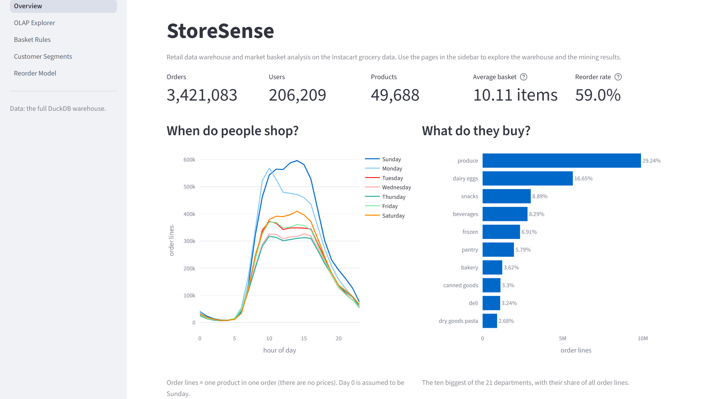

**Figure 9.2 – OLAP Explorer, roll-up and drill-down tab (department > aisle, grand total 33,819,106)**

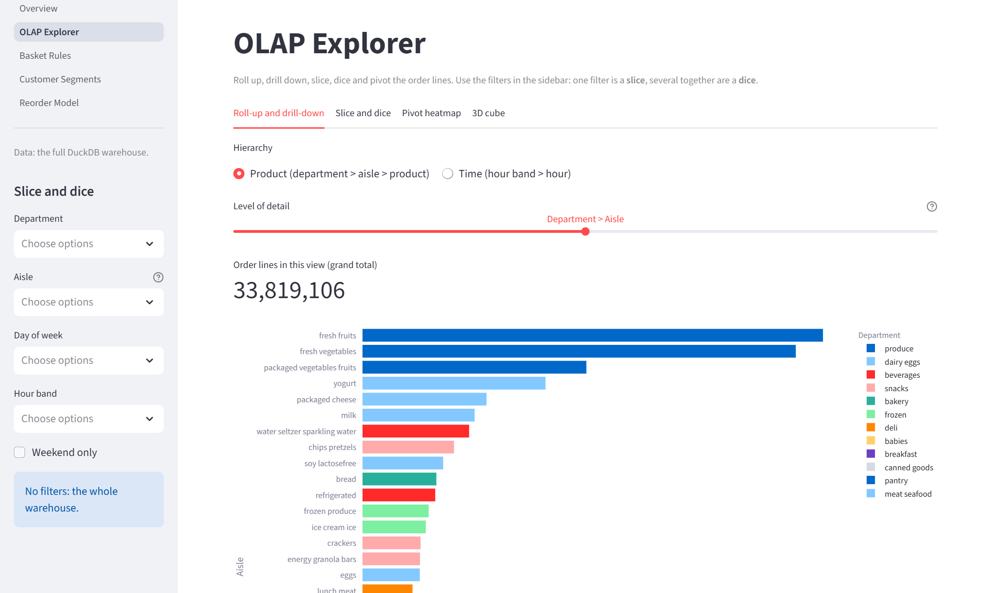

**Figure 9.3 – OLAP Explorer, 3-D cube tab (department × day of week × hour band, 588 cells)**

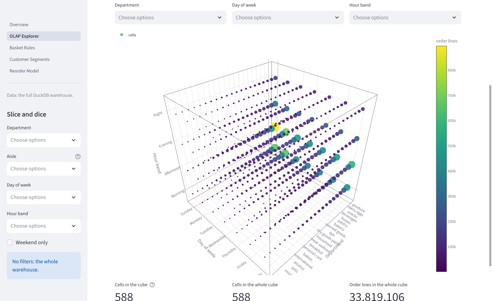

**Figure 9.4 – Basket Rules page: aisle-level rules sorted by lift, with filters and plain-English interpretations**

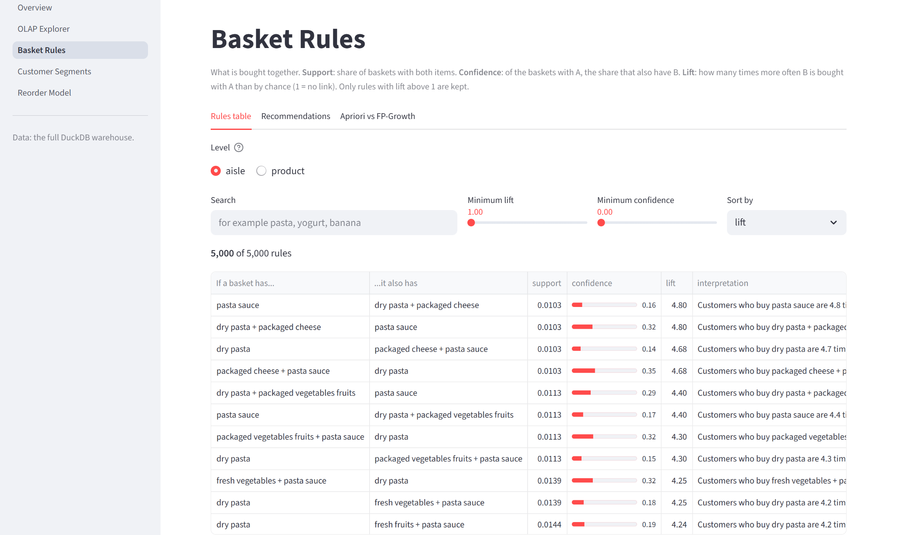

**Figure 9.5 – Customer Segments page: segment sizes and each segment against the average user**

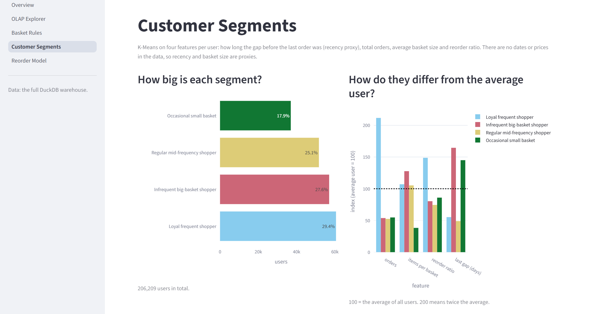

**Figure 9.6 – Reorder Model page: headline metrics, the two models compared, feature importance**

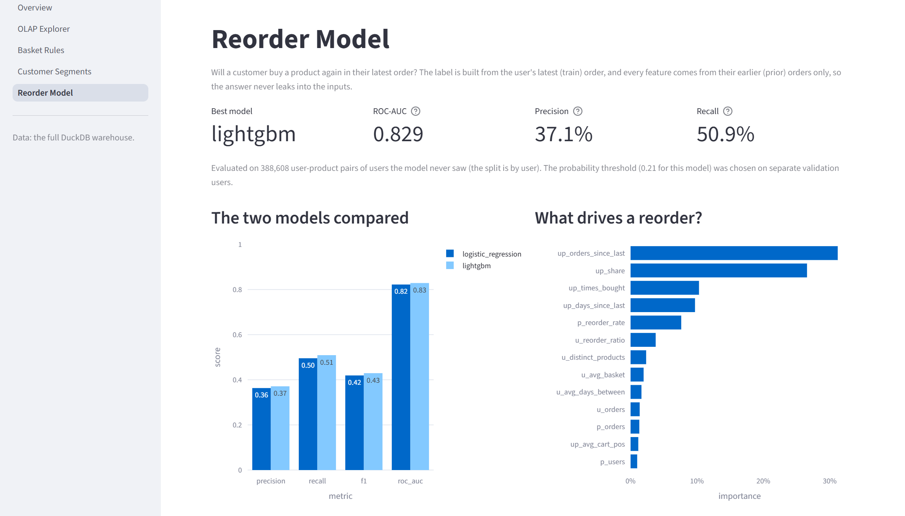

## 9.7 Integration

Modules are integrated through **files and a fixed contract**, not through function calls between team members' code:

1. The **schema** (`sql/schema.sql`) is the contract between the warehouse design and the ETL: the ETL inserts by column name.
2. The **warehouse** is the contract between the ETL and the mining modules.
3. A **result-file contract** fixes the file names and exact columns that the mining scripts write and the dashboard reads. `tests/test_dashboard.py::test_result_columns_match_the_shared_contract` fails if a script changes its output format. (The written contract, `handoff/PHASE4_SHARED_CONTRACT.md`, exists in the repository owner's working copy but is excluded from git, so it is not in the GitHub repository.)
4. The only function call across modules is `frequently_bought_together()` from `mining/association_rules.py`, used by the Basket Rules page.

## 9.8 Important Code Examples

**Example 1 – The time dimension is generated, not read** (`etl/transform.py`). Every day-and-hour slot of a week gets one row, and the hour band is the time hierarchy's upper level.

```sql
SELECT
    d.dow * 24 + h.hr                                   AS time_key,
    d.dow                                               AS order_dow,
    CASE d.dow WHEN 0 THEN 'Sunday'    WHEN 1 THEN 'Monday'
               WHEN 2 THEN 'Tuesday'   WHEN 3 THEN 'Wednesday'
               WHEN 4 THEN 'Thursday'  WHEN 5 THEN 'Friday'
               WHEN 6 THEN 'Saturday' END               AS day_name,
    d.dow IN (0, 6)                                     AS is_weekend,
    h.hr                                                AS order_hour_of_day,
    CASE WHEN h.hr BETWEEN 5  AND 11 THEN 'Morning'
         WHEN h.hr BETWEEN 12 AND 16 THEN 'Afternoon'
         WHEN h.hr BETWEEN 17 AND 20 THEN 'Evening'
         ELSE 'Night' END                               AS hour_band
FROM range(7)  AS d(dow)
CROSS JOIN range(24) AS h(hr)
```

**Example 2 – The aggregate fact table is built from the loaded atomic fact** (`etl/transform.py`). Test orders, which have no lines, get `basket_size = 0` through the `LEFT JOIN` and `COALESCE`.

```sql
SELECT o.order_id, o.user_id AS user_key,
       o.order_dow * 24 + o.order_hour_of_day     AS time_key,
       o.order_number,
       CAST(o.days_since_prior_order AS INTEGER)  AS days_since_prior,
       COALESCE(b.basket_size, 0)                 AS basket_size,
       COALESCE(b.reordered_items, 0)             AS reordered_items
FROM raw_orders o
LEFT JOIN (SELECT order_id, COUNT(*) AS basket_size, SUM(reordered) AS reordered_items
           FROM fact_order_line GROUP BY order_id) b
       ON o.order_id = b.order_id
```

**Example 3 – Roll-up with labelled levels** (`sql/olap_queries.sql`, Q1a). `GROUPING()` distinguishes a subtotal's NULL from a real value.

```sql
SELECT CASE GROUPING(p.department, p.aisle)
           WHEN 0 THEN 'aisle' WHEN 1 THEN 'department total' ELSE 'grand total' END AS level,
       p.department, p.aisle, COUNT(*) AS order_lines
FROM fact_order_line l
JOIN dim_product p ON l.product_key = p.product_key
GROUP BY ROLLUP (p.department, p.aisle)
ORDER BY p.department NULLS LAST, p.aisle NULLS LAST;
```

**Example 4 – Apriori in low-memory mode** (`mining/association_rules.py`).

```python
def mine_itemsets(onehot, min_support, algorithm, max_len=None):
    # Apriori runs with low_memory=True: the default builds one (baskets x candidates)
    # table for each itemset size, which asked for 81.6 GiB on the product baskets.
    if algorithm == "apriori":
        return apriori(onehot, min_support=min_support, use_colnames=True,
                       max_len=max_len, low_memory=True)
    return fpgrowth(onehot, min_support=min_support, use_colnames=True, max_len=max_len)
```

**Example 5 – Choosing k reproducibly** (`mining/segmentation.py`).

```python
def choose_k(scores, candidates=K_CANDIDATES):          # K_CANDIDATES = range(4, 9)
    pool = scores[scores["k"].isin(list(candidates))].copy()
    pool["sil_rounded"] = pool["silhouette"].round(3)
    best = pool["sil_rounded"].max()
    return int(pool.loc[pool["sil_rounded"] == best, "k"].min())   # smallest k among ties
```

**Example 6 – Splitting by user and tuning the threshold on validation users** (`mining/reorder_model.py`).

```python
def split_users(user_keys, seed=SEED):
    users = np.random.default_rng(seed).permutation(np.unique(np.asarray(user_keys)))
    n_train = int(len(users) * 0.6)
    n_val = int(len(users) * 0.2)
    return {"train": users[:n_train],
            "validation": users[n_train:n_train + n_val],
            "test": users[n_train + n_val:]}

def best_threshold(y_true, proba):
    precision, recall, thresholds = precision_recall_curve(y_true, proba)
    f1 = 2 * precision[:-1] * recall[:-1] / np.clip(precision[:-1] + recall[:-1], 1e-12, None)
    return float(thresholds[int(np.argmax(f1))])
```

**Example 7 – User input never enters the SQL text** (`dashboard/data.py`). Column names come from a whitelist (`DIMENSIONS`); values become `?` parameters.

```python
for key, column, alias in (("departments", "p.department", "p"), ("aisles", "p.aisle", "p"),
                           ("days", "t.day_name", "t"), ("hour_bands", "t.hour_band", "t")):
    values = list(filters.get(key) or [])
    if values:
        clauses.append(f"{column} IN ({', '.join('?' * len(values))})")
        params += values
```

---

# 10. Results and Discussion

All figures in this chapter come from the team's runs on the full Instacart data. They are recorded in `reports/sections/*.md` and in the committed result files in `reports/results/`. The warehouse row counts and the 23 validation checks were re-run on 15 October 2026 and gave the same values.

## 10.1 Features successfully implemented

| Objective | Status | Evidence |
|---|---|---|
| ETL and validated star schema | Complete | 5 tables, 23/23 checks pass (re-run 15 Oct 2026) |
| OLAP operations | Complete | Q1a–Q6 in `sql/olap_queries.sql`; dashboard OLAP Explorer |
| Association rules and benchmark | Complete | `rules_aisle.csv` (5,000 rules), `rules_product.csv` (3,410 rules), `benchmark.csv` |
| Customer segmentation | Complete | `segment_profiles.csv`; `dim_user.segment` filled |
| Reorder prediction (stretch) | Complete | `reorder_metrics.csv`, `reorder_feature_importance.csv` |
| Interactive dashboard | Complete (local) | 5 pages; headless page tests pass |
| Hosted dashboard | Configured; live status to be confirmed | `docs/DEPLOY.md`, `dashboard/requirements.txt`, demo extract |
| Tests | Complete | 90/90 passed on 15 Oct 2026 |

## 10.2 Warehouse

**Table 10.1 – Warehouse load results**

| Item | Value |
|---|---|
| `fact_order_line` | 33,819,106 rows (32,434,489 prior + 1,384,617 train) |
| `fact_order` | 3,421,083 rows (= `orders.csv`) |
| `dim_user` / `dim_product` / `dim_time` | 206,209 / 49,688 / 168 |
| Test orders kept with basket size 0 | 75,000 |
| Orders at the 30-day cap | 369,323 |
| Full load time | 8.6 s and 13.8 s in two recorded team runs (single machine) |
| Warehouse file | ≈ 0.23 GB (229,650,432 bytes on 15 Oct 2026) |
| Validation | 23 / 23 checks passed |

The two load times come from different runs recorded in sections 1 and 2 of the team's technical report. The machine and conditions of each run were not recorded, so the difference cannot be explained from the available evidence.

## 10.3 OLAP findings

**Table 10.2 – Roll-up of order lines by department (top 5)**

| Department | Order lines | Share |
|---|---|---|
| produce | 9,888,378 | 29.2% |
| dairy eggs | 5,631,067 | 16.7% |
| snacks | 3,006,412 | 8.9% |
| beverages | 2,804,175 | 8.3% |
| frozen | 2,336,858 | 6.9% |
| **grand total** | **33,819,106** | 100% |

- **Concentration.** Produce and dairy eggs together account for **45.9%** of all order lines. The largest aisles are fresh fruits (3,792,661) and fresh vegetables (3,568,630).
- **Weekly rhythm.** The weekend (Sunday + Saturday) holds **33.2%** of lines from 2 of 7 days (28.6%). Sunday is the busiest day (6,533,692 lines) and Thursday the quietest (3,942,696), a ratio of 1.66.
- **Exception.** Alcohol peaks on **Friday** (28,465 lines) and is lowest on Sunday (18,150).
- **Daily rhythm.** The busiest hour is 10:00. In the evening dice, produce and dairy eggs both fall by about 52% between 17:00 and 20:00.
- **Basket size.** The average basket over 3,346,083 non-empty orders is **10.11 items**. Sunday baskets are the largest (11.16) and Wednesday baskets the smallest (9.34).
- **Speed.** Each demo query ran in 0.4 s or less on 33.8 million rows, and dashboard queries in 0.1–0.3 s (team measurements).

*Interpretation.* Demand is concentrated in a few departments and in time, which matters for stock, staffing and delivery slots. The day names depend on the assumption that day 0 is Sunday.

## 10.4 Association rules and the algorithm benchmark

**Table 10.3 – Top association rules**

| Level | Rule | Support | Confidence | Lift |
|---|---|---|---|---|
| Aisle | pasta sauce ⇒ dry pasta + packaged cheese | 1.03% | 15.6% | 4.80 |
| Aisle | dry pasta ⇒ pasta sauce | 2.08% | 27.6% | 4.17 |
| Aisle | canned jarred vegetables ⇒ canned meals beans | 1.94% | 24.8% | 3.36 |
| Aisle | frozen meals ⇒ frozen pizza | 1.07% | 13.6% | 2.95 |
| Aisle | fresh herbs ⇒ fresh vegetables | 8.44% | 84.7% | 1.80 |
| Product | Icelandic Style Skyr Blueberry Non-fat Yogurt ⇒ Non Fat Acai & Mixed Berries Yogurt | 0.16% | 22.1% | 63.1 |
| Product | Icelandic Style Skyr Blueberry Non-fat Yogurt ⇒ Non Fat Raspberry Yogurt | 0.27% | 36.6% | 58.0 |
| Product | Zero Calorie Cola ⇒ Soda | 0.16% | 53.4% | 46.9 |
| Product | Organic Yellow Squash ⇒ Organic Zucchini | 0.20% | 47.8% | 11.8 |
| Product | Bartlett Pears ⇒ Banana | 0.54% | 39.0% | 2.17 |

*Interpretation.* At aisle level the rules describe shopping "missions" (a pasta dinner, pantry cooking, a frozen "easy dinner"). At product level the strongest rules link flavours of the same product line. The fresh herbs rule shows why lift matters: its confidence is high (84.7%) only because fresh vegetables are in about 47% of all baskets, and its lift is a modest 1.8.

**Table 10.4 – Benchmark of Apriori and FP-Growth (100,000-order sample, `max_len = 3`; selected rows)**

| Level | `min_support` | Itemsets | Apriori time | FP-Growth time | Apriori memory | FP-Growth memory |
|---|---|---|---|---|---|---|
| aisle | 0.05 | 170 | 0.18 s | 1.69 s | 18 MB | 69 MB |
| aisle | 0.01 | 2,329 | 1.14 s | 4.31 s | 26 MB | 134 MB |
| aisle | 0.005 | 6,142 | 2.32 s | 7.15 s | 30 MB | 147 MB |
| product | 0.01 | 159 | 0.42 s | 1.15 s | 26 MB | 83 MB |
| product | 0.003 | 1,078 | 5.80 s | 2.12 s | 109 MB | 104 MB |
| product | 0.0015 | 2,516 | 10.80 s | 3.51 s | 165 MB | 130 MB |

**Figure 10.1 – Runtime of the mining step**


**Figure 10.2 – Peak memory of the mining step**


*Discussion.* At **product level with low support**, FP-Growth was about 3× faster than Apriori (3.5 s against 10.8 s at 0.0015) and used less memory, as the literature leads one to expect [2]. At **aisle level** (132 items), Apriori was faster and lighter at every setting tried. The team's explanation, which was **not tested**, is that with few items and `max_len = 3` Apriori has few candidates to check, while mlxtend's Python FP-tree construction has a fixed overhead. Both algorithms found identical itemsets at every setting. The practical conclusion is that the faster algorithm depends on the data, and that a benchmark on the real data should decide.

*Limits of this evaluation.* One run per setting, on one machine, with one library's implementations.

## 10.5 Customer segments

**Figure 10.3 – Elbow curve** and **Figure 10.4 – Silhouette score against k**


| k | 2 | 3 | 4 | 5 | 6 | 7 | 8 | 9 | 10 |
|---|---|---|---|---|---|---|---|---|---|
| Inertia (thousands) | 542 | 439 | 371 | 322 | 290 | 261 | 241 | 225 | 212 |
| Silhouette | 0.309 | 0.276 | 0.274 | 0.274 | 0.258 | 0.255 | 0.242 | 0.234 | 0.231 |

The elbow is not sharp, and k = 3, 4 and 5 have practically equal silhouettes. The team chose **k = 4**: it is the smallest k among the ties in the candidate range, and it keeps a distinct small-basket group, which k = 3 merges into the other groups.

**Table 10.5 – Segment profiles (means)**

| Segment | Users | Share | Orders | Items / basket | Days between orders | Reorder ratio | Last gap (days) |
|---|---|---|---|---|---|---|---|
| Loyal frequent shopper | 60,586 | 29.4% | 35.1 | 10.7 | 9.7 | 66% | 9.4 |
| Infrequent big-basket shopper | 57,005 | 27.6% | 8.9 | 12.8 | 20.3 | 36% | 28.1 |
| Regular mid-frequency shopper | 51,657 | 25.1% | 8.7 | 10.5 | 13.9 | 33% | 8.4 |
| Occasional small basket | 36,961 | 17.9% | 9.1 | 3.8 | 19.6 | 38% | 24.7 |
| All users | 206,209 | 100% | 16.6 | 10.0 | 15.5 | 44% | 17.1 |

**Figure 10.5 – The four segments projected onto two principal components** (PC1 50%, PC2 25% of variance)


*Interpretation.* The **loyal frequent shoppers** are 29.4% of users but place about 62% of all orders and buy about 65% of all items. The **occasional small basket** group is 17.9% of users but buys only about 3.6% of items. The PCA plot shows the loyal group well separated and the two middle groups overlapping. This is consistent with a silhouette of about 0.27, so the segment borders should be treated as soft.

## 10.6 Reorder prediction

**Table 10.6 – Reorder model metrics on the 6,000 test users (388,608 pairs, 37,664 positive)**

| Model | Precision | Recall | F1 | ROC-AUC | Threshold (from validation) |
|---|---|---|---|---|---|
| Logistic Regression (baseline) | 0.363 | 0.496 | 0.419 | 0.822 | 0.675 |
| **LightGBM** | **0.371** | **0.509** | **0.429** | **0.829** | 0.213 |

A model that always predicts "no reorder" would have an accuracy of 90.3% on these users and an F1 of 0. Both models have lower accuracy (86.7% and 86.9%) but find about half of the real reorders, which is why accuracy is not used to compare them.

**Figure 10.6 – ROC curves on the test users**


**Figure 10.7 – LightGBM feature importance (share of total split gain)**


The top features are `up_orders_since_last` (31.2%), `up_share` (26.6%), `up_times_bought` (10.3%), `up_days_since_last` (9.7%) and `p_reorder_rate` (7.6%). User × product features together give about 79% of the importance. In the raw data, 27.9% of products bought in the user's last prior order are bought again, against 2.8% of products last bought five or more orders ago.

*Interpretation.* Habit and recency predict a reorder far better than customer traits do. The gain of LightGBM over the baseline is small (0.007 ROC-AUC) and was measured on a single split without tuning, so it is not shown to be stable. A ROC-AUC well below 0.95 is consistent with the absence of leakage, though it does not prove it; the leakage test (Chapter 11, TC-23) is the stronger evidence.

## 10.7 Key insights (summary)

1. Produce and dairy eggs make up 45.9% of order lines.
2. Demand peaks on Sunday and at 10:00; the weekend carries 33.2% of sales.
3. Alcohol peaks on Friday, unlike the store as a whole.
4. Aisle rules reveal shopping missions (pasta dinner: lift up to 4.8).
5. Product rules link flavours of one line (lift above 60).
6. 29.4% of customers (loyal frequent shoppers) place about 62% of orders.
7. Recency and frequency of past purchases drive reorders (ROC-AUC 0.83).
8. The faster frequent-itemset algorithm depends on the number of items.

These are patterns in historical data. None of them has been tested as an intervention in a store.

## 10.8 Limitations of the evaluation

- No prices and no dates limit every analysis (Section 7.3).
- The mining results rest on samples (500,000 orders, 30,000 users), checked against the full data for the top rule only.
- The benchmark and the model comparison were each run once, without repetition or confidence intervals.
- The reorder model was not cross-validated or tuned.
- No user study of the dashboard was carried out.
- **Suggested future evaluation:** repeated benchmark runs with mean and standard deviation; k-fold user-level cross-validation; bootstrap confidence intervals for rule metrics; a small usability test of the dashboard with task completion times.

---

# 11. Testing

## 11.1 Testing Approach

| Level | What was done | Evidence |
|---|---|---|
| **Unit tests** | Hand-worked expected values for small inputs: support, confidence and lift on a 5-basket example; feature values on a tiny database; K-Means on synthetic users in 3 clear groups; F1-optimal threshold; GROUPING level names | `tests/test_rules.py`, `test_reorder.py`, `test_segmentation.py`, `test_dashboard.py` |
| **Integration tests** | The real ETL run end to end on a hand-checkable mini dataset; validation run on deliberately broken warehouses (deleted product, forced wrong NULL); the demo extract compared with the warehouse | `tests/test_etl.py`, `test_dashboard.py` |
| **Data-validation tests** | The 23 warehouse checks, and tests that run on the real warehouse when it is present | `etl/validate.py`, `test_real_*` tests |
| **System / functional tests** | Every dashboard page run headless with Streamlit `AppTest`, checking for errors and for the real headline numbers; the rules search; a filter on the OLAP page; the 3-D cube slice | `tests/test_dashboard.py` |
| **Security test** | An SQL-injection string sent as a filter value; the test checks that no table is dropped | `test_values_from_the_page_are_parameters_not_sql` |
| **Contract and regression tests** | Result-file columns match the shared contract; the committed report is up to date with its sections; the committed demo extract matches the warehouse | `test_dashboard.py`, `test_report.py` |
| **Manual testing** | Each dashboard page opened in a browser on the full warehouse and checked by eye on 15 Oct 2026 (Figures 9.1–9.6); the team also reports doing this (`reports/sections/06_dashboard.md`) | Done for the pages shown in Section 9.6 |
| **Usability testing** | Not performed | — |

**Test run used for this report:** `python -m pytest -q` on 15 October 2026, branch `feature/deploy` at commit `b61f423`, Windows 11, Python 3.13.9, with the full warehouse and raw data present: **90 passed, 0 failed** (2 warnings, in 26.7 s). `python etl/validate.py`: **23/23 checks passed**.

## 11.2 Test Cases

**Table 11.1 – Test cases.** *Actual results are from the 15 October 2026 run unless marked otherwise.*

| Test Case ID | Module | Test Scenario | Input | Expected Result | Actual Result | Status |
|---|---|---|---|---|---|---|
| TC-01 | Common | Opening a warehouse that does not exist | Missing path | Clear error raised | Error raised | Pass |
| TC-02 | ETL | Row counts after load | Mini fixture dataset | Each table has the hand-counted rows | As expected | Pass |
| TC-03 | ETL | Time dimension hierarchy | Generated `dim_time` | 168 rows; correct day names, weekend flag, bands | As expected | Pass |
| TC-04 | ETL | Every hour falls in exactly one band | Hours 0–23 | 4 bands cover all 24 hours | As expected | Pass |
| TC-05 | ETL | Product hierarchy with a quoted comma in a name | Fixture product CSV | Name parsed intact; aisle and department joined | As expected | Pass |
| TC-06 | ETL | First orders keep NULL, not 0 | Fixture orders | `days_since_prior` NULL on order 1 only | As expected | Pass |
| TC-07 | ETL | Validation detects an orphan key | Product deleted after load | Orphan check fails | Check failed as intended | Pass |
| TC-08 | ETL | Validation detects a wrong NULL | NULL forced on a later order | NULL-policy check fails | Check failed as intended | Pass |
| TC-09 | ETL | Existing warehouse needs `--force` | Second load without flag | Load refused | Refused | Pass |
| TC-10 | ETL | Missing raw file leaves existing warehouse untouched | One CSV removed | Error; warehouse unchanged | As expected | Pass |
| TC-11 | ETL | Real warehouse passes all checks | Full data | 23/23 pass | 23/23 pass | Pass |
| TC-12 | Rules | Frequent itemsets match a hand count | 5-basket example, both algorithms | Hand-counted supports | As expected (Apriori and FP-Growth) | Pass |
| TC-13 | Rules | Apriori and FP-Growth agree | Same baskets | Identical itemsets | Identical | Pass |
| TC-14 | Rules | Support, confidence and lift of rules | 5-basket example | Hand-worked values | As expected | Pass |
| TC-15 | Rules | `max_len` caps itemset size | Capped mining run | No itemset larger than the cap | As expected | Pass |
| TC-16 | Rules | "Frequently bought together" lookup | Product name | Products from the rules, ordered by strength | As expected | Pass |
| TC-17 | Segmentation | Recency is the gap before the last order | Synthetic orders | Gap of the highest `order_number` | As expected | Pass |
| TC-18 | Segmentation | Log transform reduces skew; scaling gives mean 0, sd 1 | Synthetic features | Lower skew; mean 0, sd 1 | As expected | Pass |
| TC-19 | Segmentation | K-Means recovers three clear groups and `choose_k` finds k = 3 | Synthetic users in 3 groups | 3 groups recovered | As expected | Pass |
| TC-20 | Segmentation | Ties in silhouette choose the smallest k | Synthetic scores | Smallest tied k | As expected | Pass |
| TC-21 | Segmentation | Write-back updates every user in one statement | Mini database | Every user has a segment | As expected | Pass |
| TC-22 | Reorder | Candidates are prior pairs only; labels from train order | Tiny database | Hand-worked pairs and labels | As expected | Pass |
| TC-23 | Reorder | **No train-order data leaks into features** | Train orders replaced with different baskets | All features identical; only labels change | As expected | Pass |
| TC-24 | Reorder | Split is by user with no overlap | User list | No user in two sets | As expected | Pass |
| TC-25 | Reorder | Metrics and threshold | Hand-made scores | Hand-counted precision/recall; F1-maximising threshold | As expected | Pass |
| TC-26 | Dashboard | Roll-up has details, subtotals and a grand total that add up | 7-line mini warehouse | Hand-counted totals | As expected | Pass |
| TC-27 | Dashboard | Slice (weekend) and dice (dairy eggs, Evening) | Mini warehouse | Hand-counted values | As expected | Pass |
| TC-28 | Dashboard | Pivot keeps week order and fills empty cells with 0 | Mini warehouse | Sunday…Saturday; zeros | As expected | Pass |
| TC-29 | Dashboard | 3-D cube includes empty cells; slice/dice highlight | Mini warehouse | Complete cube; correct mask | As expected | Pass |
| TC-30 | Dashboard | SQL injection through a filter | `x'; DROP TABLE dim_product; --` | Treated as a value; table still exists | As expected | Pass |
| TC-31 | Dashboard | Demo extract gives the same answers as the warehouse | Both sources | Identical tables | Identical | Pass |
| TC-32 | Dashboard | Every page runs without an error | 5 pages, real data, headless | No exception | No exception | Pass |
| TC-33 | Dashboard | Overview shows the real numbers | Real data | 3,421,083 orders; 206,209 users; 59.0% | As expected | Pass |
| TC-34 | Dashboard | Cube tab Sunday slice | Department × day × band | 588 cells; Sunday slice = 6,533,692 lines | As expected | Pass |
| TC-35 | Dashboard | Result files match the contract | Committed CSVs | Exact column names | As expected | Pass |
| TC-36 | Report | Committed assembled report is up to date | Sections 00–07 | Rebuilt text equals committed file | As expected | Pass |
| TC-37 | Dashboard | Pages look correct in a browser | Manual inspection of the five pages | Readable charts and tables, real numbers | As expected (Figures 9.1–9.6) | Pass |
| TC-38 | Deployment | Hosted app on Streamlit Community Cloud loads and runs from the demo extract | App URL | All five pages work | Not verified for this report | Pending Verification |
| TC-39 | Usability | Users complete typical tasks | Task list, test users | Tasks completed | Not performed | Pending Verification |

The complete list of the 90 automated tests is in Appendix E.

## 11.3 Testing Summary

- **Confirmed:** all 90 automated tests passed and all 23 warehouse checks passed on 15 October 2026, with the full data present. This includes the tests that run against the real warehouse.
- **Warnings:** the run reported 2 warnings, which did not affect any result. They were not investigated for this report.
- **Manual check:** every page was opened in a browser and checked by eye on 15 October 2026 (Figures 9.1–9.6).
- **Pending:** confirmation that the hosted deployment works, and any usability testing.
- **Not covered by tests:** the exact numerical results of the full mining runs (they depend on the data and take minutes; they are recorded in the result files), and the visual layout on different screen sizes.


---

# PART II — TEAM CONTRIBUTION AND INDIVIDUAL RESPONSIBILITIES

# 12. Team Contribution and Individual Work Distribution

This chapter states who was responsible for each part of StoreSense and what evidence supports each attribution. It uses three kinds of evidence, and labels each statement with its kind:

- **[Documented]**: role allocation written in the repository (`README.md` team table, `CONTRIBUTING.md` "Who owns what", `docs/PROJECT_BRIEF.md` §9, `docs/DEMO_FLOW.md`), and per-member task briefs kept in a local `handoff/` folder of the working copy (not version-controlled).
- **[Git]**: commit authorship, pull requests and changed files in the GitHub repository `maxlovesher/StoreSense`, all branches, 3–15 October 2026, inspected on 15 October 2026.
- **[To confirm]**: anything that the repository cannot show, such as work done outside GitHub, pair work, reviews, and slide preparation. Each such item must be confirmed by the team before submission.

## 12.1 Team Member Information

**Table 12.1 – Team members** [Documented]

| Team Member | Registration Number | Assigned Role | Main Responsibilities |
|---|---|---|---|
| Manish Sarkar (@maxlovesher) | 24051496 | Member 1 – Data & ETL Lead | Extract, transform, load and validate scripts; data validation; EDA notebook; shared database helper; project skeleton and project brief; owner of the GitHub repository |
| Kavya Agarwal (@Kavya-025) | 24052086 | Member 2 – Warehouse & OLAP | Star schema (`sql/schema.sql`); OLAP queries (`sql/olap_queries.sql`); star schema diagram; warehouse and OLAP report section |
| Kartik Biswal (@KB-0141) | 24051938 | Member 3 – Association Rules | Apriori and FP-Growth at aisle and product level; rule interpretation; Apriori vs FP-Growth benchmark; association rules report section |
| Manish Dey (@foresto-dreamer) | 24051562 | Member 4 – Customer Segmentation | RFM-style features; K-Means; choice of k; cluster profiling and naming; write-back to `dim_user.segment`; segmentation report section |
| Animesh Prakash (@DIO4699) | 24051610 | Member 5 – Reorder Prediction & Evaluation | Reorder classification (Logistic Regression, LightGBM); leakage control; metrics; model comparison; reorder report section |
| Rohit Gupta (@rohitguptanit7070-lab) | 24052654 | Member 6 – Dashboard & Integration | Streamlit dashboard; connecting all modules; report assembly; demo flow; hosting set-up |

## 12.2 Work Allocation Across the Project

**Table 12.2 – Work allocation** (commit ids refer to the GitHub repository; see Appendix F)

| Project Component / Module | Tasks Involved | Primary Contributor(s) | Supporting Contributor(s) | Completion Status | Evidence |
|---|---|---|---|---|---|
| Project planning and set-up | Project brief, repository skeleton, requirements, contributing guide, README | Member 1 | — | Complete | [Git] `5576bf6`, `ff4f2ea` |
| Task briefs and result-file contract | Per-member task sheets; the Phase 4 contract fixing result-file names and columns | Not recorded | Member 6 (the contract says it must be agreed with Member 6) | Complete (local files) | [Documented] `handoff/` folder, excluded from git; author not recorded **[To confirm]** |
| Data acquisition and ETL | Kaggle download instructions; extract, transform, load, validate (23 checks); ETL tests | Member 1 | Member 2 (schema the ETL loads into) | Complete | [Git] `4b96dd0`; [Documented] CONTRIBUTING §2 |
| Exploratory data analysis | `notebooks/eda.ipynb`; Data & ETL report section | Member 1 | Member 2 (filled in the full-data results) | Complete | [Git] `f59ec4d`; `0f498ed` (Member 2) |
| Warehouse design | Star schema DDL; types; key and constraint experiments | Member 2 | Member 1 (load order; consulted, per `schema.sql` notes) | Complete | [Git] `f0d86be` |
| OLAP | Roll-up, drill-down, slice, dice, pivot, `CUBE` queries; star schema diagram; report section | Member 2 | — | Complete | [Git] `de1114d`, `7ebc352`, `13edff7` |
| Association rules | Mining at two levels; agreement check; lookup function; tests; report section | Member 3 | Member 6 (consumer of the result files) | Complete | [Git] `b037c57`, `983b01b`, `7c45399` |
| Algorithm benchmark | Runtime and memory of Apriori vs FP-Growth; charts | Member 3 | — | Complete | [Git] `c8e6e5c` |
| Customer segmentation | Features, k selection, K-Means, naming, write-back, PCA, tests, report section | Member 4 | Member 6 (consumer) | Complete | [Git] `ed29dad`, `3f263ad`, `bfde90a`, `2d49686` |
| Reorder prediction | Prior-only features, leakage test, user split, two models, metrics, report section | Member 5 | Member 6 (consumer) | Complete | [Git] `9b5ef95`, `8c89661`, `7d06373`, `9e011a1` |
| Dashboard | Data layer, five pages, OLAP query builder, 3-D cube, tests | Member 6 | Members 3–5 (result files read by the pages) | Complete | [Git] `3a3ee06`, `9095d96`, `9ed6b7e`, `c000312`, `f9268d8` |
| Report assembly and demo script | Introduction, dashboard and insights sections; `build_report.py`; demo flow | Member 6 | All members (own sections) | Complete | [Git] `1414ecd`, `cc997dd`, `871be48` |
| Hosting | Demo extract; Streamlit Community Cloud configuration; deployment guide | Member 6 | Member 1 (deployment from the repository owner's account, per `docs/DEPLOY.md`) | Configured; live status **[To confirm]** | [Git] `78d2004`, `7bfe589`, `c588bd6`, `b61f423` |
| Testing and debugging | Each module's tests | Each module's owner | — | Complete (90 tests pass) | [Git] test files in the commits above |
| Integration into `main` | Merging pull requests | Member 2 (6 merges), Member 1 (2), Member 3 (1) | — | Complete (9/9 PRs merged) | [Git] PRs #1–#9 |
| This submission report | Compilation of this document from the repository | **[To confirm]** | — | Draft | — |
| Presentation | Slides and live demo | Each member for their module; Member 6 opens and closes | — | **[To confirm]** | [Documented] `docs/DEMO_FLOW.md`; no slides in the repository |

## 12.3 GitHub Contribution Analysis

**Scope examined.** Repository `github.com/maxlovesher/StoreSense` (private), all local and remote branches, from the first commit (3 October 2026) to commit `94f0309` (15 October 2026). It contains **42 commits**: **33 authored commits** and **9 pull-request merge commits**. All **9 pull requests** were merged into `main`.

**Table 12.3 – GitHub evidence by identity** [Git]

| Team Member / GitHub Identity | Commits or Changes Identified | Relevant Files or Modules | Evidence of Contribution | Limitations |
|---|---|---|---|---|
| Manish Sarkar / @maxlovesher (commits authored as "ocean" with an e-mail address that GitHub links to @maxlovesher) | 4 authored commits (3 and 11 Oct); 2 PR merges (#4, #6); opened 8 of the 9 PRs | Project skeleton (23 files incl. brief, README, CONTRIBUTING, requirements); `common/db.py`; `pyproject.toml`; `etl/*.py`; `tests/test_etl.py`, `test_common_db.py`, fixture schema; `notebooks/eda.ipynb`; report section 01 | ETL implementation (+801 lines in `4b96dd0`), EDA notebook, shared helper | The 3 commits of 11 Oct share one timestamp (14:17:00) |
| Kavya Agarwal / @Kavya-025 | 5 authored commits (14 Oct); 6 PR merges (#1, #3, #5, #7, #8, #9); opened PR #2 | `sql/schema.sql`, `sql/olap_queries.sql`, `star_schema.dbml/.png`, report section 02; results added to section 01 | Schema, OLAP queries, diagram; most merges into `main` | The 4 warehouse commits share one timestamp (22:57:39) |
| Kartik Biswal / @KB-0141 | 4 authored commits (14 Oct); 1 PR merge (#2) | `mining/association_rules.py`, `mining/benchmark.py`, `tests/test_rules.py`, rule and benchmark result files and charts, report section 03 | Rule mining, benchmark, tests | All 4 commits share one timestamp (23:51:11); the PR was opened from @maxlovesher |
| Manish Dey / @foresto-dreamer | 4 authored commits (15 Oct) | `mining/segmentation.py`, `tests/test_segmentation.py`, segment result files, 3 charts, report section 04 | Segmentation, tests | All 4 commits share one timestamp (00:09:44); the PR was opened from @maxlovesher |
| Animesh Prakash / @DIO4699 | 4 authored commits (15 Oct) | `mining/reorder_model.py`, `tests/test_reorder.py`, reorder result files, 2 charts, report section 05 | Reorder model, leakage tests | Commits within one second (00:43:16–17); the PR was opened from @maxlovesher; @DIO4699 was not in the repository's collaborator list on 15 Oct 2026 |
| Rohit Gupta / @rohitguptanit7070-lab | 12 authored commits (15 Oct) | `dashboard/*`, `data/demo/*`, `tests/test_dashboard.py`, `tests/test_report.py`, `reports/build_report.py`, sections 00, 06, 07, `StoreSense_report.md`, `docs/DEMO_FLOW.md`, `docs/DEPLOY.md`, edits to README, CONTRIBUTING and the brief | Dashboard, integration, deployment preparation, report assembly | Commits fall into three bursts (about 01:02, 01:14 and 01:25), with shared timestamps inside each burst; the PRs were opened from @maxlovesher |

**Observations from the repository history** [Git]:

1. **Commits were made in batches.** Within each module, the commits carry the same author timestamp to the second (for example, all four @KB-0141 commits are dated 2026-10-14 23:51:11 +05:30), and modules 2 to 6 were committed within about 2.5 hours on the night of 14–15 October. The history therefore records **when work was committed**, not when or how it was developed.
2. **Pull requests were mostly opened from one account.** Eight of the nine pull requests were opened from @maxlovesher, including those whose commits are attributed to other members; PR #2 was opened by @Kavya-025.
3. **No reviews are recorded.** None of the nine PRs has a recorded review or review comment, although `CONTRIBUTING.md` asks for one team member's review before merging. Reviews may have happened outside GitHub **[To confirm]**.
4. **Commit identity is not proof of authorship.** A commit's author name and e-mail are set in the local git configuration and are not authenticated by GitHub. They show which account a commit is attributed to, not who wrote the code.
5. **Every module was delivered on its own branch**, as `CONTRIBUTING.md` prescribes (`feature/etl`, `feature/warehouse`, `feature/association-rules`, `feature/segmentation`, `feature/reorder-model`, `feature/dashboard`, plus `feature/etl-results` and `feature/deploy`).

Because of observations 1–4, this report treats commit authorship as **supporting evidence for the documented role allocation**, not as an independent measure of who did the work or how much work each person did.

## 12.4 Individual Contribution Details

Each subsection lists the work that the documented role allocation and the commit history attribute to the member. Each member should check and amend their own subsection before submission **[To confirm]**, in particular to add work that is not visible in GitHub.

### 12.4.1 Manish Sarkar — Member 1, Data & ETL Lead

1. **Role and responsibilities** [Documented]: extract/transform/load scripts, data validation, EDA notebook (`CONTRIBUTING.md` §2; brief §9).
2. **Modules:** `etl/extract.py`, `etl/transform.py`, `etl/load.py`, `etl/validate.py`, `common/db.py`, `notebooks/eda.ipynb`, `tests/test_etl.py`, `tests/test_common_db.py`.
3. **Concrete tasks:** typed DuckDB views over the six CSVs; one SQL statement per warehouse table; dependency-ordered loading with a `--force` guard; the 23 validation checks; an ETL test suite that runs the real pipeline on a hand-checkable dataset and deliberately breaks the warehouse to prove that validation catches the faults; the project skeleton, brief, README and contributing guide.
4. **DMDW contribution:** data preprocessing, integration and transformation; NULL policy for first orders; handling of hidden test orders; data quality validation; EDA findings (basket distribution, reorder rates, busiest days and hours).
5. **Coding, testing, integration:** ETL code and tests (15 ETL tests, 4 helper tests); set-up of the shared helper that all modules use; repository owner, who opened 8 of 9 PRs and merged PRs #4 and #6.
6. **Documentation and presentation:** report section 1 (Data & ETL); presents the Overview page and the ETL flow in the demo (`docs/DEMO_FLOW.md`).
7. **Deliverables:** a working ETL that builds the 33.8M-row warehouse; `validate.py` (23/23 passing); EDA notebook.
8. **Evidence:** [Git] `5576bf6`, `ff4f2ea`, `4b96dd0`, `f59ec4d`; PR #1.
9. **Contribution to the whole:** every other module reads the warehouse that this module builds.

### 12.4.2 Kavya Agarwal — Member 2, Warehouse & OLAP

1. **Role** [Documented]: star schema, `schema.sql`, OLAP queries, schema diagram.
2. **Modules:** `sql/schema.sql`, `sql/olap_queries.sql`, `reports/figures/star_schema.dbml` and `.png`, report section 2.
3. **Concrete tasks:** column types (including `SMALLINT` for `time_key`, which `TINYINT` cannot hold); primary keys on the dimensions and `fact_order`; measured comparison of a composite primary key and of foreign keys on the full data (2.6 s against 56.1 s; 0.23 GB against 1.81 GB; foreign keys fail with this load order); seven commented OLAP queries (Q1a–Q6); the DBML star schema diagram; filling in the full-data results of the ETL section.
4. **DMDW contribution:** dimensional modelling, grain definition, hierarchies, OLAP operations with `ROLLUP`, `CUBE`, `GROUPING()` and `PIVOT`, and the interpretation of their results.
5. **Coding, testing, integration:** schema verified against the ETL load; merged six of the nine pull requests into `main` (#1, #3, #5, #7, #8, #9).
6. **Documentation and presentation:** report section 2; presents the star schema and the live OLAP demo (`docs/DEMO_FLOW.md`).
7. **Deliverables:** the warehouse schema, the OLAP query catalogue and the schema diagram.
8. **Evidence:** [Git] `f0d86be`, `de1114d`, `7ebc352`, `13edff7`, `0f498ed`; PR #2 (opened by @Kavya-025).
9. **Contribution to the whole:** the schema is the contract that the ETL loads into and that every analysis queries.

### 12.4.3 Kartik Biswal — Member 3, Association Rules (@KB-0141)

1. **Role** [Documented]: Apriori and FP-Growth, rule interpretation, benchmark.
2. **Modules:** `mining/association_rules.py`, `mining/benchmark.py`, `tests/test_rules.py`, `rules_aisle.csv`, `rules_product.csv`, `benchmark.csv`, two benchmark charts, report section 3.
3. **Concrete tasks:** basket extraction in SQL; 500,000-order sample; sparse one-hot encoding; mining with both algorithms and an agreement check; lift > 1 filter and plain-English interpretations; Apriori's low-memory mode after the default asked for 81.6 GiB; recounting the top rule on the full warehouse; a benchmark that measures time and memory in separate runs; the `frequently_bought_together()` lookup used by the dashboard.
4. **DMDW contribution:** frequent-pattern mining, support/confidence/lift, algorithm comparison, and analysis of sampling error.
5. **Coding and testing:** 10 tests, including a hand-worked 5-basket example; merged PR #2.
6. **Documentation and presentation:** report section 3; presents the Basket Rules page (`docs/DEMO_FLOW.md`).
7. **Deliverables:** 5,000 aisle rules, 3,410 product rules, the benchmark table and charts, the lookup function.
8. **Evidence:** [Git] `b037c57`, `983b01b`, `c8e6e5c`, `7c45399`; PR #4.
9. **Contribution to the whole:** answers "what is bought together" and supplies the dashboard's recommendations.

### 12.4.4 Manish Dey — Member 4, Customer Segmentation (@foresto-dreamer)

1. **Role** [Documented]: feature engineering, K-Means, cluster profiling.
2. **Modules:** `mining/segmentation.py`, `tests/test_segmentation.py`, `segment_profiles.csv`, `segment_pca_sample.csv`, three charts, `dim_user.segment`, report section 4.
3. **Concrete tasks:** RFM-style features from the warehouse; skew analysis and a log transform; standardisation; K-Means for k = 2–10 with elbow and sampled silhouette; the `choose_k` rule; rule-based naming of the four segments; a set-based write-back to the warehouse; PCA sample for the dashboard.
4. **DMDW contribution:** clustering, cluster validation, adaptation of RFM to data without prices or dates, and segment interpretation with business actions.
5. **Coding and testing:** 11 tests, including synthetic users in three clear groups.
6. **Documentation and presentation:** report section 4; presents the Customer Segments page (`docs/DEMO_FLOW.md`).
7. **Deliverables:** four named segments covering all 206,209 users; profile and PCA files; charts.
8. **Evidence:** [Git] `ed29dad`, `3f263ad`, `bfde90a`, `2d49686`; PR #5.
9. **Contribution to the whole:** answers "what kinds of customers exist" and adds the `segment` attribute to the user dimension.

### 12.4.5 Animesh Prakash — Member 5, Reorder Prediction & Evaluation (@DIO4699)

1. **Role** [Documented]: classification model, metrics, model comparison (stretch goal).
2. **Modules:** `mining/reorder_model.py`, `tests/test_reorder.py`, `reorder_metrics.csv`, `reorder_feature_importance.csv`, ROC and importance charts, report section 5.
3. **Concrete tasks:** label definition from the train order; 13 prior-only features in SQL; reading `eval_set` from the raw file; a test that changes the train orders and checks that no feature changes; a user-level 60/20/20 split; Logistic Regression and LightGBM; threshold tuning on validation users; evaluation with precision, recall, F1 and ROC-AUC.
4. **DMDW contribution:** classification, feature engineering, leakage prevention, and evaluation under class imbalance.
5. **Coding and testing:** 12 tests.
6. **Documentation and presentation:** report section 5; presents the Reorder Model page (`docs/DEMO_FLOW.md`).
7. **Deliverables:** two evaluated models (best ROC-AUC 0.829), feature importance, charts.
8. **Evidence:** [Git] `9b5ef95`, `8c89661`, `7d06373`, `9e011a1`; PR #6.
9. **Contribution to the whole:** completes the stretch objective and turns the reorder pattern into a prediction.

### 12.4.6 Rohit Gupta — Member 6, Dashboard & Integration (@rohitguptanit7070-lab)

1. **Role** [Documented]: Streamlit app, connecting all modules, final demo flow.
2. **Modules:** `dashboard/` (data layer, UI helpers, five pages, demo extract builder, hosting requirements), `tests/test_dashboard.py`, `tests/test_report.py`, `reports/build_report.py`, report sections 0, 6 and 7, `docs/DEMO_FLOW.md`, `docs/DEPLOY.md`.
3. **Concrete tasks:** an OLAP query builder with a column whitelist and parameterised values; roll-up, pivot and 3-D cube builders with slice/dice highlighting; five pages; caching and friendly error messages; the `views/` navigation fix; a 4.3 MB demo extract, with a test that it gives the same tables as the warehouse; Streamlit Community Cloud configuration; report assembly with a test that the committed report is up to date.
4. **DMDW contribution:** interactive OLAP (roll-up, drill-down, slice, dice, pivot, cube) for end users; visualisation and analytical reporting; the cross-module business insights (report section 7).
5. **Coding, testing, integration:** 30 dashboard tests and 8 report tests, including headless page runs on the real data, an SQL-injection test and a test that the result files match the shared contract.
6. **Documentation and presentation:** report sections 0, 6, 7; the demo script; opens and closes the presentation (`docs/DEMO_FLOW.md`).
7. **Deliverables:** the dashboard, the assembled technical report, the demo flow, the hosting set-up.
8. **Evidence:** [Git] 12 commits from `3a3ee06` to `b61f423`; PRs #7, #8, #9.
9. **Contribution to the whole:** makes all modules visible and usable in one place.

## 12.5 Contribution Percentage Estimation

> **Status: PROVISIONAL estimate. It requires confirmation by all six members before submission.** The percentages estimate the **share of the project's scope** assigned to each member's documented role. They are not measurements of individual effort, hours worked or code written.

**Method.**

1. The project was divided into the tasks in Table 12.4.
2. Each task was given **effort points** (1 = small, 14 = largest) by judgement of its complexity and scope, using the code size, number of tests, the difficulty of the design decisions recorded in the report sections, and the importance to the whole system.
3. Each task's points were assigned to the member responsible for it under the documented role allocation, supported by commit authorship (Section 12.3).
4. Each task was also placed in one of four categories, and the shares were computed within each category and overall.

Commit counts and lines of code were **not** used directly. Doing so would, for example, give Member 6 (12 commits) three times the share of Member 1 (4 commits), although Member 1's four commits contain the whole ETL. Work outside GitHub (meetings, help given to others, slide preparation) could not be observed and is **not included**. If the team reports such work, the points should be adjusted.

**Table 12.4 – Effort points by task (judgement-based)**

| Task | Member | Development | Data / DMDW | Testing & Integration | Documentation / Presentation | Total |
|---|---|---:|---:|---:|---:|---:|
| ETL scripts (extract, transform, load, validate) | M1 | 10 | | | | 10 |
| EDA and ETL design decisions | M1 | | 5 | | | 5 |
| ETL tests; project set-up, shared helper, PR coordination | M1 | | | 6 | | 6 |
| Brief, README, contributing guide, section 1 | M1 | | | | 3 | 3 |
| Schema DDL | M2 | 4 | | | | 4 |
| Schema design and constraint experiments; OLAP queries | M2 | | 9 | | | 9 |
| Schema load checks; merging 6 PRs | M2 | | | 2 | | 2 |
| Star schema diagram; section 2; ETL results | M2 | | | | 5 | 5 |
| Rule mining and benchmark code | M3 | 6 | | | | 6 |
| Rule analysis, sampling check, benchmark analysis | M3 | | 8 | | | 8 |
| Rule tests | M3 | | | 2 | | 2 |
| Section 3 | M3 | | | | 3 | 3 |
| Segmentation code | M4 | 4 | | | | 4 |
| Feature design, k selection, profiling | M4 | | 4 | | | 4 |
| Segmentation tests | M4 | | | 2 | | 2 |
| Section 4 | M4 | | | | 3 | 3 |
| Reorder model code | M5 | 4 | | | | 4 |
| Label, features, leakage control, evaluation | M5 | | 5 | | | 5 |
| Reorder tests | M5 | | | 2 | | 2 |
| Section 5 | M5 | | | | 3 | 3 |
| Dashboard data layer, five pages, 3-D cube, demo extract | M6 | 14 | | | | 14 |
| OLAP query builder and cube design for end users | M6 | | 3 | | | 3 |
| Dashboard and report tests; hosting; contract checks | M6 | | | 6 | | 6 |
| Sections 0, 6, 7; report builder; demo flow; deploy guide | M6 | | | | 4 | 4 |
| **Total** | | **42** | **34** | **20** | **21** | **117** |

**Table 12.5 – Provisional contribution estimate** (share of each column's points; overall = member's points ÷ 117)

| Team Member | Development | Data / DMDW Work | Testing and Integration | Documentation / Presentation | Overall Contribution |
|---|---:|---:|---:|---:|---:|
| Manish Sarkar (M1) | 23.8% | 14.7% | 30.0% | 14.3% | **20.5%** |
| Kavya Agarwal (M2) | 9.5% | 26.5% | 10.0% | 23.8% | **17.1%** |
| Kartik Biswal (M3) | 14.3% | 23.5% | 10.0% | 14.3% | **16.2%** |
| Manish Dey (M4) | 9.5% | 11.8% | 10.0% | 14.3% | **11.1%** |
| Animesh Prakash (M5) | 9.5% | 14.7% | 10.0% | 14.3% | **12.0%** |
| Rohit Gupta (M6) | 33.3% | 8.8% | 30.0% | 19.0% | **23.1%** |
| **Total** | 99.9%* | 100.0% | 100.0% | 100.0% | **100.0%** |

\*The Development column adds to 99.9% because of rounding (exact shares: 10, 4, 6, 4, 4 and 14 of 42 points).

**How to read this table.** The differences between members come from the **scope of the assigned roles**. Integration roles (M1, M6) and the warehouse role (M2) carry more cross-cutting tasks, and the segmentation and reorder roles were narrower. A small scope does not mean low effort. The table says nothing about how hard each person worked, and it should be replaced by the team's own agreed figures if they differ.

## 12.6 Responsibility Matrix

**Table 12.6 – RACI matrix** (R = Responsible, A = Accountable, C = Consulted, I = Informed; "—" = not established by the available evidence)

| Task | M1 Manish Sarkar | M2 Kavya Agarwal | M3 Kartik Biswal | M4 Manish Dey | M5 Animesh Prakash | M6 Rohit Gupta |
|---|---|---|---|---|---|---|
| Project brief, repository set-up, contributing guide | R, A | I | I | I | I | I |
| ETL and validation | R, A | C | I | I | I | I |
| EDA notebook | R, A | — | — | — | — | — |
| Star schema and DDL | C | R, A | I | I | I | I |
| OLAP queries and schema diagram | — | R, A | — | — | — | C |
| Association rules and benchmark | — | — | R, A | — | — | C |
| Customer segmentation (incl. write-back) | — | — | — | R, A | — | C |
| Reorder prediction | — | — | — | — | R, A | C |
| Dashboard and integration | I | C | C | C | C | R, A |
| Report sections | R (s. 1) | R (s. 2) | R (s. 3) | R (s. 4) | R (s. 5) | R (s. 0, 6, 7), A (assembly) |
| Merging pull requests into `main` | R (2) | R (6) | R (1) | — | — | — |
| Hosting on Streamlit Community Cloud | R (owner account, per `DEPLOY.md`) **[To confirm]** | — | — | — | — | R, A (configuration) |
| Final demo | R (Overview) | R (OLAP) | R (Rules) | R (Segments) | R (Reorder) | R, A (opening, closing, flow) |

"C" for Member 6 on the mining modules reflects the written result-file contract, which asks each mining member to agree it with the dashboard owner. "C" for Member 2 on ETL and Member 1 on the schema reflects the documented dependency: the ETL inserts into the schema by column name, and the schema's design notes discuss the ETL's load order.

## 12.7 Collaboration and Integration

**Practices documented in the repository** (`CONTRIBUTING.md`):

- Each member owns a set of files and works on their own `feature/…` branch.
- Changes reach `main` only through pull requests, and members tell the owner before changing a file they do not own.
- A fixed **build order**: ETL and schema first, because everything reads the warehouse; the mining members could prototype on samples meanwhile, and the dashboard on placeholder data.
- Data files are never committed; only small result files are.

**Figure 12.1 – Dependencies between modules**

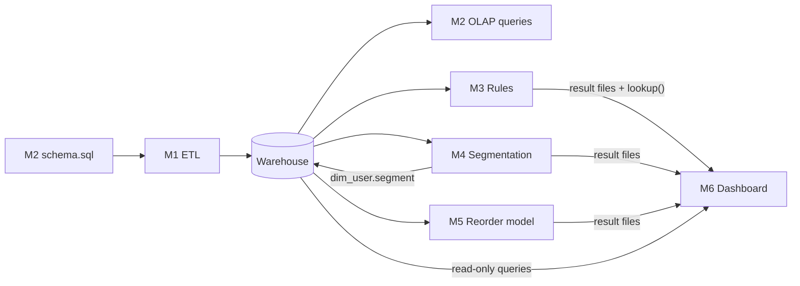

**How the parts were integrated.**

- The **schema** is the contract between M2 and M1: the ETL inserts by column name, so the names had to match the brief exactly.
- The **result-file contract** is the contract between M3–M5 and M6. The dashboard test `test_result_columns_match_the_shared_contract` fails if a mining script changes its output format.
- **Report sections** were written per module and joined by `build_report.py`, with a test that the committed report is up to date.

**Integration challenges recorded in the project:**

| Challenge | Resolution |
|---|---|
| Foreign keys fail with the ETL's load order (`fact_order_line` before `fact_order`) | Constraints left out; orphan checks in `validate.py` instead (schema notes) |
| `order_dow * 24` overflowed with `TINYINT` | Source types read as `INTEGER`; caught by the ETL tests |
| Apriori asked for 81.6 GiB on product baskets | `low_memory=True`, sampling, top-1,000 filter |
| DuckDB allows one writer; segmentation writes while the dashboard reads | Dashboard opens the warehouse read-only per query and closes it |
| Streamlit's `pages/` folder bypassed the custom navigation menu | Pages moved to `dashboard/views/` |
| The 0.23 GB warehouse cannot be committed for hosting | 4.3 MB demo extract with an equivalence test |

**Not documented:** the repository does not record team meetings, the communication channel used, or code reviews (Section 12.3, observation 3). They are therefore not described here **[To confirm]**.

## 12.8 Contribution Evidence and Limitations

- **Evidence used:** the role tables in `README.md`, `CONTRIBUTING.md` and `docs/PROJECT_BRIEF.md`; the per-member task briefs in the local `handoff/` folder; `docs/DEMO_FLOW.md`; GitHub commits, changed files, pull requests and merge records, and the repository's collaborator list (queried on 15 October 2026).
- **Supported by GitHub history:** for each module, the files and commits listed in Tables 12.2 and 12.3 are attributed to the account of the member who owns that role, and every PR was merged.
- **Based on documentation only:** the role allocation itself, the presentation assignments, and the result-file contract.
- **Uncertain:**
  - who actually wrote each module, because the commits were made in batches and most PRs were opened from one account (Section 12.3);
  - whether pull requests were reviewed;
  - who wrote the task briefs and the contract;
  - why @DIO4699 is not in the collaborator list;
  - work outside GitHub, including slide preparation and the preparation of this report.
- **Needed to finalise this chapter:** each member's confirmation (or correction) of their subsection in 12.4; the team's agreement on the percentages in 12.5; full names and roll numbers; a statement on reviews and on any tools used (see the Declaration placeholder).

## 12.9 Individual Presentation Responsibilities

The following assignments come from `docs/DEMO_FLOW.md` (a 10-minute demo). They are documented in the repository but must be confirmed as the final plan **[To confirm]**.

| Time | Part of the presentation | Presenter |
|---|---|---|
| 0:00 | Problem statement, data limitations, architecture (slides) | Rohit Gupta (M6) |
| 1:30 | Overview page: headline numbers, ETL flow, validation | Manish Sarkar (M1) |
| 3:00 | Star schema; live OLAP demo (roll-up, drill-down, slice, dice, pivot) | Kavya Agarwal (M2) |
| 5:00 | Basket Rules: rules, recommendations, Apriori vs FP-Growth | Kartik Biswal (M3) |
| 6:30 | Customer Segments: sizes, scatter plot, profiles, actions | Manish Dey (M4) |
| 8:00 | Reorder Model: metrics, feature importance, leakage control | Animesh Prakash (M5) |
| 9:00 | Key insights, limitations, questions (slides) | Rohit Gupta (M6) |

The demo flow mentions "five presenters" but assigns parts to all six members. The team should confirm the final split.

---

# 13. Advantages, Limitations and Challenges

## 13.1 Advantages of the implemented system

- **One validated source of truth.** All analyses read the same warehouse, which passes 23 integrity checks.
- **Scales on a laptop.** 33.8 million order lines are loaded and queried with an embedded database, with no server to install.
- **Fast analytical queries.** Hierarchy queries are single `ROLLUP`/`CUBE` statements that ran in under half a second on the full data (team measurements).
- **Evidence-based design choices.** Constraints, algorithm choice and the number of clusters were chosen by measurement on the real data.
- **Honest evaluation.** The reorder model is protected against leakage, is evaluated with metrics suited to imbalance, and has its threshold tuned on separate users.
- **Reproducible and tested.** Fixed seeds, scripted steps, committed results and 90 automated tests.
- **Usable by non-specialists.** Plain-English rules, named segments and a guided dashboard.

## 13.2 Practical value (potential, not demonstrated)

The results point to possible actions for a grocery retailer, such as co-locating or bundling "mission" products, staffing and stocking for Sunday and late-morning peaks, retention offers for the loyal segment, minimum-basket nudges for small-basket shoppers, and "buy it again" lists ranked by recency and frequency. These actions are suggestions drawn from historical patterns. None of them was tested in a store.

## 13.3 Technical challenges encountered

Data volume (32M-row file); the `TINYINT` overflow; the load-order conflict with foreign keys; the cost of a composite primary key; Apriori's memory demand; the DuckDB single-writer rule; Streamlit's page discovery; and hosting without the warehouse. Section 12.7 describes how each was resolved.

## 13.4 Data-related challenges

No prices; no calendar dates and a 30-day cap; an undocumented day-of-week coding; 75,000 orders with hidden contents; uncategorised products; and a long tail of rare products that cannot appear in rules.

## 13.5 Current limitations

- Revenue cannot be analysed; "basket size" is only a proxy for spending.
- Recency is the gap before the last order, not time since it.
- Rules cover the top 1,000 products only, with itemsets of at most 3 items, mined from a 15.7% sample.
- Segments overlap (silhouette ≈ 0.27).
- The reorder model is modest (precision ≈ 0.37), untuned, and evaluated on one split.
- The warehouse is a static snapshot, rebuilt in full; a rebuild erases the segments until the segmentation script is run again.
- The dashboard is single-user and has no authentication.

## 13.6 Limitations of the evaluation

No repeated runs or confidence intervals; benchmark on one machine; sample-based mining validated only for the top rule; no usability study; hosted deployment not verified for this report.

## 13.7 Dependencies and assumptions

- `order_dow = 0` is Sunday.
- The Kaggle data is available to each member (the rules must be accepted).
- Python 3.11+, and the library versions in `requirements.txt` (minimum versions, not pinned).
- Streamlit Community Cloud remains free and available for hosting.

---

# 14. Future Enhancements

All items below are **proposed work**, not existing functionality.

| # | Proposed improvement | Why it is useful | Limitation addressed | DMDW relationship |
|---|---|---|---|---|
| 1 | Integrate a price source (or a synthetic price table) and add revenue measures to the facts | Rank rules, segments and recommendations by money, not counts | No prices | New fact measures; true RFM "monetary" |
| 2 | Add a real date dimension (if a dated dataset is used) | Trends, seasonality, true recency | No calendar dates | Time hierarchy (day → week → month → year); time-series analysis |
| 3 | Mine longer itemsets and the long tail (e.g. product-level rules per department, or higher `max_len` with closed/maximal itemsets) | Cover niche products and bigger bundles | Top-1,000 filter; `max_len = 3` | Closed and maximal frequent itemsets |
| 4 | Sequential pattern mining across a user's orders | Learn what is bought *after* what | Rules are within one basket | Sequential patterns (e.g. GSP, PrefixSpan) |
| 5 | Repeat the benchmark (several runs, several libraries) and test the aisle-level explanation | Turn an untested explanation into a finding | Single-run benchmark | Algorithm performance analysis |
| 6 | Try other clustering methods (Gaussian mixtures, DBSCAN) and stability analysis | Softer or non-spherical segments; test robustness | Overlapping K-Means segments | Clustering evaluation |
| 7 | Cross-validated, tuned reorder model with order-time features (day, hour, gap of the predicted order) | More accurate, better-validated predictions | One split, no tuning | Classification, model selection |
| 8 | Incremental ETL and scheduled refresh; preserve `segment` across rebuilds | Keep the warehouse and segments current | Full rebuild; segments erased | ETL refresh strategies; slowly changing dimensions |
| 9 | Serve recommendations through an API and evaluate with an A/B test | Measure real business impact | No live evaluation | Deployment of mined knowledge |
| 10 | Usability and accessibility testing of the dashboard | Confirm the dashboard is usable by its intended users | No usability study | Analytical reporting |
| 11 | Add statistical tests and confidence intervals (e.g. bootstrap for rule metrics) | Quantify uncertainty from sampling | Descriptive results only | Statistical data mining |

---

# 15. Conclusion

StoreSense set out to show, on real grocery data, how a data warehouse and data mining work together. It turns the 3.4-million-order Instacart history into a validated DuckDB star schema with two fact tables and three dimensions. On that schema it answers "when and what do people buy?" with the five OLAP operations, "what is bought together?" with Apriori and FP-Growth at two levels of the product hierarchy (and a benchmark showing that the faster algorithm depends on the data), and "what kinds of customers are there?" with K-Means on RFM-style features adapted to data without prices or dates. As a stretch goal, it predicts reorders with a leakage-controlled classifier (ROC-AUC 0.829). A five-page Streamlit dashboard presents all results, and 90 automated tests and 23 validation checks passed on 15 October 2026.

The DMDW concepts genuinely applied are the KDD process, ETL and data quality validation, dimensional modelling with an atomic and an aggregate fact table and concept hierarchies, OLAP with `ROLLUP`, `CUBE` and `PIVOT`, frequent-pattern mining with support, confidence and lift, clustering with validation, and classification evaluated under class imbalance. The main limits are the missing prices and dates, the use of samples and filters in mining, modest cluster separation and predictive power, and single-run evaluations. The report states where each result depends on them.

The work was divided into six roles, each with its own module, tests and report section, and integrated through a shared schema, a result-file contract and the dashboard (Chapter 12). The contribution estimates in Chapter 12 are provisional and await the team's confirmation.

The main learning outcomes were that design choices at this scale should be measured rather than assumed (constraints, algorithms, k); that evaluation must be protected from leakage and judged with suitable metrics; and that results are only as credible as the limitations reported with them.

---

# References

*IEEE style. Items marked "(verify)" should be checked for exact details or current URL before submission.*

[1] R. Agrawal and R. Srikant, "Fast algorithms for mining association rules," in *Proc. 20th Int. Conf. Very Large Data Bases (VLDB)*, Santiago, Chile, 1994, pp. 487–499.

[2] J. Han, J. Pei, and Y. Yin, "Mining frequent patterns without candidate generation," in *Proc. ACM SIGMOD Int. Conf. Management of Data*, Dallas, TX, USA, 2000, pp. 1–12.

[3] R. Agrawal, T. Imieliński, and A. Swami, "Mining association rules between sets of items in large databases," in *Proc. ACM SIGMOD Int. Conf. Management of Data*, Washington, DC, USA, 1993, pp. 207–216.

[4] S. Brin, R. Motwani, J. D. Ullman, and S. Tsur, "Dynamic itemset counting and implication rules for market basket data," in *Proc. ACM SIGMOD Int. Conf. Management of Data*, Tucson, AZ, USA, 1997, pp. 255–264.

[5] J. MacQueen, "Some methods for classification and analysis of multivariate observations," in *Proc. 5th Berkeley Symp. Mathematical Statistics and Probability*, vol. 1, 1967, pp. 281–297.

[6] S. P. Lloyd, "Least squares quantization in PCM," *IEEE Trans. Inf. Theory*, vol. 28, no. 2, pp. 129–137, Mar. 1982.

[7] P. J. Rousseeuw, "Silhouettes: A graphical aid to the interpretation and validation of cluster analysis," *J. Comput. Appl. Math.*, vol. 20, pp. 53–65, 1987.

[8] D. Arthur and S. Vassilvitskii, "k-means++: The advantages of careful seeding," in *Proc. 18th Annu. ACM-SIAM Symp. Discrete Algorithms (SODA)*, 2007, pp. 1027–1035.

[9] J. R. Bult and T. Wansbeek, "Optimal selection for direct mail," *Marketing Science*, vol. 14, no. 4, pp. 378–394, 1995. (verify)

[10] G. Ke *et al.*, "LightGBM: A highly efficient gradient boosting decision tree," in *Advances in Neural Information Processing Systems 30 (NIPS 2017)*, 2017, pp. 3146–3154.

[11] F. Pedregosa *et al.*, "Scikit-learn: Machine learning in Python," *J. Mach. Learn. Res.*, vol. 12, pp. 2825–2830, 2011.

[12] S. Raschka, "MLxtend: Providing machine learning and data science utilities and extensions to Python's scientific computing stack," *J. Open Source Softw.*, vol. 3, no. 24, p. 638, 2018.

[13] M. Raasveldt and H. Mühleisen, "DuckDB: An embeddable analytical database," in *Proc. 2019 Int. Conf. Management of Data (SIGMOD '19)*, Amsterdam, Netherlands, 2019, pp. 1981–1984.

[14] R. Kimball and M. Ross, *The Data Warehouse Toolkit: The Definitive Guide to Dimensional Modeling*, 3rd ed. Indianapolis, IN, USA: Wiley, 2013.

[15] W. H. Inmon, *Building the Data Warehouse*, 4th ed. Indianapolis, IN, USA: Wiley, 2005.

[16] J. Gray *et al.*, "Data cube: A relational aggregation operator generalizing group-by, cross-tab, and sub-totals," *Data Mining and Knowledge Discovery*, vol. 1, no. 1, pp. 29–53, 1997.

[17] S. Chaudhuri and U. Dayal, "An overview of data warehousing and OLAP technology," *ACM SIGMOD Record*, vol. 26, no. 1, pp. 65–74, 1997.

[18] J. Han, M. Kamber, and J. Pei, *Data Mining: Concepts and Techniques*, 3rd ed. Waltham, MA, USA: Morgan Kaufmann, 2012.

[19] U. Fayyad, G. Piatetsky-Shapiro, and P. Smyth, "From data mining to knowledge discovery in databases," *AI Magazine*, vol. 17, no. 3, pp. 37–54, 1996.

[20] T. Fawcett, "An introduction to ROC analysis," *Pattern Recognit. Lett.*, vol. 27, no. 8, pp. 861–874, 2006.

[21] H. He and E. A. Garcia, "Learning from imbalanced data," *IEEE Trans. Knowl. Data Eng.*, vol. 21, no. 9, pp. 1263–1284, 2009.

[22] S. Kaufman, S. Rosset, C. Perlich, and O. Stitelman, "Leakage in data mining: Formulation, detection, and avoidance," *ACM Trans. Knowl. Discov. Data*, vol. 6, no. 4, Art. 15, 2012.

[23] Instacart, "Instacart Market Basket Analysis" (competition data: *The Instacart Online Grocery Shopping Dataset 2017*), Kaggle, 2017. [Online]. Available: https://www.kaggle.com/competitions/instacart-market-basket-analysis/data

[24] Streamlit, "Streamlit documentation." [Online]. Available: https://docs.streamlit.io (accessed Oct. 2026; verify)

[25] DuckDB Foundation, "DuckDB documentation: GROUPING SETS, ROLLUP and CUBE; PIVOT statement." [Online]. Available: https://duckdb.org/docs/ (accessed Oct. 2026; verify exact page URLs)

[26] W. McKinney, "Data structures for statistical computing in Python," in *Proc. 9th Python in Science Conf. (SciPy 2010)*, 2010, pp. 56–61.

[27] Plotly Technologies Inc., "Plotly Python graphing library." [Online]. Available: https://plotly.com/python/ (accessed Oct. 2026; verify)

[28] J. D. Hunter, "Matplotlib: A 2D graphics environment," *Computing in Science & Engineering*, vol. 9, no. 3, pp. 90–95, 2007.

[29] I. T. Jolliffe, *Principal Component Analysis*, 2nd ed. New York, NY, USA: Springer, 2002.

[30] R. L. Thorndike, "Who belongs in the family?," *Psychometrika*, vol. 18, no. 4, pp. 267–276, 1953.

[31] Streamlit, "Streamlit Community Cloud documentation." [Online]. Available: https://docs.streamlit.io/deploy/streamlit-community-cloud (accessed Oct. 2026; verify)

[32] S. Raschka, "mlxtend documentation: apriori, fpgrowth, association_rules." [Online]. Available: https://rasbt.github.io/mlxtend/ (accessed Oct. 2026; verify)

[33] Microsoft Corporation, "LightGBM documentation." [Online]. Available: https://lightgbm.readthedocs.io/ (accessed Oct. 2026; verify)

---

# Appendices

## Appendix A – Repository and reproduction

- **Repository:** https://github.com/maxlovesher/StoreSense (private; evaluators need to be invited or given a copy) **[To confirm access for evaluators]**
- **Hosted dashboard:** [App URL on Streamlit Community Cloud — to confirm]
- **Reproduction:**

```bash
git clone https://github.com/maxlovesher/StoreSense.git
cd StoreSense
python -m venv .venv
# Windows: .venv\Scripts\activate    macOS/Linux: source .venv/bin/activate
pip install -r requirements.txt
pip install -e .
# put the six Kaggle CSVs in data/raw/
python etl/load.py
python etl/validate.py
python mining/association_rules.py
python mining/benchmark.py
python mining/segmentation.py
python mining/reorder_model.py
streamlit run dashboard/app.py
pytest
```

## Appendix B – Warehouse schema (DDL, abridged from `sql/schema.sql`)

```sql
CREATE TABLE dim_time (
    time_key SMALLINT PRIMARY KEY, order_dow SMALLINT NOT NULL CHECK (order_dow BETWEEN 0 AND 6),
    day_name VARCHAR NOT NULL, is_weekend BOOLEAN NOT NULL,
    order_hour_of_day SMALLINT NOT NULL CHECK (order_hour_of_day BETWEEN 0 AND 23),
    hour_band VARCHAR NOT NULL);
CREATE TABLE dim_product (
    product_key INTEGER PRIMARY KEY, product_name VARCHAR NOT NULL,
    aisle_id INTEGER NOT NULL, aisle VARCHAR, department_id INTEGER NOT NULL, department VARCHAR);
CREATE TABLE dim_user (
    user_key INTEGER PRIMARY KEY, total_orders INTEGER NOT NULL, avg_basket_size DOUBLE,
    avg_days_between_orders DOUBLE, reorder_ratio DOUBLE, segment VARCHAR);
CREATE TABLE fact_order (
    order_id INTEGER PRIMARY KEY, user_key INTEGER NOT NULL, time_key SMALLINT NOT NULL,
    order_number INTEGER NOT NULL, days_since_prior INTEGER,
    basket_size INTEGER NOT NULL, reordered_items INTEGER NOT NULL);
CREATE TABLE fact_order_line (
    order_id INTEGER NOT NULL, product_key INTEGER NOT NULL, user_key INTEGER NOT NULL,
    time_key SMALLINT NOT NULL, add_to_cart_order SMALLINT NOT NULL, reordered TINYINT NOT NULL);
```

## Appendix C – OLAP query catalogue (`sql/olap_queries.sql`)

| Id | Operation | Question answered |
|---|---|---|
| Q1a | Roll-up (`ROLLUP (department, aisle)`) | Order lines per aisle, per department and in total |
| Q1b | Drill-down | Products within dairy eggs → yogurt, with aisle and department totals |
| Q2 | Slice (`is_weekend`) | Weekend order lines by department |
| Q3 | Dice (two departments × Evening) | Produce and dairy eggs per evening hour |
| Q4 | Pivot (`PIVOT … ON day_name`) | Department × day-of-week matrix |
| Q5 | `CUBE (department, hour_band)` | All combinations including per-band totals |
| Q6 | `CUBE (day_name, hour_band)` on `fact_order` | Average basket size by day and time of day |

## Appendix D – Result files (`reports/results/`)

| File | Rows | Written by | Columns |
|---|---|---|---|
| `rules_aisle.csv` | 5,000 | `association_rules.py` | antecedents, consequents, antecedent_support, consequent_support, support, confidence, lift, algorithm, interpretation |
| `rules_product.csv` | 3,410 | `association_rules.py` | same as above |
| `benchmark.csv` | 20 | `benchmark.py` | level, algorithm, min_support, n_transactions, n_itemsets, runtime_seconds, peak_memory_mb |
| `segment_profiles.csv` | 4 | `segmentation.py` | segment, users, share_of_users, avg_total_orders, avg_basket_size, avg_days_between_orders, avg_reorder_ratio, avg_recency_days, description |
| `segment_pca_sample.csv` | 10,000 | `segmentation.py` | user_key, pc1, pc2, segment |
| `reorder_metrics.csv` | 2 | `reorder_model.py` | model, precision, recall, f1, roc_auc, threshold, n_train_rows, n_test_rows |
| `reorder_feature_importance.csv` | 13 | `reorder_model.py` | model, feature, importance |

Figures in `reports/figures/`: `star_schema.png` (+ `.dbml`), `benchmark_runtime.png`, `benchmark_memory.png`, `segmentation_elbow.png`, `segmentation_silhouette.png`, `segmentation_clusters.png`, `reorder_roc.png`, `reorder_feature_importance.png`.

## Appendix E – Complete automated test list (90 tests, all passed on 15 Oct 2026)

| File | Tests | Count |
|---|---|---:|
| `test_common_db.py` | missing warehouse raises; write-then-read round trip; query parameters; raw CSV present/missing | 4 |
| `test_etl.py` | row counts; dim_time hierarchy; hour bands cover every hour; product hierarchy and quoted comma; fact_order values; first orders keep NULL; order lines carry user and time; dim_user aggregates; validation passes on a good warehouse; detects an orphan key; detects a wrong NULL; empty schema rejected; existing warehouse needs `--force`; missing raw file leaves warehouse untouched; real warehouse passes validation | 15 |
| `test_rules.py` | one-hot shape; itemsets match hand count (Apriori; FP-Growth); the two agree; `max_len` cap; support/confidence/lift; multi-item join with " + "; empty itemsets give empty rules; frequently bought together; real warehouse baskets | 10 |
| `test_segmentation.py` | recency = gap before last order; write-back in one statement; scaling mean 0 / sd 1; log reduces skew; K-Means recovers three groups; `choose_k` finds 3; ties choose smallest k; repeatable clustering; profiles, sizes and names match; PCA sample columns and size; real warehouse features | 11 |
| `test_reorder.py` | candidates are prior pairs only; labels from train order; times bought and user features; recency features; product features use all users' prior lines; no train-order leakage; one prior order gives zero average gap; split by user without overlap; evaluate matches hand count; best threshold maximises F1; models fit and importances sum to one; real data features | 12 |
| `test_dashboard.py` | KPIs ignore test orders; group by department and aisle; roll-up details/subtotals/total; three-level roll-up names; slice weekend; dice department and hour band; filter on a dimension outside the grouping; pivot day order and zeros; cube has every cell; cube keeps biggest values of a long axis; highlight mask for slice and dice; demo extract = warehouse; demo extract counts several lines per row; fallback to demo extract; committed demo extract matches the warehouse; values are parameters, not SQL; filter choices; missing result file names its command; every result file is in the repo; result columns match the contract; every page runs without error (×5); Overview shows the real numbers; OLAP page reacts to a filter; cube tab highlights a slice; rules page search; segments page names the four segments | 30 |
| `test_report.py` | sections in number order, unnumbered files left out; assembled report has contents and separators; image links rewritten; heading and anchor; image targets; real report has all eight sections; every chart used exists; committed report is up to date | 8 |
| **Total** | | **90** |

## Appendix F – Detailed GitHub evidence

All commits in `maxlovesher/StoreSense`, newest first (author as recorded in git; times in IST, +05:30).

| Commit | Date / time | Author identity | Message (abridged) | PR |
|---|---|---|---|---|
| `94f0309` | 15 Oct 01:28 | Kavya-025 (GitHub merge) | Merge PR #9 from feature/deploy | #9 |
| `95a67fa` | 15 Oct 01:28 | Kavya-025 (GitHub merge) | Merge PR #8 from feature/dashboard | #8 |
| `b61f423` | 15 Oct 01:25 | rohitguptanit7070-lab | Add the deploy guide; describe the demo extract in the report | #9 |
| `c588bd6` | 15 Oct 01:25 | rohitguptanit7070-lab | Test that the demo extract gives the same tables as the warehouse | #9 |
| `7bfe589` | 15 Oct 01:25 | rohitguptanit7070-lab | Make the dashboard run on Streamlit Community Cloud | #9 |
| `78d2004` | 15 Oct 01:25 | rohitguptanit7070-lab | Add a 4 MB demo extract | #9 |
| `871be48` | 15 Oct 01:14 | rohitguptanit7070-lab | Document the 3-D cube and the dashboard/views folder | #8 |
| `f9268d8` | 15 Oct 01:14 | rohitguptanit7070-lab | Add a rotatable 3-D cube tab; move pages to dashboard/views | #8 |
| `c000312` | 15 Oct 01:13 | rohitguptanit7070-lab | Add the 3-D cube query and slice/dice highlight to the data layer | #8 |
| `2492429` | 15 Oct 01:05 | Kavya-025 (GitHub merge) | Merge PR #7 from feature/dashboard | #7 |
| `cc997dd` | 15 Oct 01:02 | rohitguptanit7070-lab | README: report build step, demo flow | #7 |
| `1414ecd` | 15 Oct 01:02 | rohitguptanit7070-lab | Report introduction, dashboard and insights sections; assembled report; demo flow | #7 |
| `9ed6b7e` | 15 Oct 01:02 | rohitguptanit7070-lab | Dashboard tests | #7 |
| `9095d96` | 15 Oct 01:02 | rohitguptanit7070-lab | Add the dashboard pages | #7 |
| `3a3ee06` | 15 Oct 01:02 | rohitguptanit7070-lab | Add the dashboard data layer | #7 |
| `496f564` | 15 Oct 00:52 | Manish Sarkar (GitHub merge) | Merge PR #6 from feature/reorder-model | #6 |
| `9e011a1` | 15 Oct 00:43 | DIO4699 | Add the Reorder prediction report section | #6 |
| `7d06373` | 15 Oct 00:43 | DIO4699 | Add the reorder metrics, feature importance and charts | #6 |
| `8c89661` | 15 Oct 00:43 | DIO4699 | Add tests for label, features, leakage and user split | #6 |
| `9b5ef95` | 15 Oct 00:43 | DIO4699 | Add reorder prediction (Logistic Regression and LightGBM) | #6 |
| `a774308` | 15 Oct 00:36 | Kavya-025 (GitHub merge) | Merge PR #5 from feature/segmentation | #5 |
| `2d49686` | 15 Oct 00:09 | foresto-dreamer | Add the Customer segmentation report section | #5 |
| `bfde90a` | 15 Oct 00:09 | foresto-dreamer | Add the segment profiles, PCA sample and charts | #5 |
| `3f263ad` | 15 Oct 00:09 | foresto-dreamer | Add tests for segmentation | #5 |
| `ed29dad` | 15 Oct 00:09 | foresto-dreamer | Add customer segmentation (K-Means, write-back) | #5 |
| `cda8fb2` | 14 Oct 23:58 | Manish Sarkar (GitHub merge) | Merge PR #4 from feature/association-rules | #4 |
| `7c45399` | 14 Oct 23:51 | KB-0141 | Add the Association rules report section | #4 |
| `c8e6e5c` | 14 Oct 23:51 | KB-0141 | Add the Apriori vs FP-Growth benchmark and rule result files | #4 |
| `983b01b` | 14 Oct 23:51 | KB-0141 | Add hand-worked tests for support, confidence, lift and the lookup | #4 |
| `b037c57` | 14 Oct 23:51 | KB-0141 | Add association rule mining at aisle and product level | #4 |
| `2fa096f` | 14 Oct 23:21 | Kavya-025 (GitHub merge) | Merge PR #3 from feature/etl-results | #3 |
| `0f498ed` | 14 Oct 23:12 | Kavya-025 | Fill in the Data & ETL results from the full-data run | #3 |
| `381b4ce` | 14 Oct 23:08 | KB-0141 (GitHub merge) | Merge PR #2 from feature/warehouse | #2 |
| `13edff7` | 14 Oct 22:57 | Kavya-025 | Add the Warehouse & OLAP report section | #2 |
| `7ebc352` | 14 Oct 22:57 | Kavya-025 | Add the star schema diagram and its DBML source | #2 |
| `de1114d` | 14 Oct 22:57 | Kavya-025 | Add OLAP demo queries | #2 |
| `f0d86be` | 14 Oct 22:57 | Kavya-025 | Add the star schema: 2 fact and 3 dimension tables | #2 |
| `6d0ad53` | 14 Oct 18:47 | Kavya-025 (GitHub merge) | Merge PR #1 from feature/etl | #1 |
| `f59ec4d` | 11 Oct 14:17 | ocean (→ @maxlovesher) | Add EDA notebook and the Data & ETL report section | #1 |
| `4b96dd0` | 11 Oct 14:17 | ocean (→ @maxlovesher) | Implement the ETL: extract, transform, load, validate | #1 |
| `ff4f2ea` | 11 Oct 14:17 | ocean (→ @maxlovesher) | Add shared db helper, package config and team table | #1 |
| `5576bf6` | 3 Oct 13:41 | ocean (→ @maxlovesher) | Set up project skeleton (Phase 1) | (initial commit on `main`) |

**Pull requests** (all merged; none has a recorded review):

| PR | Title | Opened by | Merged by | Merged (UTC) |
|---|---|---|---|---|
| #1 | Data & ETL: extract, transform, load, validate, tests, EDA notebook | @maxlovesher | @Kavya-025 | 14 Oct 13:17 |
| #2 | Add star schema, OLAP queries, diagram and report section | @Kavya-025 | @KB-0141 | 14 Oct 17:38 |
| #3 | Data & ETL: fill in the results from the full-data run | @maxlovesher | @Kavya-025 | 14 Oct 17:51 |
| #4 | Association rules: Apriori vs FP-Growth at aisle and product level | @maxlovesher | @maxlovesher | 14 Oct 18:28 |
| #5 | Customer segmentation: K-Means on RFM-style features | @maxlovesher | @Kavya-025 | 14 Oct 19:06 |
| #6 | Reorder prediction: Logistic Regression and LightGBM | @maxlovesher | @maxlovesher | 14 Oct 19:22 |
| #7 | Dashboard and integration: Streamlit app, assembled report, demo flow | @maxlovesher | @Kavya-025 | 14 Oct 19:35 |
| #8 | OLAP Explorer: rotatable 3-D cube with slice and dice highlighting | @maxlovesher | @Kavya-025 | 14 Oct 19:58 |
| #9 | Deploy the dashboard on Streamlit Community Cloud (demo extract) | @maxlovesher | @Kavya-025 | 14 Oct 19:58 |

No credentials, keys or tokens are included in this report or in the files it quotes.
