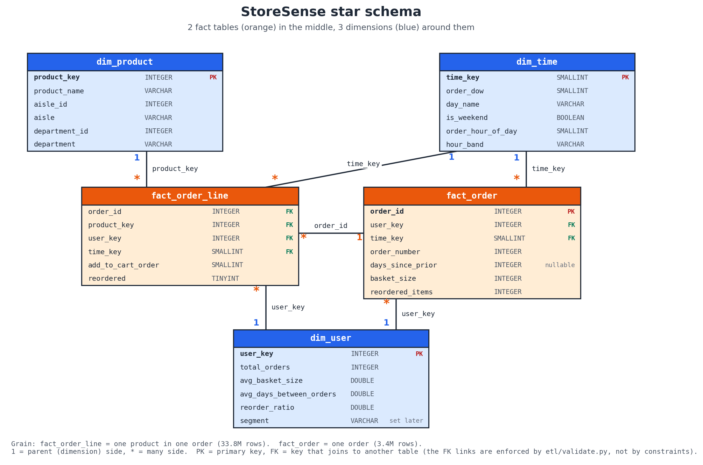

# 2. Warehouse and OLAP

*Author: Member 2 (Warehouse & OLAP). This is one section of the single project report; Member 6 assembles the final document.*

## 2.1 The star schema



The warehouse has **two fact tables** and **three dimension tables**. The tables are created by `sql/schema.sql`, and the ETL then fills them (section 1).

| Table | Kind | Grain (one row is...) | Rows |
|---|---|---|---|
| `fact_order_line` | fact | one product in one order | 33,819,106 |
| `fact_order` | fact | one order | 3,421,083 |
| `dim_product` | dimension | one product (with its aisle and department) | 49,688 |
| `dim_user` | dimension | one customer (with order-history aggregates) | 206,209 |
| `dim_time` | dimension | one day-of-week x hour slot | 168 |

`fact_order_line` is the main fact table. Its only measure is the row itself: with no prices in the data, a "sale" is one order line, so the basic measure is `COUNT(*)`. It carries `user_key` and `time_key` copied from its order, so a query reaches the user and time dimensions without joining `fact_order` first.

`fact_order` is an **aggregate fact table**. It holds one row per order, with the measures `basket_size` and `reordered_items` already counted. Order-level questions (average basket per day) then read 3.4M rows instead of 33.8M.

### Why a star schema, and not one big table?

A single flat table would repeat the product name, aisle and department on every one of the 33.8M order lines, and the day name and hour band on each of them too. A star schema stores each of those facts once in a small dimension table and keeps only integer keys in the large fact table. This gives three benefits:

- **Less space.** The fact table holds six small numbers per row. The whole warehouse file is about 0.23 GB.
- **One place to change a label.** Fixing a department name is a one-row update.
- **Simple, fast queries.** Every OLAP question has the same shape: join the fact table to the dimensions it needs, filter, and `GROUP BY` the dimension columns. Dimensions are small, so these joins are cheap.

### Column types

Keys and counts are integers, names and labels are `VARCHAR`, `is_weekend` is `BOOLEAN`, and averages and ratios are `DOUBLE`. `time_key` is a `SMALLINT` because it runs 0 to 167, and a `TINYINT` stops at 127. `days_since_prior` is the one nullable fact column (NULL on every user's first order), and `dim_user.segment` starts NULL until the segmentation step fills it.

### Keys and constraints

Each dimension has a primary key, and so does `fact_order` (`order_id`). `fact_order_line` has **no** primary key and there are **no** foreign keys. We tested both on the full data instead of guessing:

| Variant | Result on the full data |
|---|---|
| **Chosen:** primary keys on the dimensions and `fact_order`; nothing on `fact_order_line` | `fact_order_line` loads in 2.6 s; whole warehouse in 13.8 s; file 0.23 GB |
| Add `PRIMARY KEY (order_id, product_key)` to `fact_order_line` | that table loads in **56.1 s**; whole warehouse 61.8 s; file **1.81 GB** |
| Add `FOREIGN KEY` constraints to the fact tables | the load **fails after 2.4 s**: `Violates foreign key constraint because key "order_id: 2" does not exist in the referenced table` |

The foreign keys fail because of the ETL's load order. `fact_order_line` is loaded before `fact_order` (which counts its basket sizes from the loaded order lines) and before `dim_user`, so the order lines reference parents that do not exist yet. Instead of constraints, `etl/validate.py` checks every key for orphans after the load, and it passes all 23 checks on this schema.

## 2.2 Dimension hierarchies

A hierarchy is the ordered list of levels along which we roll up or drill down.

```
dim_product:   department (21)  ->  aisle (134)  ->  product (49,688)
dim_time:      hour_band (4)    ->  hour (24)     ->  (day x hour slot, 168)
```

- **Product hierarchy.** Instacart groups products into 21 departments, 134 aisles and 49,688 products, all stored in `dim_product`. Two departments are not real shelves: `missing` and `other` (115,482 order lines, 0.34% of all lines), which hold products without a proper category.
- **Time hierarchy.** The hour bands are Morning (05:00 to 11:59, 7 hours), Afternoon (12:00 to 16:59, 5 hours), Evening (17:00 to 20:59, 4 hours) and Night (21:00 to 04:59, 8 hours). `dim_time` also has the day of the week above the hour, which gives 7 x 24 = **168 rows**.
- **`time_key`** is `order_dow * 24 + order_hour_of_day`, a number from 0 (Sunday midnight) to 167 (Saturday 23:00). That is why `dim_time` has 168 rows: one for every possible day-and-hour slot of a week. The data has no calendar dates, so a week is the only time unit that exists.

## 2.3 OLAP operations

All queries are in `sql/olap_queries.sql`, each with a comment saying what it answers. "Sales" means order lines, as the data has no prices. On the full data each query ran in 0.4 s or less.

### Roll-up: department, then aisle, then grand total (Q1a)

```sql
SELECT CASE GROUPING(p.department, p.aisle)
           WHEN 0 THEN 'aisle' WHEN 1 THEN 'department total' ELSE 'grand total' END AS level,
       p.department, p.aisle, COUNT(*) AS order_lines
FROM fact_order_line l
JOIN dim_product p ON l.product_key = p.product_key
GROUP BY ROLLUP (p.department, p.aisle)
ORDER BY p.department NULLS LAST, p.aisle NULLS LAST;
```

`ROLLUP (department, aisle)` produces the detail rows, a subtotal for each department, and a grand total, all in one scan (156 rows). `GROUPING()` is 1 when a NULL is a subtotal marker rather than a real value. Results:

| Department | Order lines | Share of all lines |
|---|---|---|
| produce | 9,888,378 | 29.2% |
| dairy eggs | 5,631,067 | 16.7% |
| snacks | 3,006,412 | 8.9% |
| beverages | 2,804,175 | 8.3% |
| frozen | 2,336,858 | 6.9% |
| **grand total** | **33,819,106** | 100% |

Produce and dairy eggs alone make up **45.9%** of everything sold. The largest aisles are fresh fruits (3,792,661), fresh vegetables (3,568,630), packaged vegetables fruits (1,843,806) and yogurt (1,507,583). The grand total equals the number of rows in `fact_order_line`, which confirms that nothing was dropped.

### Drill-down: opening one aisle down to its products (Q1b)

Drill-down is the same hierarchy read in the other direction: start from a department total and add the next level beneath it. A three-level `ROLLUP (department, aisle, product_name)` over every product would return about 50,000 rows, so the query fixes `department = 'dairy eggs'` and `aisle = 'yogurt'` and shows the product level of just that aisle, with the aisle and department totals above it. The aisle total is 1,507,583 lines, and the best-selling product in it is *Total 2% with Strawberry Lowfat Greek Strained Yogurt* (30,866 lines). Changing the two names drills into any other aisle.

### Slice: weekend orders only (Q2)

```sql
SELECT p.department, COUNT(*) AS weekend_order_lines, ...
FROM fact_order_line l
JOIN dim_product p ON l.product_key = p.product_key
JOIN dim_time    t ON l.time_key    = t.time_key
WHERE t.is_weekend
GROUP BY p.department
ORDER BY weekend_order_lines DESC;
```

A slice fixes **one** dimension to **one** value (`dim_time.is_weekend = true`, meaning Sunday and Saturday). The weekend holds **11,241,275 lines, or 33.2%** of all sales, although it is only 2 of 7 days (28.6%). Within the weekend, produce is 30.8% of lines, against 28.5% on weekdays.

### Dice: Produce and Dairy Eggs in the evening (Q3)

```sql
WHERE p.department IN ('produce', 'dairy eggs')
  AND t.hour_band = 'Evening'
GROUP BY p.department, t.order_hour_of_day
```

A dice fixes **several** dimensions at once, here two departments (from `dim_product`) and one hour band (from `dim_time`). The result has 8 rows:

| Hour | produce | dairy eggs |
|---|---|---|
| 17 | 622,014 | 355,685 |
| 18 | 483,307 | 280,786 |
| 19 | 371,953 | 216,548 |
| 20 | 299,865 | 170,442 |

Both departments **fall by about 52% between 17:00 and 20:00** (produce -51.8%, dairy eggs -52.1%), and produce sells about 1.75 times as much as dairy eggs in every hour. The evening is 18.0% of produce and dairy sales, close to its 18.4% share of all sales.

### Pivot: department by day of week (Q4)

```sql
PIVOT (
    SELECT p.department, t.day_name, l.order_id
    FROM fact_order_line l
    JOIN dim_product p ON l.product_key = p.product_key
    JOIN dim_time    t ON l.time_key    = t.time_key
)
ON day_name IN ('Sunday', 'Monday', 'Tuesday', 'Wednesday', 'Thursday', 'Friday', 'Saturday')
USING COUNT(order_id)
GROUP BY department
ORDER BY department;
```

A pivot turns the day of week from rows into columns, giving a 21 x 7 matrix. The `IN` list fixes the column order to Sunday through Saturday (the default would be alphabetical). Totals per day over all departments:

| Sun | Mon | Tue | Wed | Thu | Fri | Sat |
|---|---|---|---|---|---|---|
| 6,533,692 | 5,871,834 | 4,378,360 | 3,998,498 | 3,942,696 | 4,386,443 | 4,707,583 |

Sunday is the busiest day and Thursday the quietest, a ratio of 1.66. The gap is larger for produce (2,057,869 on Sunday against 1,095,847 on Thursday, 1.88x). Alcohol is the clear exception: it peaks on **Friday** (28,465) and is lowest on Sunday (18,150).

### Bonus: `CUBE` and the order-level table (Q5 and Q6)

- **Q5** uses `CUBE (department, hour_band)`. `ROLLUP (a, b)` gives the groups (a, b), (a) and the grand total. `CUBE (a, b)` also gives (b) alone, which here is the total for each time of day across all departments: Afternoon 13,749,997, Morning 11,388,324, Evening 6,236,388 and Night 2,444,397. `ROLLUP` cannot produce those because it only follows one hierarchy from the left.
- **Q6** reads `fact_order` and applies `CUBE (day_name, hour_band)` to the average basket size. It filters `basket_size > 0`, because the 75,000 test orders have no products and would pull the average down. That leaves 3,346,083 real orders with an average basket of **10.11 items**. Sunday baskets are the largest (11.16) and Wednesday baskets the smallest (9.34).

## 2.4 What we learned

- **The shape of demand is very uneven.** Two of the 21 departments sell 45.9% of all order lines, and the weekend (2 days) sells 33.2%.
- **Time of day matters.** The busiest hours are 10:00 (2,874,905 lines), 11:00 and 14:00. Evening sales drop by about half between 17:00 and 20:00 in both produce and dairy.
- **Constraints are a real design cost, not a default.** A primary key on the 33.8M-row table made its load about 21 times slower (2.6 s to 56.1 s) and the file about 8 times larger (0.23 GB to 1.81 GB). Foreign keys could not be used at all with this load order. Validation queries give the same safety at no load cost.
- **`ROLLUP` against `CUBE`.** `ROLLUP` gives subtotals along one hierarchy and is the right tool for department, aisle, product. `CUBE` gives every combination and suits two independent dimensions, such as department and time of day.
- **A star schema keeps the queries short.** Every OLAP query is one fact join to one or two small dimensions, and all of them ran in under half a second on 33.8M rows.

## 2.5 Limitations

- **No prices.** "Sales" counts order lines, so a cheap item and an expensive item weigh the same. Rankings by revenue could differ from the ones above.
- **No calendar dates.** The only time information is day of week and hour, so there is no month, season or trend analysis.
- **Day-of-week coding is an assumption.** We treat 0 as Sunday, as the dataset does not say. If 0 were another day, the day names in Q2 and Q4 would shift (the weekend slice in particular), but the numeric patterns would not change.
- **Test orders.** 75,000 orders have no products. They appear in `fact_order` (`basket_size = 0`) but not in `fact_order_line`, so order-level statistics must filter `basket_size > 0`.
- **Not every product is categorised.** The `missing` and `other` departments hold 0.34% of order lines.

## 2.6 How to reproduce

```bash
python etl/load.py --force      # builds the warehouse from sql/schema.sql (about 14 s)
python etl/validate.py          # 23/23 checks passed
```

Then run any query from `sql/olap_queries.sql`, for example from Python:

```python
from common.db import query_df
print(query_df(open("sql/olap_queries.sql").read().split(";")[3]))   # the dice query, Q3
```
