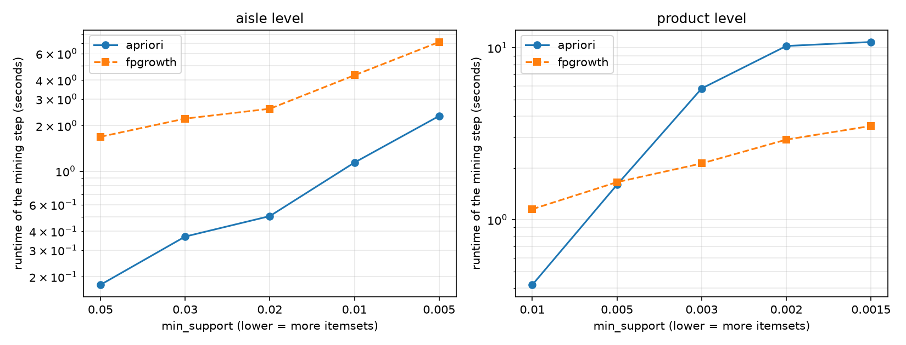
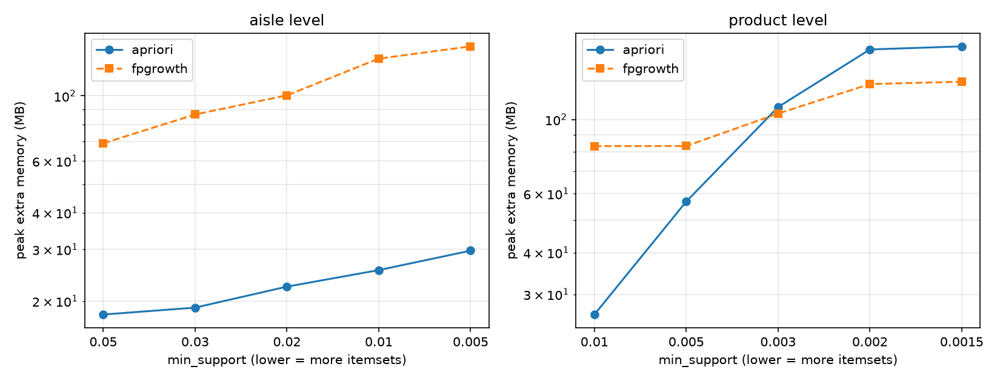

# 3. Association rules

*Author: Member 3 (Association Rules). This is one section of the single project report; Member 6 assembles the final document.*

## 3.1 Method

We look for items that are bought together. An **order is a basket** and each **aisle or product is an item**. Baskets are read from `fact_order_line` and joined to `dim_product`. Only orders with **2 or more items** are used, because a single item cannot form a rule (3,182,490 orders qualify).

Three measures describe a rule `A -> B`:

| Measure | Meaning | Formula |
|---|---|---|
| **Support** | the share of baskets that contain A and B | `count(A and B) / baskets` |
| **Confidence** | of the baskets with A, the share that also have B | `support(A and B) / support(A)` |
| **Lift** | how much more often B is bought with A than by chance | `confidence / support(B)` |

A lift of 1 means A and B are independent (A tells us nothing about B). A lift of 3 means B is three times as likely in baskets with A as in a typical basket. We keep only rules with **lift > 1**.

We mine the frequent itemsets with both **Apriori** and **FP-Growth** (`mlxtend`), then build rules from them. Both algorithms must find exactly the same itemsets for the same `min_support`; `mining/association_rules.py` stops with an error if they do not, and a test checks this on a hand-worked example. Because they agree, the rule files hold the rules once, labelled `fpgrowth`.

### The two levels and the exact filters

| | Aisle level | Product level |
|---|---|---|
| Items | 132 aisles (the `missing` and `other` aisles removed) | the **1,000 most popular products** (by order lines, whole warehouse) |
| Orders | random sample of **500,000** orders (seed 42) out of the 3,182,490 | the same 500,000 orders |
| Baskets used | **492,350** (orders with 2+ distinct aisles) | **418,175** (orders with 2+ of the top 1,000 products) |
| `min_support` | **0.01** (at least 4,924 baskets) | **0.0015** (at least 627 baskets) |
| Largest itemset | 3 items | 3 items |
| Frequent itemsets | 2,344 (96 single aisles, 894 pairs, 1,354 triples) | 2,527 |
| Rules with lift > 1 | 9,730; the **top 5,000 by lift** are kept (lift 1.42 and above) | 3,410 (all kept) |

`min_support` is different for each level because the items are different. Aisles are common (a few percent of baskets each), so 0.01 is a sensible floor. A single product is rare: the 1,000th most popular has 5,677 order lines in 3.18M orders, so a floor of 0.0015 is already low for products.

The 1,000 products make up **53.9%** of all order lines, so the product rules describe the popular half of the shop, and a product outside the top 1,000 cannot appear in any rule.

### Memory

One row per order and one column per item would be a large table, so the baskets are stored as a **sparse** table (only the True cells are stored). With its default settings, Apriori still failed on the product baskets: mlxtend built a table of baskets x candidate itemsets and asked for **81.6 GiB** of memory. So `mine_itemsets()` runs Apriori with `low_memory=True`, which counts one candidate at a time. FP-Growth needs no such setting. The 500,000-order sample and the top-1,000 filter are the other memory controls; the whole script runs in about 2 minutes.

### Checking a rule by hand

The top product rule is *Icelandic Style Skyr Blueberry Non-fat Yogurt -> Non Fat Acai & Mixed Berries Yogurt*. We counted it with SQL on the **whole warehouse** (not the sample), using the same top-1,000 filter. Of 2,663,388 baskets, 19,850 contain the Blueberry skyr, 9,004 contain the Acai yogurt, and **4,094 contain both**.

| | In the 500,000-order sample (the rule file) | On the whole warehouse (SQL) |
|---|---|---|
| Confidence | 22.1% | 20.6% |
| Lift | 63.1 | 61.0 |

The sample gives almost the same answer as the full data, within about 7%.

## 3.2 Top rules and what a store could do with them

All rule files are in `reports/results/`, each with a plain-English `interpretation` column.

### Aisle level

| Rule | Support | Confidence | Lift |
|---|---|---|---|
| pasta sauce -> dry pasta + packaged cheese | 1.03% | 15.6% | 4.80 |
| dry pasta -> pasta sauce | 2.08% | 27.6% | 4.17 |
| canned jarred vegetables -> canned meals beans | 1.94% | 24.8% | 3.36 |
| frozen meals -> frozen pizza | 1.07% | 13.6% | 2.95 |
| frozen appetizers sides -> frozen meals | 1.14% | 20.3% | 2.58 |
| fresh herbs -> fresh vegetables | 8.44% | 84.7% | 1.80 |

- **Pasta dinner.** Dry pasta, pasta sauce and packaged cheese form the strongest group. A store could place them close together, or sell a "pasta night" bundle. When a customer has dry pasta in the cart, a pasta sauce suggestion is a good one (27.6% already buy it).
- **Pantry cooking.** Canned vegetables go with canned meals and beans, spices and soup. These are good aisles for a joint promotion.
- **Frozen aisles.** Frozen meals, frozen pizza and frozen appetizers are bought together, which suggests one "easy dinner" mission across the freezer.
- **High confidence is not high lift.** 84.7% of baskets with fresh herbs also contain fresh vegetables, but fresh vegetables are in about 47% of all baskets anyway, so the lift is only 1.8. The lift is the better guide to a *special* link. The confidence mostly reflects that fresh vegetables are popular.

### Product level

| Rule | Support | Confidence | Lift |
|---|---|---|---|
| Icelandic Style Skyr Blueberry Non-fat Yogurt -> Non Fat Acai & Mixed Berries Yogurt | 0.16% | 22.1% | 63.1 |
| Icelandic Style Skyr Blueberry Non-fat Yogurt -> Non Fat Raspberry Yogurt | 0.27% | 36.6% | 58.0 |
| Zero Calorie Cola -> Soda | 0.16% | 53.4% | 46.9 |
| Organic Yellow Squash -> Organic Zucchini | 0.20% | 47.8% | 11.8 |
| Bartlett Pears -> Banana | 0.54% | 39.0% | 2.17 |

- **The strongest product links are flavours of one line.** Customers who buy one skyr yogurt buy other flavours too, which looks like stocking up on variety. A store could sell a mixed-flavour multipack, and when one flavour is out of stock, recommend the other flavours.
- **Drinks.** Over half of the baskets with Zero Calorie Cola also have Soda. This could be a cross-promotion, or customers buying two kinds of soda for different people. The data cannot tell us which.
- **Fresh produce.** Squash and zucchini, which are similar vegetables, are bought together (47.8%). A produce display could put them side by side.
- **The dashboard lookup.** `frequently_bought_together("Banana")` reads `rules_product.csv` and returns the products most often bought with it. The dashboard uses this for a "customers also bought" box.

Rules show **association, not cause**: they say that two items appear in the same baskets, not that buying one makes a customer buy the other.

## 3.3 Benchmark: Apriori against FP-Growth

`mining/benchmark.py` times only the mining step, on a **100,000-order sample** (98,508 aisle baskets and 83,658 product baskets), with itemsets capped at 3 items. For each `min_support`, runtime and memory are measured in **separate runs**, because the memory tracer (`tracemalloc`) slows Python down and would distort the times. Memory is the **peak extra memory** used while mining. Each setting was run once. Apriori used `low_memory=True`, as in section 3.1.

| Level | `min_support` | Itemsets | Apriori time | FP-Growth time | Apriori memory | FP-Growth memory |
|---|---|---|---|---|---|---|
| aisle | 0.05 | 170 | 0.18 s | 1.69 s | 18 MB | 69 MB |
| aisle | 0.01 | 2,329 | 1.14 s | 4.31 s | 26 MB | 134 MB |
| aisle | 0.005 | 6,142 | 2.32 s | 7.15 s | 30 MB | 147 MB |
| product | 0.01 | 159 | 0.42 s | 1.15 s | 26 MB | 83 MB |
| product | 0.003 | 1,078 | 5.80 s | 2.12 s | 109 MB | 104 MB |
| product | 0.0015 | 2,516 | 10.80 s | 3.51 s | 165 MB | 130 MB |

(The full table, with five `min_support` values per level, is `reports/results/benchmark.csv`.)





What the benchmark shows:

- **At product level, FP-Growth is faster once `min_support` is low.** The two are level at `min_support` 0.005 (about 1.6 s each). At 0.0015 FP-Growth takes 3.5 s and Apriori 10.8 s, a ratio of about 3. Apriori's time grows quickly with the number of itemsets, while FP-Growth's grows slowly. Apriori has to test every candidate pair and triple against the baskets again; FP-Growth reads the baskets into a compact tree once and finds the itemsets from the tree without more passes over the data. From 0.003 downwards FP-Growth also uses less memory (130 MB against 165 MB at 0.0015).
- **At aisle level, Apriori was faster and used less memory at every `min_support` we tried.** FP-Growth was about 3 to 9 times slower here, and used about 4 to 5 times as much memory. This is the opposite of the textbook result. Our explanation (we did not test it) is that there are only 132 aisle items and we cap itemsets at 3, so Apriori has few candidates to check, while the `mlxtend` FP-Growth builds its tree in Python and pays a fixed cost for it however few itemsets there are. The cost shows even at the highest `min_support`.
- **Lower `min_support` costs more for both**, as expected: the number of itemsets grows, and so does the time. Apriori's growth is the steeper one at product level.
- **Both found the same itemsets** at every setting (the script stops if they differ).

So the usual advice "FP-Growth is faster" is true for **many items and low support** (the product level), not for **few items**. The right choice depends on the data, and the benchmark is how to find out.

## 3.4 Limitations

- **Sampling.** The rules come from 500,000 of 3.18M orders (15.7%), and the benchmark from 100,000. The check in section 3.1 shows the sample is close to the full data for the top rule, but a rare rule can differ more. We did not repeat the check for every rule.
- **Only the top 1,000 products.** They cover 53.9% of order lines. Rules for the long tail of rare products are missing, and a niche product cannot get a recommendation.
- **Short itemsets and a cap on rules.** Itemsets stop at 3 items. At aisle level we keep the top 5,000 of 9,730 rules by lift, so the aisle file leaves out the weakest lift > 1 rules (lift below 1.42). Many aisle rules are the same group of aisles read in different directions, so the number of rules overstates the number of ideas.
- **No prices.** Every item counts the same. A strong link between two cheap items may matter less to revenue than a weaker link between expensive ones. With prices we would rank rules by the money they bring, not by lift.
- **One basket is one order.** The data does not show who bought for whom, and repeat purchases are included: customers who reorder the same items every week make those items look strongly linked.
- **Association is not cause**, and a high lift on a rare pair (support 0.16%) rests on a few hundred baskets.
- **Benchmark scope.** One run per setting, on one laptop, with `mlxtend`'s implementations, `max_len = 3`, and Apriori in its low-memory mode. A different library or settings could change which algorithm wins at aisle level.

## 3.5 How to reproduce

```bash
python mining/association_rules.py   # writes rules_aisle.csv and rules_product.csv (about 2 minutes)
python mining/benchmark.py           # writes benchmark.csv and the two charts (about 4 minutes)
pytest tests/test_rules.py           # hand-worked 5-basket example
```

```python
from mining.association_rules import frequently_bought_together
print(frequently_bought_together("Banana", top_n=5))
```
