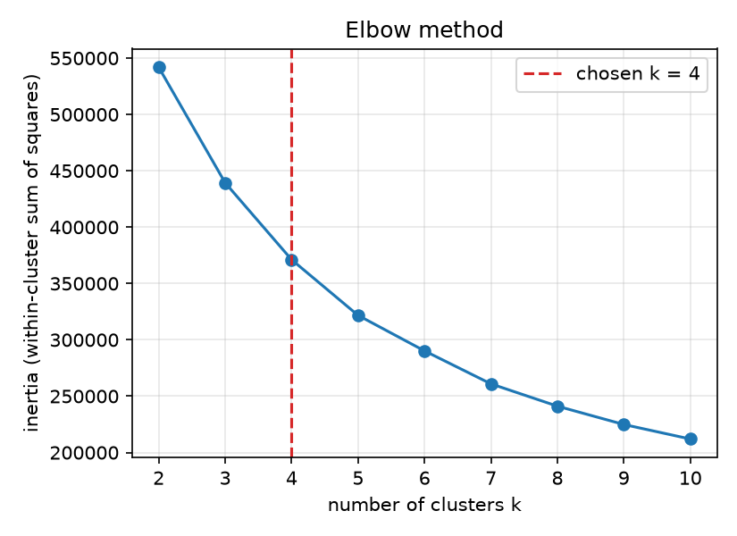
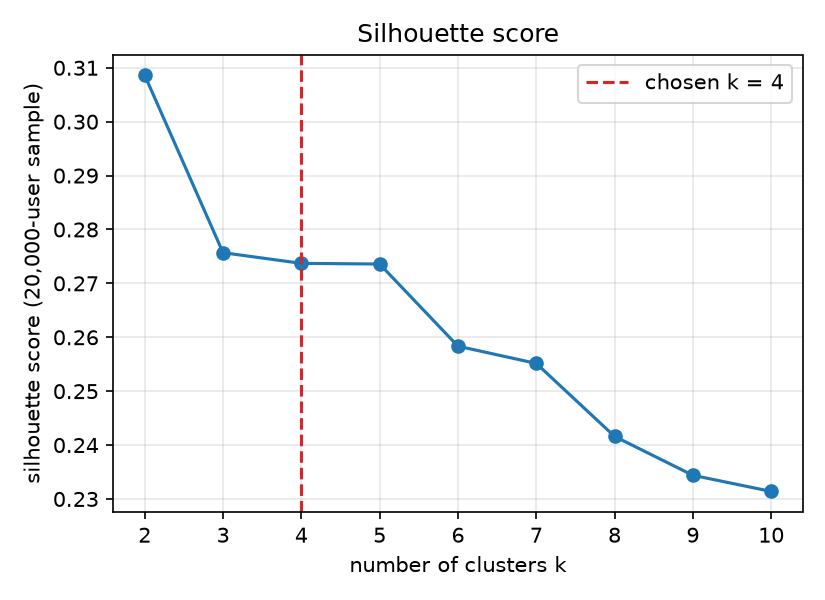
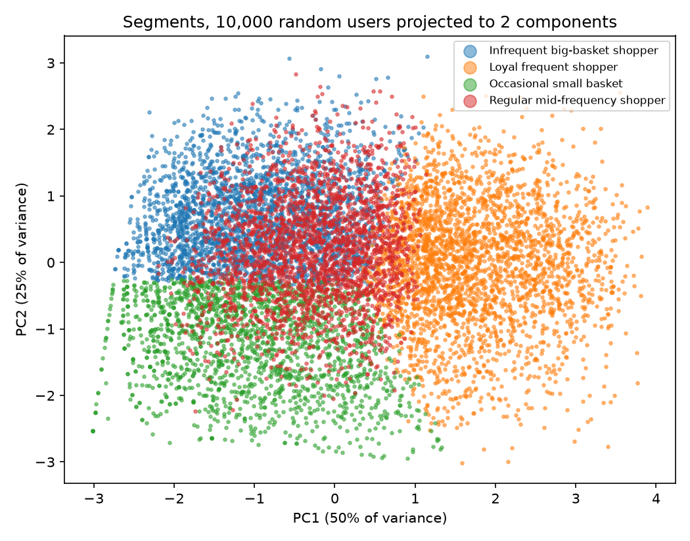

# 4. Customer segmentation

*Author: Member 4 (Customer Segmentation). This is one section of the single project report; Member 6 assembles the final document.*

## 4.1 Features

We group the **206,209 users** with K-Means on four features taken from the warehouse. They follow the classic RFM idea (recency, frequency, monetary value), adapted to a dataset with no prices and no dates, plus the reorder ratio.

| Feature | Source | Stands for |
|---|---|---|
| `recency_days` | `fact_order.days_since_prior` of the user's **last** order (highest `order_number`) | Recency |
| `total_orders` | `dim_user.total_orders` | Frequency |
| `avg_basket_size` | `dim_user.avg_basket_size` | Monetary value (a proxy: there are no prices) |
| `reorder_ratio` | `dim_user.reorder_ratio` | Loyalty to the same products |

**The recency caveat.** The data has no calendar dates, so we cannot say how long ago a user last ordered. `days_since_prior` on the last order is the gap *before* that order, so it measures how long the user waited between their last two orders. It is the best proxy available, but a user with a short last gap may still have left a long time ago. 30.6% of users have the value 30, which is the cap in the data ("30 days or more"). 75,000 users have a test order as their last order. It has no items, but it does have a valid gap, so recency still works for them; we never use its `basket_size`.

`avg_days_between_orders` is also in `dim_user`. It is *not* a clustering feature (it overlaps with recency and frequency); it is only shown in the profile table.

## 4.2 Scaling

K-Means uses distances, so a feature measured in large numbers would dominate one measured in small numbers (orders run to 100, the reorder ratio only from 0 to 1). We therefore **standardise** every feature to mean 0 and standard deviation 1.

Before that we looked at each feature's shape:

| Feature | Mean | Median | Skew | Skew after `log(1 + x)` |
|---|---|---|---|---|
| `recency_days` | 17.1 | 15 | 0.04 | |
| `total_orders` | 16.6 | 10 | **2.40** | 0.65 |
| `avg_basket_size` | 10.0 | 9 | **1.22** | -0.33 |
| `reorder_ratio` | 0.44 | 0.44 | 0.02 | |

`total_orders` and `avg_basket_size` have long right tails: a few users have 100 orders or 60-item baskets. Without a transform those few users would stretch the scale and squeeze everyone else together. We apply **`log(1 + x)` to these two features** and leave recency and the reorder ratio alone (they are already symmetric).

## 4.3 Choosing k

We ran K-Means (`n_init = 10`, `random_state = 42`) for k = 2 to 10 on all users. The silhouette score compares every pair of points, so it is computed on a **fixed random sample of 20,000 users**.

| k | 2 | 3 | 4 | 5 | 6 | 7 | 8 | 9 | 10 |
|---|---|---|---|---|---|---|---|---|---|
| Inertia (thousands) | 542 | 439 | 371 | 322 | 290 | 261 | 241 | 225 | 212 |
| Silhouette | **0.309** | 0.276 | 0.274 | 0.274 | 0.258 | 0.255 | 0.242 | 0.234 | 0.231 |





- **The elbow is not sharp.** The inertia falls steadily, with no clear bend. The drops get smaller after k = 5.
- **k = 2 has the best silhouette** (0.309), but it only splits frequent from infrequent users, which is too coarse to act on, so we only consider k = 4 or more.
- **k = 3, 4 and 5 are about equal** (0.276, 0.274, 0.274). Differences of 0.002 are inside the noise of a 20,000-user sample, so the silhouette cannot rank them. At k = 3 the small-basket shoppers are absorbed into other groups: none of the three segments has a small basket.
- **We chose k = 4**, the smallest k among the ties. It has fewer segments than k = 5 for the same silhouette score, and each of the four can be described in one sentence (section 4.4). At k = 5 two of the clusters had similar averages and were harder to tell apart.

The rule is in `choose_k()`: among k = 4 to 8, take the best silhouette rounded to 3 decimals, and the smallest k if several tie.

## 4.4 The four segments

Names were written *after* looking at the averages, and `name_segment()` gives each name by a rule on those averages. All figures are the mean per segment (`reports/results/segment_profiles.csv`).

| Segment | Users | Share | Orders | Items per basket | Days between orders | Reorder ratio | Last gap (days) |
|---|---|---|---|---|---|---|---|
| **Loyal frequent shopper** | 60,586 | 29.4% | 35.1 | 10.7 | 9.7 | 66% | 9.4 |
| **Infrequent big-basket shopper** | 57,005 | 27.6% | 8.9 | 12.8 | 20.3 | 36% | 28.1 |
| **Regular mid-frequency shopper** | 51,657 | 25.1% | 8.7 | 10.5 | 13.9 | 33% | 8.4 |
| **Occasional small basket** | 36,961 | 17.9% | 9.1 | 3.8 | 19.6 | 38% | 24.7 |
| All users | 206,209 | 100% | 16.6 | 10.0 | 15.5 | 44% | 17.1 |



The first two PCA components keep 50% and 25% of the variance. The picture shows that frequent users (orange) are well apart from the rest, and that the small-basket group (green) sits at the bottom, but the two middle groups overlap heavily (see the limitations).

**The loyal frequent shoppers are 29% of users, but they place about 62% of all orders and buy about 65% of all items.** The other three segments are about equal in order count (9 each); they differ in rhythm and basket size.

### What a store would do for each

- **Loyal frequent shopper.** The most valuable group: an order every 10 days, and two thirds of each basket is repeat items. Protect them: a "buy it again" list, a subscription or standing order, a loyalty reward, and no stock-outs on their usual items. The cost of losing one of them is high.
- **Infrequent big-basket shopper.** They shop about every 20 days but buy the most per visit (12.8 items), and their last gap was long (28 days). They are a bigger basket waiting to be won back: a reminder or offer around the 3-week mark, free delivery above a basket value, and bulk or multipack deals suit them.
- **Regular mid-frequency shopper.** Active recently (last gap 8 days), ordering about every two weeks with a typical basket, but only a third of their items are repeats, so they still explore. Cross-sell with recommendations (the association rules in section 3) and make them more regular, for example by suggesting a weekly list.
- **Occasional small basket.** They order every 20 days and buy only 3.8 items, 38% of the average basket. They are 17.9% of users but buy only about 3.6% of all items. Use low-cost actions: a minimum-order incentive or a suggestion to add one more item to the cart. A small basket may also mean a top-up from a different store.

## 4.5 Writing the result back

`python mining/segmentation.py` prints the chosen k, the silhouette score and the profile table, and then writes the segment name into **`dim_user.segment`** with one set-based `UPDATE ... FROM` over a registered table, instead of 206,209 single updates. After the run, `dim_user` has **206,209 users with a segment and 0 NULL**, and the four segment sizes add up to 206,209.

It also writes `segment_profiles.csv`, `segment_pca_sample.csv` (a random sample of 10,000 users with their two PCA coordinates, for the dashboard scatter plot), and the three charts above. `python etl/load.py --force` erases `segment`, so after any rebuild of the warehouse, run the script again.

## 4.6 Limitations

- **The segments overlap.** The silhouette score is 0.27, which means weak to moderate structure. Shoppers are a continuum, and K-Means cuts it into pieces; a user near the border of two segments could easily belong to the other. The picture of the first two components shows this.
- **K-Means assumes round clusters of similar size.** It uses straight-line distance to a centre, so it cannot find long, curved or very different-sized groups, and it is sensitive to the choice of k and to the starting centres (we fix the seed and use `n_init = 10`).
- **No prices.** Basket size counts items, so a basket of three expensive items looks smaller than a basket of ten cheap ones. The "monetary" feature is a proxy, and a segment called "big basket" may not be the biggest spender.
- **No calendar dates.** Recency is the gap before the last order, not the time since it (section 4.1), and 30.6% of users sit at the cap of 30 days. We cannot tell which users have left.
- **Users with few orders.** Every user has at least 4 orders, so we cannot segment new customers, and the averages of someone with 4 orders are noisy.
- **A snapshot.** The segments describe each user's whole history in one label. A shopper who changes habits keeps the old segment until the script is run again.
- **Silhouette on a sample.** The scores use 20,000 of the 206,209 users. Differences of 0.002 between k values are not meaningful.

## 4.7 How to reproduce

```bash
python mining/segmentation.py       # about 1 minute; close the dashboard and notebooks first (DuckDB allows one writer)
pytest tests/test_segmentation.py   # made-up users in 3 clear groups
```

```sql
SELECT segment, COUNT(*) AS users FROM dim_user GROUP BY segment ORDER BY users DESC;
```
