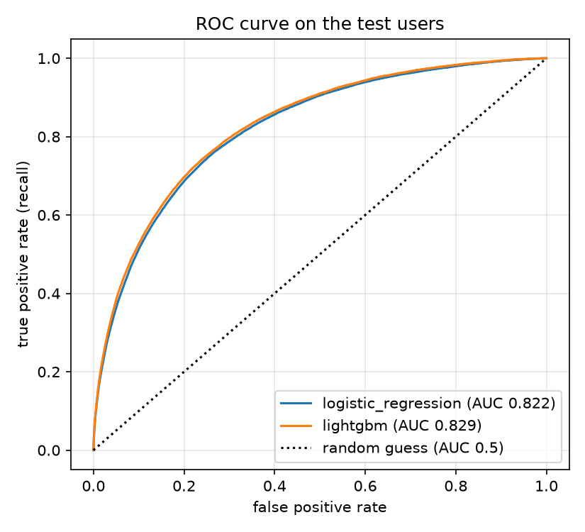
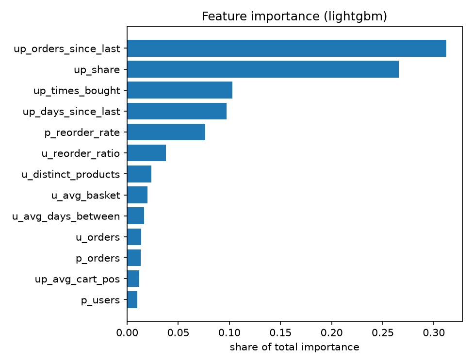

# 5. Reorder prediction

*Author: Member 5 (Reorder Prediction & Evaluation), a stretch goal. This is one section of the single project report; Member 6 assembles the final document.*

## 5.1 The problem, the label and the features

**Question:** for a product a user has bought before, will they buy it again in their latest order?

- **Label.** Each user with a "train" order has a list of products they bought in their *prior* orders. For every user x product pair on that list, the label is **1 if the product is in the user's train order, and 0 if not**. The train order is the answer; it is used for the label and for nothing else.
- **Who can be used.** Only the 131,209 users with a train order have a label. The other 75,000 users' last order is a test order with no products.
- **Scale.** On the full data there are about 8.5 million such pairs, and about 9.8% are positive. We use a **random sample of 30,000 users** (fixed seed 42): **1,951,532 pairs, 9.7% positive**.

Every feature is built from **prior orders only**, in DuckDB SQL (`FEATURE_SQL` in `mining/reorder_model.py`), and only the finished table is brought into pandas.

| Group | Feature | Meaning |
|---|---|---|
| User | `u_orders` | number of prior orders |
| | `u_avg_basket` | average items per prior order |
| | `u_reorder_ratio` | share of the user's prior order lines that were reorders |
| | `u_avg_days_between` | average gap between the user's prior orders (days) |
| | `u_distinct_products` | different products the user has bought |
| Product | `p_orders` | popularity: prior order lines of the product, over all users |
| | `p_reorder_rate` | share of those lines that were reorders |
| | `p_users` | different users who bought it before |
| User x product | `up_times_bought` | how many prior orders contain the product |
| | `up_share` | `up_times_bought / u_orders` |
| | `up_orders_since_last` | orders since the user last bought it (0 = in the last prior order) |
| | `up_days_since_last` | days since the user last bought it (sum of the gaps after that order) |
| | `up_avg_cart_pos` | average position in the cart (early items are the habits) |

## 5.2 Avoiding leakage

**Data leakage** is when information from the answer slips into the inputs, so a model looks excellent in testing and fails in real use. Here the danger is the train order: if any feature used it, even indirectly (a product's "reorder rate" that counts the train order, or a user's "average basket" that includes it), the model would partly be reading the answer.

How we prevented it:

1. **The warehouse does not store which order is prior or train**, so `eval_set` is read from the raw `orders.csv` (through `etl.extract.register_raw_views`) into a small `order_eval` table.
2. **Every feature query filters on `eval_set = 'prior'`.** This includes the product features (`p_orders`, `p_reorder_rate`, `p_users`), which are calculated over *all users' prior orders only*.
3. **The train order appears in exactly one place:** the `train_labels` part of the query, which supplies the label after all the features are built. The candidate pairs also come only from prior orders, so a product that was bought for the first time in the train order is not a row.
4. **The train-order columns that are not a product list** (its day of week, hour, and gap since the previous order) are also left out, even though they would be known at order time, so that "prior orders only" is strictly true.
5. **A test checks it.** In `tests/test_reorder.py` the train orders are replaced with completely different baskets, with different `reordered` flags: the candidate pairs and every feature stay exactly the same, and only the labels change.

As a sanity check, the best ROC-AUC we found is 0.83. A value above about 0.95 would have been a warning sign of leakage.

## 5.3 Splitting and imbalance

**The split is by user, not by row.** Rows of the same user are alike (the same habits), so a row-level split would put almost-copies of a user in both training and test and flatter the score. We split the 30,000 users into **60% train (18,000 users), 20% validation (6,000) and 20% test (6,000)**, and a test checks that no user is in two sets.

| Set | Users | Rows | Positive |
|---|---|---|---|
| Train | 18,000 | 1,161,258 | 9.79% |
| Validation | 6,000 | 401,666 | 9.62% |
| Test | 6,000 | 388,608 | 9.69% |

**Why not accuracy.** Only about 1 pair in 10 is positive. A model that always answers "no" has an accuracy of **90.3%** on the test users and finds no reorder at all. Our models have *lower* accuracy (86.7% and 86.9%) while being far more useful, so accuracy would point to the wrong model. We use:

- **Precision:** of the products we predict will be reordered, the share that really are.
- **Recall:** of the products that really are reordered, the share we find.
- **F1:** the harmonic mean of precision and recall.
- **ROC-AUC:** the chance that a random reordered product gets a higher score than a random non-reordered one. 0.5 is random guessing and 1.0 is perfect. It does not depend on a threshold.

**Handling the imbalance.** Logistic Regression uses `class_weight = "balanced"`. LightGBM uses no class weights. For both, the **probability threshold is chosen on the validation users** (the one with the highest F1) and then used unchanged on the test users, so the test set is never used to tune anything. The threshold is a column in `reorder_metrics.csv`.

## 5.4 Results

All numbers are on the **6,000 test users (388,608 pairs, 37,664 of them positive)**.

| Model | Precision | Recall | F1 | ROC-AUC | Threshold |
|---|---|---|---|---|---|
| Logistic Regression (baseline) | 0.363 | 0.496 | 0.419 | 0.822 | 0.675 |
| **LightGBM** | **0.371** | **0.509** | **0.429** | **0.829** | 0.213 |



At its threshold, LightGBM predicts 51,663 reorders: **19,178 right, 32,485 wrong, and it misses 18,486** that did happen.

- **Both models are far above guessing** (ROC-AUC 0.5), and far above "always no" on F1 (which is 0).
- **We chose LightGBM** because it has the better ROC-AUC on the *validation* users (the choice is made there, not on the test set), and it also wins on every test metric.
- **But the gain is small:** 0.007 of ROC-AUC and 0.010 of F1. A simple, explainable Logistic Regression is almost as good. We did not tune LightGBM's settings, and we ran one split, so we cannot say how stable such a small gap is.
- **Precision is low: only about 37% of our "will reorder" predictions are right.** Whether someone reorders an item on a given trip has a lot of chance in it, and prices and dates might help. The model is a ranking aid ("which items to put on a reorder list first") more than an exact prediction.

## 5.5 What matters most

Importance of the 13 features in LightGBM (share of the total split gain):



| Feature | Importance |
|---|---|
| `up_orders_since_last` | 31.2% |
| `up_share` | 26.6% |
| `up_times_bought` | 10.3% |
| `up_days_since_last` | 9.7% |
| `p_reorder_rate` | 7.6% |
| the other 8 features | 14.6% in total |

What it says about shopping habits:

- **Recency and habit decide it.** The two top features, how recently the user bought the product and how large a share of their orders contain it, make up 58% of the importance. The raw data agrees: **27.9% of products bought in the user's last prior order are bought again, against 2.8% of products last bought 5 or more orders ago.**
- **A product bought once is rarely bought again.** 60% of all pairs are products bought a single time, and only 4.7% of those come back in the next order. For a product bought 6 times it is 23.1%.
- **What the user buys matters more than who the user is.** All five user features together give about 11% of the importance, and the three product features about 10%, while the five user-and-product features give about 79%.
- **Some products are reordered by many users.** `p_reorder_rate` is fifth (7.6%): products that many users keep reordering (usually staples) are more likely to come back than one-off items.

For a store this suggests a "buy it again" list built from what the customer bought most recently and most often, with the list ordered by the model's score.

## 5.6 Limitations

- **A sample of users.** We train on 30,000 of the 131,209 users with a train order (22.9%), to keep the run to about 20 seconds. The results on the full set could be slightly different.
- **Only products the user has bought before.** The candidates are prior purchases, so the model cannot predict a first-time purchase in the train order. Those are missed by design.
- **No prices and no calendar dates.** The "days since last" feature is a sum of day gaps, not a date, and a price change or promotion cannot be a feature. Gaps are also capped at 30 days in the data.
- **Left-out information.** We did not use the day or hour of the train order, or its gap since the previous order. They would be available at order time and would probably help; we left them out to keep "prior orders only" strict.
- **The threshold reflects one choice.** Maximising F1 treats a missed reorder and a wrong prediction as equally bad. A store with a different cost would pick another threshold.
- **One split and no tuning.** We did not run cross-validation or search for better settings, so the small LightGBM gain is not proven.
- **Product statistics use other users' prior orders**, including users in our test set. These are not labels, and a real system would have that data too, so we do not count it as leakage, but it means a product's statistics were not computed from the training users alone.

## 5.7 How to reproduce

```bash
python mining/reorder_model.py     # about 20 seconds: prints both models' metrics, writes the two CSVs and two charts
pytest tests/test_reorder.py       # a tiny database with answers worked out by hand, and the leakage check
```

It needs the raw CSVs in `data/raw/` (for `eval_set`) and the built warehouse. The results are in `reports/results/reorder_metrics.csv` and `reorder_feature_importance.csv`.
